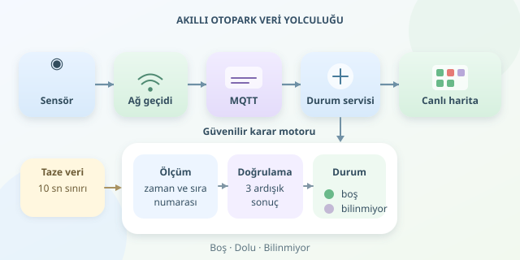

Otoparkta boş yer ararken aynı koridordan üçüncü kez geçmek, otomobil dünyasının sonsuz döngüsüdür. Akıllı otopark sistemleri bu döngüyü sensörler, mesajlaşma altyapısı ve canlı haritalarla kırar. Ancak sürücünün ekranındaki yeşil kutu, yalnızca bir sensörün verdiği cevap değildir; ölçümün güvenilir biçimde işlenmesiyle ortaya çıkan bir karardır.

``

## Önce fizik: Bir park yeri nasıl konuşur?

Sistem, her park alanının fiziksel durumunu dijital bir sinyale dönüştürür. Ultrasonik sensör mesafeyi ölçerken manyetik sensör, aracın oluşturduğu manyetik alan değişimini izler. Kamera tabanlı çözümler ise görüntüdeki araçları ve park sınırlarını analiz eder.

Buradaki temel ayrım, **ölçüm ile durumun aynı şey olmamasıdır**. Sensör mesafe üretir; yazılım bu mesafeyi değerlendirerek “boş” veya “dolu” kararı verir. Yağmur, yaya hareketi ve yanlış hizalama gibi etkenler nedeniyle tek ölçümle karar vermek risklidir. Kurulum sırasında zemine ve araç tiplerine uygun kalibrasyon gerekir.

| Teknoloji | Karar dayanağı | Dikkat noktası |
|---|---|---|
| Ultrasonik | Nesneye olan mesafe | Montaj açısı |
| Manyetik | Manyetik alan değişimi | Çevresel parazit |
| Kamera | Görüntüde araç tespiti | Işık ve mahremiyet |




## Doluluk hesabında üçüncü bir durum var

Bir park yeri yalnızca boş veya dolu değildir: bağlantısı kesildiyse **bilinmiyor** olabilir. Toplam kapasiteyi $C$, boş yerleri $B$, dolu yerleri $D$, bilinmeyenleri $U$ ile gösterelim:

$$C = B + D + U$$

Güncel ölçümü bulunan alanların doluluk oranı, $B + D > 0$ olduğunda şöyle hesaplanır:

$$O = 100 D / (B + D)$$

Bu oran tüm otoparkı değil, gözlemlenebilen bölümünü anlatır. Ekranda bilinmeyen alan sayısı da gösterilmelidir. Aksi halde çevrimdışı sensörler yüzünden otopark olduğundan daha boş görünebilir. Eski veri, boş yer vaadi değildir!

## Verinin yolculuğu: Sensörden canlı haritaya

Tipik akış şöyledir: **sensör → ağ geçidi → MQTT broker → durum servisi → mobil uygulama**. Ağ geçidi ölçümlere park kimliği, zaman damgası ve sıra numarası ekler. MQTT, küçük mesajları yayınlama-abonelik modeliyle ilgili servislere taşır.

Durum servisi güncel haritayı saklar; değişiklikleri WebSocket veya SSE üzerinden uygulamaya iletir. Böylece telefon sürekli bütün otoparkı sorgulamaz. MQTT QoS 1 kullanıldığında yinelenen teslimatlar mümkün olduğundan, servis aynı mesajı tekrar işlese bile sonucu bozmamalıdır. Sıra numarası kontrolü bunun pratik yollarından biridir.

## Python ile küçük ama temkinli bir durum motoru

Aşağıdaki örnek, eski mesajları reddeder ve aynı sonucu üç ardışık ölçümde gördüğünde durumu değiştirir. Olaylar `slot_id`, `occupied`, `seq` ve `observed_at` alanlarını içerir:

```python
from time import time

slots = {}

def ingest(event):
    age = time() - event['observed_at']
    if not 0 <= age <= 10:
        return

    slot = slots.setdefault(event['slot_id'], {
        'seq': -1, 'candidate': None, 'hits': 0,
        'state': 'bilinmiyor', 'updated': 0
    })
    if event['seq'] <= slot['seq']:
        return

    value = 'dolu' if event['occupied'] else 'bos'
    slot['hits'] = slot['hits'] + 1 if value == slot['candidate'] else 1
    slot.update(candidate=value, seq=event['seq'],
                updated=event['observed_at'])
    if slot['hits'] >= 3:
        slot['state'] = value


def snapshot():
    now = time()
    return {
        key: item['state'] if now - item['updated'] <= 10
        else 'bilinmiyor'
        for key, item in slots.items()
    }
```

Üçlü doğrulama, gelip geçen bir yayayı otomobil sanma ihtimalini azaltır; fakat algılama gecikmesini artırır. On saniye boyunca güncellenmeyen alan, sorgu anında bilinmiyor olarak gösterilir. Üretimde bu eşikler ölçüm sıklığına göre ayarlanmalı, saatler senkronize edilmeli ve sıra numaraları cihaz yeniden başlatıldığında güvenle yönetilmelidir. Ayrıca bellek yerine kalıcı durum depolaması ve eşzamanlı işlem kontrolü gerekir.

## “Anlık” demek sıfır gecikme demek değildir

Ölçümden ekrana toplam gecikme yaklaşık olarak $L = L_{ağ} + L_{işleme} + L_{iletim} + L_{arayüz}$ şeklinde modellenebilir. Örneğin bu aşamalar 80, 40, 100 ve 150 milisaniye sürerse toplam 370 milisaniyedir. Ancak aracın gelişi ile ilk ölçüm arasındaki bekleme ve doğrulama süresi de kullanıcı deneyimine eklenir.

Bu nedenle yalnızca ortalamayı değil, yoğun saatlerdeki yüksek gecikmeleri de izlemek gerekir. Arayüzde son güncelleme zamanı gösterilmeli; bağlantı kopunca yeşil kutular sonsuza kadar yeşil kalmamalıdır.

## Boş yer bildirimi, rezervasyon değildir

İki sürücü aynı boşluğu aynı anda görebilir. Sistem yalnızca yönlendirme yapıyorsa müsaitliğin değişebileceğini belirtmelidir. Yer ayırma sunuluyorsa süreli rezervasyon ve atomik güncelleme gerekir; ilk başarılı işlem yeri alır.

Kamera kullanıldığında mümkünse görüntüler yerinde işlenmeli, merkeze yalnızca doluluk bilgisi gönderilmelidir. Başarılı sistemin sırrı daha çok veri toplamak değil; doğru, güncel ve gerekli veriyi sürücüye ulaştırmaktır.
