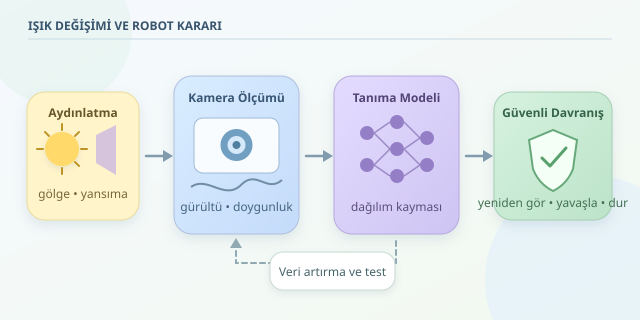

Robotunuz gündüz kupayı kusursuz tanırken akşam aynı kupaya saksı diyorsa, sorun mutlaka modelin yeterince büyük olmaması değildir. Kamera, nesneleri değil, nesnelerden gelen ışığın sensördeki karşılığını görür. Aydınlatma değiştiğinde bu karşılık da değişir. Dolayısıyla robotik nesne tanımada güvenilirlik, yalnızca iyi bir sinir ağı değil, iyi tasarlanmış bir algılama sistemi gerektirir.
``

## Aynı nesne, farklı veri dağılımı

Derin öğrenme modeli, eğitim görüntülerindeki renk, kenar ve doku örüntülerinden karar üretmeyi öğrenir. Ancak nesnenin anlamını temsil eden özelliklerle, ortamın tesadüfi özelliklerini her zaman ayıramaz. Örneğin sürekli parlak masalarda görülen bir tornavida, model için metalik yansıma demek olabilir. Yansıma kaybolunca tanıma da zorlaşır: model tornavidayı değil, onun ışıklı kostümünü öğrenmiştir!

Bu durum, **dağılım kayması** olarak açıklanabilir:

$$P_{train}(x,y) \neq P_{robot}(x,y)$$

Burada $x$ görüntüyü, $y$ nesne etiketini temsil eder. Etiket aynı kalsa bile görüntünün dağılımı değişebilir. Eğitimde düşük hata elde etmek, yeni aydınlatmada düşük hata garantisi değildir. Ayrıca kamera otomatik pozlama ve beyaz dengesiyle görüntüyü sürekli değiştirdiğinden, sorun yalnızca lambanın parlaklığı değildir.

## Karanlık yalnızca düşük parlaklık değildir

Az ışıkta sensöre daha az foton ulaşır. Basitleştirilmiş bir modelde foton sayısı Poisson dağılımını izler; okuma gürültüsü de hesaba katıldığında sinyal-gürültü oranı yaklaşık şöyledir:

$$\mathrm{SNR} \approx \frac{\lambda}{\sqrt{\lambda+\sigma_r^2}}$$

$bb$ yerine kullanılan $\lambda$, beklenen foton sayısı; $\sigma_r$ ise okuma gürültüsünün standart sapmasıdır. Daha az foton, ayrıntıların gürültü içinde kaybolması demektir. Yazılımla parlaklığı yükseltmek kayıp ayrıntıyı geri getirmez. Aşırı pozlamada ise pikseller doygunlaşır; beyaza dönüşen bölgelerde bilgi gerçekten silinir.

| Işık koşulu | Görüntüdeki değişim | Olası önlem | Sınırı |
|---|---|---|---|
| Düşük ışık | Gürültü, zayıf ayrıntılar | Ek aydınlatma | Güç tüketimi |
| Sert gölge | Bölgesel kararma | Gölge çeşitliliğiyle eğitim | Her gölgeyi kapsamaz |
| Güçlü yansıma | Doygun bölgeler | Pozlama kontrolü | Kayıp bilgiyi kurtarmaz |
| Farklı renk sıcaklığı | Renk kayması | Beyaz dengesi, veri artırma | Renk ipuçlarını bozabilir |




## Çözümü kameradan başlatın

Her şeyi sinir ağına bırakmak, yağmurda bozulan görüşü daha büyük gözlükle düzeltmeye benzer. Önce görüntü oluşumunu iyileştirin:

- **Pozlama ve kazancı birlikte yönetin:** Uzun pozlama robot hareketinde bulanıklık, yüksek kazanç ise daha belirgin gürültü oluşturabilir.
- **Kontrollü aydınlatma kullanın:** Dağınık ışık gölgeleri azaltabilir; parlak yüzeylerde ışığın geliş açısı ayrıca önemlidir.
- **HDR’yi ölçerek değerlendirin:** Dinamik aralığı artırabilir, fakat çoklu pozlama hareket artefaktları ve gecikme üretebilir.

Amaç estetik fotoğraf değil, karar vermeye elverişli ve tutarlı ölçümdür.

## Eğitimde ışıkları biraz karıştırın

Fotometrik veri artırma, modele aynı nesnenin farklı görünümlerini öğretir. Aşağıdaki PyTorch dönüşümü parlaklık, kontrast, renk ve gamma değişimleri uygular. Geometriyi değiştirmediği için nesne tespitindeki kutu koordinatlarını güncellemek gerekmez.

```python
import random
from torchvision import transforms as T
from torchvision.transforms import functional as F


def random_gamma(image):
    gamma = random.uniform(0.7, 1.5)
    return F.adjust_gamma(image, gamma=gamma)


train_transform = T.Compose([
    T.ColorJitter(
        brightness=0.35,
        contrast=0.30,
        saturation=0.20,
        hue=0.02,
    ),
    T.RandomApply([T.Lambda(random_gamma)], p=0.5),
    T.ToTensor(),
    T.Normalize(
        mean=[0.485, 0.456, 0.406],
        std=[0.229, 0.224, 0.225],
    ),
])
```

Normalizasyon değerleri ImageNet ön eğitiminde yaygındır; kullandığınız modelin giriş sözleşmesiyle eşleşmelidir. Rastgele dönüşümleri eğitimde kullanın, standart değerlendirmede kapatın. Renk sınıfı belirliyorsa artırma aralıklarını daraltın. Bu işlemler gerçek sensör gürültüsünü, yansımaları veya karmaşık gölgeleri tam olarak taklit etmez; gerçek saha verisi hâlâ gereklidir.

## Güvenilirliği ortalama skorun arkasına saklamayın

Test verisini düşük ışık, ters ışık, renk sıcaklığı ve hareket gibi koşullara ayırın. Aynı nesneleri farklı aydınlatmalarda çekmek, ışığın etkisini incelemeyi kolaylaştırır. Eğitim ve test arasında aynı sahnenin neredeyse kopyalarının bulunması, sonuçları gereğinden iyimser gösterebilir.

Nesne tespitinde mAP yanında özellikle kritik sınıfların kaçırılma oranını ölçün. Sınıflandırmada sınıf bazlı duyarlılığı izleyin. Ayrıca uçtan uca gecikmeyi kaydedin: doğru ama geç gelen bir karar, hareketli robot için yeterli olmayabilir.

## Emin değilse durabilmeli

Yüksek model güveni doğruluk garantisi değildir. Güven kalibrasyonunu farklı ışık koşullarında değerlendirin; görüntü kalitesi kontrolleri ve dağılım dışı örnek göstergeleriyle destekleyin. Hiçbiri tek başına güvenlik kanıtı sayılmaz.

Belirsizlik veya görüntü bozulması arttığında robot yeniden görüntü alabilir, aydınlatmayı değiştirebilir, yavaşlayabilir ya da güvenli duruma geçebilir. Eşikler uygulamanın riskine göre doğrulanmalıdır. En güvenilir robot, her koşulda tahmin yapan değil, ne zaman görmediğini anlayıp uygun davranabilen robottur.
