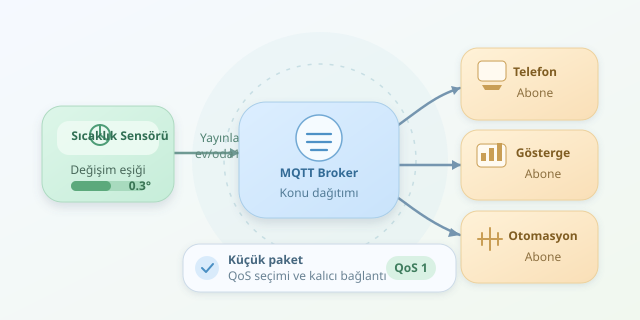

Bir sıcaklık sensörünün her ölçümde uzun bir HTTP isteği gönderdiğini düşünün: Küçücük veri, yanında koca bir bavul taşıyor! MQTT, özellikle sınırlı bağlantıya sahip IoT cihazlarında bu bavulu hafifletir. Ancak verimlilik yalnızca küçük paketlerden gelmez; doğru mesajlaşma modeli, uygun teslimat seviyesi ve gereksiz ölçümleri göndermemek de oyunun önemli parçalarıdır.

``

## Önce mantık: Cihazlar birbirini tanımak zorunda değil

MQTT, **yayınla/abone ol** modelini kullanır. Sensör, mesajını `ev/oda1/sicaklik` gibi bir konuya yayımlar. Bu konuyu dinleyen uygulamalar mesajı alır. Aradaki dağıtımı ise **broker** adlı sunucu gerçekleştirir.

Böylece sensör, kaç uygulamanın verisini kullandığını bilmez. Telefon uygulaması, gösterge paneli ve otomasyon sistemi aynı yayını bağımsız şekilde tüketebilir. Broker, cihazların adres defteri olmaktan çok, abonelikleri yöneten bir dağıtım merkezidir.

MQTT genellikle TCP üzerinde çalışır ve bağlantıyı açık tutar. Her ölçüm için yeniden bağlantı kurulmaması, özellikle sık mesajlaşmada maliyeti azaltır. Bununla birlikte bağlantıyı sürdürmek de tamamen ücretsiz değildir.

| Özellik | Tipik HTTP sorgulaması | MQTT |
|---|---|---|
| İletişim modeli | İstek ve yanıt | Yayın ve abonelik |
| Yeni veriyi öğrenme | Düzenli sorgulama gerekebilir | Mesaj geldiğinde dağıtılır |
| Alıcıların yönetimi | Uygulama tarafından yapılır | Broker üzerinden yapılır |
| Paket yükü | Başlıklar görece büyük olabilir | Protokol başlıkları küçüktür |




HTTP de kalıcı bağlantılar kullanabilir; dolayısıyla karşılaştırmayı “HTTP her zaman yeniden bağlanır” varsayımına dayandırmamak gerekir.

## Teslimat garantisinin bir bedeli var

MQTT, üç farklı **QoS** seviyesi sunar. Buradaki seçim, güvenilirlik ile iletişim maliyeti arasındaki dengedir.

| Seviye | Teslimat davranışı | Uygun örnek |
|---|---|---|
| QoS 0 | En fazla bir kez; kaybolabilir | Sık sıcaklık ölçümleri |
| QoS 1 | En az bir kez; yinelenebilir | Önemli durum değişiklikleri |
| QoS 2 | Tam bir kez protokol teslimatı | Yinelenmemesi gereken mesajlar |

QoS 1 ve QoS 2, onay paketleri nedeniyle daha fazla trafik oluşturur. Ayrıca QoS 2, fiziksel bir işlemin kendiliğinden yalnızca bir kez gerçekleşmesini garanti etmez. Uygulama mantığında mesaj kimlikleri ve **idempotent işlemler** hâlâ önemlidir.

## Bayt hesabı: Küçük başlık, büyük fark

MQTT'nin en küçük sabit başlığı 2 bayttır. Ancak konu adı ve diğer alanlar da pakete eklenir. MQTT 3.1.1 üzerinden, yedi baytlık `oda/isi` konusuna yirmi baytlık yükü QoS 0 ile gönderdiğimizi düşünelim:

$$B = 2 + 2 + 7 + 20 = 31\text{ bayt}$$

Burada ikinci terim, konu adının uzunluk alanıdır. Hesap TCP/IP, TLS ve bağlantı kurulum maliyetlerini içermez. Gerçek ağ tüketimi daha yüksektir.

Daha etkili bir optimizasyon, anlamlı değişiklikleri göndermektir:

$$\vert T_{yeni} - T_{son}\vert  \ge 0.3$$

Sıcaklık yeterince değişmediyse mesajı atlayabiliriz. Yine de cihazın yaşadığını göstermek için belirli aralıklarla güncelleme göndermek faydalıdır.

## Python ile değişime duyarlı yayın

Aşağıdaki örnek, `paho-mqtt` 2.x kullanır. Paket `pip install paho-mqtt` ile kurulabilir. Broker adresi ve kimlik bilgileri ortam değişkenlerinden okunur. Örnek, sistemin güvendiği bir sertifikaya sahip TLS broker'ı varsayar; özel sertifika otoritesi kullanılıyorsa ayrıca yapılandırılmalıdır.

```python
import json
import os
import random
import time
import paho.mqtt.client as mqtt

client = mqtt.Client(
    mqtt.CallbackAPIVersion.VERSION2,
    client_id="oda1-sensor"
)
client.username_pw_set(os.environ["MQTT_USER"], os.environ["MQTT_PASSWORD"])
client.tls_set()
client.connect(os.environ["MQTT_HOST"], 8883, keepalive=60)
client.loop_start()

last_value = None
last_sent = 0

try:
    while True:
        temperature = round(22 + random.uniform(-0.4, 0.4), 2)
        now = time.monotonic()
        changed = last_value is None or abs(temperature - last_value) >= 0.3

        if changed or now - last_sent >= 60:
            payload = json.dumps(
                {"t": temperature, "ts": int(time.time())},
                separators=(",", ":")
            )
            result = client.publish("ev/oda1/sicaklik", payload, qos=1, retain=True)
            result.wait_for_publish(timeout=10)
            if not result.is_published():
                raise RuntimeError("Yayın onayı alınamadı")
            last_value, last_sent = temperature, now
        time.sleep(5)
finally:
    client.disconnect()
    client.loop_stop()
```

Kod, sensörü rastgele değerlerle taklit eder. Beş saniyede bir ölçer; değişim eşiği aşılırsa veya altmış saniye dolarsa yayımlar. Sıkıştırılmış JSON gösterimi gereksiz boşlukları kaldırır. Ağ döngüsü arka planda çalışırken yayın onayı beklenir; üretimde bağlantı hataları için yeniden deneme stratejisi de eklenmelidir.

## Son rötuşlar: Verimlilik güvenlikle birlikte gelir

`retain=True`, broker'ın konuya ait son mesajı saklamasını sağlar. Yeni aboneler hemen başlangıç değeri alabilir; fakat bu özellik yayın trafiğini otomatik azaltmaz. Eski ölçümleri güncel sanmamak için zaman damgası kontrol edilmelidir.

Kısa konu adları, uygun örnekleme aralığı ve gerektiğinde ikili veri biçimleri tüketimi azaltabilir. Buna karşılık okunabilirliği gereksiz yere feda etmeyin. TLS, konu bazlı erişim izinleri ve benzersiz cihaz kimlikleri de ihmal edilmemeli. MQTT'nin asıl numarası, her şeyi göndermek değil; doğru bilgiyi, doğru zamanda, yeterli güvenilirlikle göndermektir.
