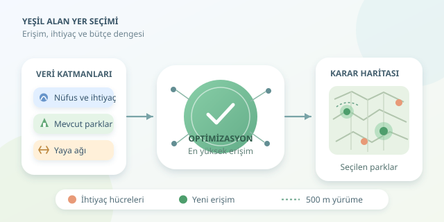

Bir mahallede her köşe başında park varken diğerinde çocuklar top oynamak için otoparka gidiyorsa, mesele yalnızca yeşil alan miktarı değildir. Asıl soru, yeşilin insanlara nasıl dağıldığıdır. Mekânsal analiz; nüfusu, yürüyüş yollarını ve uygun arazileri birlikte değerlendirerek park yatırımlarını sezgilerden ölçülebilir kararlara taşır. Haydi şehrin yeşil yapbozunu çözelim!

``

## Önce doğru soruyu soralım

Kent genelinde kişi başına düşen yeşil alan, başlangıç için yararlıdır:

$$g = A / P$$

Burada $A$ toplam yeşil alanı, $P$ nüfusu gösterir. Ancak ortalama, eşitsizliği gizleyebilir: Kentin dışındaki dev bir koruluk, merkezdeki çocuğun günlük park ihtiyacını karşılamayabilir.

Bu nedenle üç boyutu birlikte değerlendirmeliyiz: **miktar, erişilebilirlik ve ihtiyaç**. Nüfus yoğunluğu talebin nerede biriktiğini gösterirken yaş dağılımı, gelir ve mevcut park kalitesi önceliklendirmeyi tamamlar. Yoğunluk, tek başına otomatik yatırım kararı değildir.

| Ölçüt | Ne anlatır? | Tek başına eksikliği |
|---|---|---|
| Kişi başına alan | Toplam kaynak yeterliliği | Uzaklığı gizler |
| Yürüyüş mesafesi | Günlük erişilebilirlik | Kaliteyi ölçmez |
| Nüfus yoğunluğu | Talebin yoğunlaşması | Kırılganlığı açıklamaz |

## Haritayı analize hazırlamak

Nüfus verisini mahallelerden veya düzenli hücrelerden alabiliriz. Park sınırları, giriş kapıları, yaya ağı ve aday parseller diğer temel katmanlardır. GeoPandas, bu verileri ortak koordinat sisteminde birleştirmek için uygundur.

Mesafe ve alan hesaplarında metre birimli, yerel bir projeksiyon kullanın. Enlem-boylam derecelerini metre sanmak, haritanın size küçük bir şaka yapmasıdır! Mahalle nüfusunu hücrelere aktarırken konut alanlarıyla ağırlıklandırma yapmak, insanları fabrikalara veya göllere dağıtmayı önler.

Kuş uçuşu tamponlar hızlıdır; fakat otoyolları, duvarları ve kapalı geçitleri görmez. Daha gerçekçi yaklaşım, park girişlerine **yaya ağı üzerinden en kısa mesafeyi** hesaplamaktır. Örneğin $r=500$ metreyi deneysel erişim eşiği seçebiliriz; bu değer evrensel bir standart değildir.

## Yer seçimini optimizasyon problemine çevirmek

Her nüfus hücresi için $p_i$ nüfusunu, $w_i$ ihtiyaç ağırlığını tanımlayalım. Aday park seçilirse $x_j=1$, hücre erişim kazanırsa $z_i=1$ olsun. $a_{ij}$, hücre ile park arasındaki yürüyüş mesafesi eşik içindeyse 1, değilse 0 değerini alsın.

Amaç, erişim kazanan ağırlıklı nüfusu büyütmektir:

$$\max \sum_i p_i w_i z_i$$

Temel kısıtlar şöyledir:

$$z_i \leq \sum_j a_{ij}x_j, \qquad \sum_j c_jx_j \leq B$$

Burada $c_j$ yatırım maliyeti, $B$ bütçedir. İkili $z_i$ değişkeni sayesinde aynı kişinin iki park tarafından kapsanması iki kez ödüllendirilmez. Mevcut parklara zaten erişen hücreleri çıkararak yeni yatırımın ek faydasına odaklanabiliriz.

## Python ile küçük bir karar motoru

Aşağıdaki örnek, NetworkX ile erişimi hesaplar; PuLP ile bütçeye uygun parkları seçer. `G`, kenarlarının `length` değeri metre olan yönsüz yaya ağıdır. `cells`, mevcut erişimi olmayan hücreleri; `candidates`, hukuki ve fiziksel uygunluğu önceden kontrol edilmiş adayları içerir. Tablolardaki `node`, ağa bağlanmış giriş veya temsil noktasıdır.

```python
import networkx as nx
import pulp

radius = 500
budget = 6_000_000
access = {}

for j in candidates.itertuples():
    reachable = nx.single_source_dijkstra_path_length(
        G, j.node, cutoff=radius, weight="length"
    )
    for i in cells.itertuples():
        access[i.Index, j.Index] = int(i.node in reachable)

model = pulp.LpProblem("park_selection", pulp.LpMaximize)
x = pulp.LpVariable.dicts("park", candidates.index, cat="Binary")
z = pulp.LpVariable.dicts("served", cells.index, cat="Binary")

model += pulp.lpSum(
    row.population * row.need_weight * z[row.Index]
    for row in cells.itertuples()
)
for i in cells.index:
    model += z[i] <= pulp.lpSum(
        access[i, j] * x[j] for j in candidates.index
    )
model += pulp.lpSum(
    candidates.loc[j, "cost"] * x[j]
    for j in candidates.index
) <= budget

model.solve(pulp.PULP_CBC_CMD(msg=False))
if pulp.LpStatus[model.status] != "Optimal":
    raise RuntimeError("Optimal çözüm bulunamadı.")
selected = [j for j in candidates.index if x[j].value() > 0.5]
print(selected)
```

İlk döngü erişim matrisini oluşturur; model ise yatırım kombinasyonlarını karşılaştırır. Seçilen kimlikleri aday parsellerle birleştirerek sonuç haritası üretebilirsiniz. Maliyetlerin aynı para biriminde, tablo indekslerinin benzersiz olması gerekir.

## Sonuçları sahada sınamak

Bu model erişimi optimize eder; park kapasitesini veya kalitesini garanti etmez. Küçük bir cep parkını binlerce kişinin ihtiyacını tamamen karşılıyormuş gibi yorumlamayın. Daha gelişmiş modeller, kullanıcı ataması ve kapasite kısıtları eklemelidir.

Sonuçları farklı mesafe eşikleri, bütçeler ve ihtiyaç ağırlıklarıyla tekrar çalıştırın. Ardından erişim kazanan nüfusu, mahalleler arasındaki farkı ve yatırım maliyetini raporlayın. Bakım giderleri, gölge, engelli erişimi ve güvenlik de değerlendirmeye katılmalıdır.

Son söz mahalleliye aittir: Haritada uygun görünen bir parsel, sahada kullanışsız olabilir. Optimizasyon kararı dayatan bir robot değil, seçenekleri şeffaflaştıran bir yardımcıdır. Başarı, yalnızca daha fazla yeşil boyamak değil; daha fazla insanın günlük yaşamına kullanılabilir yeşil katmaktır.



