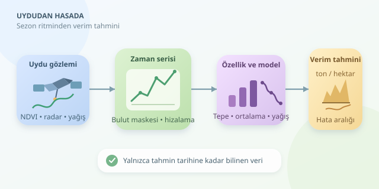

Bir tarlanın hasat sonunda kaç ton ürün vereceğini, biçerdöver çalışmadan tahmin edebilir miyiz? Uydu görüntüleri sayesinde buna yaklaşabiliyoruz. Ancak tek bir fotoğraf, filmin tamamını anlatmaz. Asıl ipucu, bitkilerin sezon boyunca nasıl geliştiğinde saklıdır. Zaman serileri, tarlanın büyüme hikâyesini izleyerek bu hikâyeyi ölçülebilir verim tahminlerine dönüştürmemizi sağlar.

``

## Yeşillik neden verim hakkında konuşur?

Bitkiler fotosentez için kırmızı ışığı büyük ölçüde soğururken yakın kızılötesi ışığı farklı biçimde yansıtır. Bu karşıtlık, bitki örtüsünü izleyen NDVI indeksinin temelidir:

$$NDVI_t = \frac{NIR_t - RED_t}{NIR_t + RED_t}$$

Burada $NIR$ yakın kızılötesi, $RED$ kırmızı bant yansıtımıdır. NDVI yükseldiğinde genellikle daha yoğun veya aktif bitki örtüsü görürüz. Fakat önemli bir ayrım vardır: **NDVI doğrudan kilogram ölçmez.** Verim; biyokütle, ürünün hasat edilen kısmına ayrılan kaynaklar, su stresi ve yönetim kararlarının birleşimidir.

Dolayısıyla aynı yeşillik, farklı ürünlerde veya farklı gelişim evrelerinde aynı verimi ifade etmeyebilir. Başaklanma dönemindeki stres, erken dönemdeki küçük bir gelişim gecikmesinden daha belirleyici olabilir.

| Veri | Gösterdiği ipucu | Temel sınırlama |
|---|---|---|
| NDVI | Yeşillik ve gelişim | Yoğun örtüde doygunlaşabilir |
| EVI | Yoğun bitki örtüsündeki değişim | Ek bantlar gerektirir |
| Radar | Yapı ve nemle ilişkili sinyaller | Yorumlanması daha karmaşıktır |
| Meteoroloji | Su ve sıcaklık koşulları | Yerel temsil gücü değişir |

## Tek kare yerine sezonun ritmi

Sentinel-2 gibi kaynaklardan farklı tarihlerde görüntüler toplanır. Bulut ve gölge maskeleri uygulanır; ardından her tarla poligonu için geçerli piksellerin ortalama veya medyan değerleri çıkarılır. Tarla sınırındaki karışık pikselleri elemek, komşu yolun modele tarım danışmanlığı yapmasını engeller!

Serileri ekim tarihine göre hizalamak önemlidir. Takvimde aynı gün, iki tarlada farklı gelişim aşamalarına denk gelebilir. On günlük bileşikler, düzensiz gözlemleri daha karşılaştırılabilir hâle getirir. Ancak uzun bulut boşluklarını doldurmak belirsizliği artırır; gözlem sayısını da özellik olarak saklamak yararlıdır.

Model; ortalama NDVI, tepe değer, yükselme hızı ve kritik dönem yağışı gibi özellikleri kullanabilir. Eğrinin altında kalan alan da sezonluk bitki aktivitesini özetler; düzensiz tarih aralıklarında bunun zaman ağırlıklı hesaplanması gerekir.

## Tahmin tarihini önce belirleyin

Tahmin hedefini şöyle yazabiliriz:

$$\hat{y} = f(x_1, x_2, \ldots, x_p)$$

Burada $\hat{y}$ tahmini verim, özellikler ise tahmin anına kadar bilinen ölçümlerdir. Örneğin ekimden sonraki 90. günde tahmin üretiyorsak sonraki görüntüleri kullanamayız. Aksi durumda model geleceğe gizlice bakar: buna **veri sızıntısı** denir.

Eğitim etiketleri, geçmiş sezonlardan ölçülmüş parsel verimleridir. Birimleri ton/hektar olarak ve mümkünse ortak ürün nemine göre standardize edilmelidir. Farklı ürünleri başlangıçta ayrı modellemek, biyolojik farklılıkları yönetmeyi kolaylaştırır.

## Python ile küçük bir başlangıç

Aşağıdaki örnekte `df`, her satırı on günlük bir dönemi temsil eden hazırlanmış tablodur. `yagis_mm` dönem toplamını, `verim_t_ha` geçmişte ölçülmüş parsel verimini taşır. Kod, ilk 90 günü özetler ve son yılı test için ayırır:

```python
from sklearn.pipeline import make_pipeline
from sklearn.impute import SimpleImputer
from sklearn.ensemble import RandomForestRegressor
from sklearn.metrics import mean_absolute_error

erken = df[df['ekim_gunu'].between(0, 90)]
ozet = erken.groupby(['parsel', 'yil']).agg(
    ndvi_ort=('ndvi', 'mean'),
    ndvi_tepe=('ndvi', 'max'),
    yagis=('yagis_mm', 'sum'),
    verim=('verim_t_ha', 'first')
).reset_index()

sutunlar = ['ndvi_ort', 'ndvi_tepe', 'yagis']
test = ozet['yil'].eq(ozet['yil'].max())
model = make_pipeline(
    SimpleImputer(strategy='median'),
    RandomForestRegressor(
        n_estimators=300, min_samples_leaf=5, random_state=42
    )
)
model.fit(ozet.loc[~test, sutunlar], ozet.loc[~test, 'verim'])
tahmin = model.predict(ozet.loc[test, sutunlar])
print('MAE:', mean_absolute_error(ozet.loc[test, 'verim'], tahmin))
```

Rastgele orman, doğrusal olmayan ilişkileri yakalayan pratik bir başlangıçtır. Eksik değer doldurma işleminin eğitim hattında olması, test verisinin istatistiklerini öğrenmeye karıştırmaz.

## Başarıyı doğru ölçmek

MAE, hatayı ton/hektar cinsinden anlaşılır kılar. Sonuçları geçmiş ortalama verim gibi basit bir referansla karşılaştırın. Tek bir iyi sezon yeterli değildir: birden fazla geçmiş yıl üzerinde ileriye dönük testler yapın. Yeni bölgelere uygulanacak modelleri ayrıca mekânsal olarak ayrılmış parsellerle sınayın.

En iyi çıktı yalnızca tek sayı değildir. Hata aralığı, veri kalitesi ve tahmin tarihi birlikte sunulmalıdır. Uydu geleceği sihirle görmez; bitkinin geçmişini okuyarak olası geleceği hesaplar. Doğru değerlendirmeyle bu yaklaşım, hasat lojistiği ve kaynak planlaması için güçlü bir erken uyarı aracına dönüşür.



