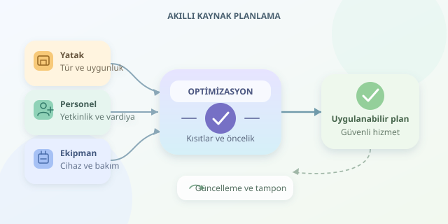

Bir hastaneyi yalnızca boş yatakları sayarak yönetmek, restoranı sadece masa sayısına göre işletmeye benzer: Masalar hazırdır ama aşçı yoksa işler karışır! Hastanelerde de yatak, personel ve ekipman birlikte planlanmalıdır. Akıllı yönetim sistemleri, bu kaynaklar arasındaki bağı algoritmalarla görünür kılar; amaç yalnızca doluluğu artırmak değil, güvenli hizmeti doğru zamanda sunmaktır.




``

## Önce problemi doğru tarif edelim

Kaynak optimizasyonunun temelinde **yöneylem araştırması** bulunur. Sistem; karar değişkenlerini, kısıtları ve hedefleri matematiksel bir modele dönüştürür. Örneğin karar, uygun bir elektif yatışın belirli bir güne planlanıp planlanmayacağı olabilir. Kısıtlar ise kullanılabilir yatakları, bakım saatlerini ve cihaz kapasitesini temsil eder.

Ancak kaynaklar birbirinin yerine geçmez. Boş bir servis yatağı, yoğun bakım yatağının alternatifi değildir; müsait bir çalışan da her uzmanlık görevini üstlenemez. Bu nedenle toplam kapasiteden önce **klinik uygunluk ve yetkinlik** kontrol edilir.

| Kaynak | Basit kapasite ölçüsü | Kritik ek kısıt |
|---|---|---|
| Yatak | Kullanılabilir yatak sayısı | Servis türü, izolasyon, temizlik |
| Personel | Vardiyadaki çalışma saati | Yetkinlik, dinlenme, bakım oranı |
| Ekipman | Kullanılabilir cihaz saati | Cihaz türü, bakım, eşzamanlı kullanım |

## Matematik: Kapasiteyi aşmadan değer üretmek

Basitleştirilmiş bir günlük modelde $x_i$, aday yatış planlanırsa $1$, aksi durumda $0$ olsun. $u_i$ klinik ekipçe belirlenen öncelik puanını, $a_{ir}$ adayın kaynak tüketimini, $C_r$ ise kapasiteyi göstersin:

$$\max \sum_i u_i x_i$$

$$\sum_i a_{ir}x_i \leq C_r \quad \forall r, \qquad x_i\in\{0,1\}$$

Bu yapı, çok boyutlu sırt çantası problemine benzer: Çantamız hastane, bölmeleri ise kaynaklardır. Gerçek modeller ayrıca bekleme süresi, fazla mesai ve iş yükü dengesizliğini ele alır. Bu hedeflerin ağırlıkları gelişigüzel seçilmemeli; klinik yönetişimle belirlenmelidir. Güvenlik şartları, birkaç puan uğruna esnetilen tercihler değil, zorunlu kısıtlardır.

## Hangi algoritma, hangi iş için?

| Yaklaşım | Güçlü tarafı | Sınırı |
|---|---|---|
| Karma tamsayılı programlama | Doğrusal maliyet ve kapasite modelleri | Büyük modellerde çözüm süresi |
| CP-SAT | Mantıksal kurallar ve ayrık çizelgeleme | Doğru modelleme gerektirir |
| Açgözlü sezgiseller | Hızlı başlangıç planı | En iyi çözümü garanti etmez |

Önceliği en yüksek hastayı sırayla yerleştirmek caziptir. Fakat bu hasta kıt bir cihazın çoğunu kullanıyorsa, başka uygun kombinasyonlar toplamda daha iyi sonuç verebilir. Optimizasyonun farkı, kararları tek tek değil, birbirleriyle etkileşimleri içinde değerlendirmesidir.

## Python ile küçük bir planlama modeli

Aşağıdaki örnek, OR-Tools üzerinden günlük elektif yatış adaylarını seçer. Kurulum için `pip install ortools` kullanılabilir. Her satır sırasıyla yatak, hemşirelik saati, cihaz saati ve öncelik puanı içerir; değerler tamamen örnektir.

```python
from ortools.sat.python import cp_model

adaylar = [(1, 8, 6, 9), (1, 10, 8, 8),
           (1, 6, 4, 6), (1, 4, 0, 4)]
kapasiteler = [3, 24, 16]

model = cp_model.CpModel()
x = [model.new_bool_var(f"aday_{i}")
     for i in range(len(adaylar))]

for r, kapasite in enumerate(kapasiteler):
    model.add(sum(adaylar[i][r] * x[i]
                  for i in range(len(adaylar))) <= kapasite)

model.maximize(sum(adaylar[i][3] * x[i]
                   for i in range(len(adaylar))))

solver = cp_model.CpSolver()
solver.parameters.max_time_in_seconds = 2.0
sonuc = solver.solve(model)

if sonuc in (cp_model.OPTIMAL, cp_model.FEASIBLE):
    print([i for i in range(len(adaylar)) if solver.value(x[i])])
else:
    print("Süre içinde uygulanabilir plan bulunamadı.")
```

Bu veride en iyi seçim, sıfırdan başlayan indekslerle `[0, 1, 3]` olur. Toplam tüketim üç yatak, 22 hemşirelik saati ve 14 cihaz saatidir. `FEASIBLE`, uygulanabilir çözüm bulunduğunu söyler; `OPTIMAL` ise en iyiliğin kanıtlandığını belirtir.

Önemli ayrıntı: Günlük saat toplamı, aynı anda yeterli personel veya cihaz bulunduğunu garanti etmez. Gerçek çizelgelemede zaman aralıkları tanımlanır; `NoOverlap` tek cihazdaki çakışmaları, `Cumulative` eşzamanlı kapasite kullanımını sınırlar. Personel yetkinliği ve hasta bakım oranları ayrıca modellenir.

## Planı yaşayan bir sisteme dönüştürmek

Acil başvurular, geciken taburculuklar ve cihaz arızaları planı değiştirir. Bu yüzden tahminler senaryolarla sınanmalı, beklenmedik talep için kapasite tamponu bırakılmalı ve plan düzenli güncellenmelidir. Her değişimde tüm vardiyayı dağıtmak yerine, mevcut plana sadakati gözeten cezalar kullanılabilir.

Başarıyı yalnızca yatak doluluğuyla ölçmeyin: Bekleme süresi, fazla mesai, iptaller, bakım güvenliği ve çalışan yükü birlikte izlenmelidir. Sistem karar desteğidir; acil bakımın reddini otomatikleştirmez. Klinik onay, insan müdahalesi, erişim kontrolü ve denetlenebilir karar kayıtları korunmalıdır. İyi algoritma, hastaneyi bir elektronik tabloya değil, daha uyumlu çalışan bir ekibe dönüştürür.
