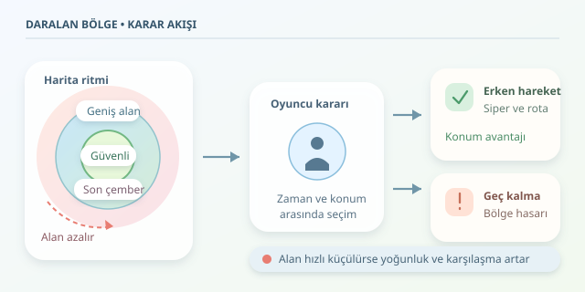

Battle Royale oyunlarında asıl rakibiniz bazen karşınızdaki oyuncu değil, arkanızdan yaklaşan çemberdir. Daralan harita, devasa bir oyun alanını giderek küçülen bir karar kutusuna dönüştürür. Oyuncuya görünmez bir yönetmen gibi seslenir: “Eşyalarını topladın mı? Güzel, şimdi biraz hareket zamanı!” Peki bu basit geometrik fikir, davranışları nasıl bu kadar güçlü biçimde şekillendiriyor?

``

## Büyük Haritadan Ortak Finale

PUBG ve Fortnite gibi oyunların popülerleşmesini yalnızca daralan haritaya bağlamak eksik olur. Erişilebilirlik, sosyal oyun deneyimi ve yayın kültürü de önemli etkenlerdir. Ancak güvenli bölge, bu türün seyir zevkini ve maç ritmini taşıyan temel mekaniklerden biridir.

Başlangıçta oyuncular farklı noktalara dağılır; keşif, ekipman toplama ve çatışmadan kaçınma mümkündür. Bölge daraldıkça bu özgürlük azalır. Böylece birbirinden bağımsız küçük hikâyeler, ortak bir final sahnesinde birleşir. Tasarımcı her karşılaşmayı senaryolaştırmadan gerilimi artırabilir.

## Teorik Temel: Alan Azalınca Ne Değişir?

Dairesel güvenli bölgenin alanı $A(t)=πr(t)^2$ olarak ifade edilir. Burada $r(t)$, zamana bağlı yarıçaptır. Yarıçap yarıya indiğinde alan dörtte bire düşer. Yani harita küçülmesi, oyuncunun gözünde göründüğünden daha sert bir alan kaybı yaratabilir.

Yaşayan oyuncu sayısını $N(t)$ ile gösterirsek ortalama yoğunluk $ρ(t)=N(t)/A(t)$ olur. Oyuncu sayısı azalmasına rağmen alan daha hızlı küçülüyorsa yoğunluk artabilir. Bunun karşılaşma ihtimalini yükseltmesi beklenir; fakat oyuncular eşit dağılmadığından bu, kesin bir çatışma formülü değildir. Binalar, görüş çizgileri ve yüksek araziler sonucu değiştirir.

| Durum | Baskın karar | Başlıca risk |
|---|---|---|
| Geniş güvenli alan | Ekipman toplamak | Hazırlıksız yakalanmak |
| Daralma yaklaşırken | Rotayı planlamak | Geç hareket etmek |
| Küçük güvenli alan | Konum üstünlüğü kurmak | Kolay fark edilmek |
| Son çember | Zamanlama ve siper seçmek | Kaçış seçeneğinin kalmaması |

## Çemberin Davranışsal Etkisi

Daralan bölge, hareketsiz kalmanın maliyetini yükseltir. Normalde güvenli görünen bir bina, birkaç dakika sonra tehlikeli bir tuzağa dönüşebilir. Böylece oyun, oyuncuyu zorunlu hareket ile taktiksel bekleme arasında seçim yapmaya iter.

Erken hareket eden oyuncu uygun siper bulabilir; fakat merkezde daha fazla yönden tehdit alabilir. Kenarda kalan oyuncu arkasını daha kolay kontrol edebilir, ancak sonraki bölgeye uzun yol katetmek zorunda kalabilir. Dolayısıyla “merkeze koşmak” her durumda en iyi strateji değildir.

Bu yapı karar teorisiyle okunabilir: Oyuncu beklenen kazancı, hasar riskini ve zaman maliyetini birlikte değerlendirir. Çember bu maliyetleri sürekli değiştirerek aynı taktiğin bütün maç boyunca işe yaramasını engeller.

## Küçük Bir Python Davranış Modeli

Aşağıdaki örnek, botun olası hedef noktalarını yolculuk süresi, bölge dışında kalma ve görünürlük riski üzerinden puanlar. Düşük puanlı hedef tercih edilir:

```python
import math


def radius_at(t, start=1000, end=250, delay=60, duration=120):
    progress = min(1.0, max(0.0, (t - delay) / duration))
    return start + (end - start) * progress


def choose_target(position, candidates, center, radius, speed=6):
    def cost(point):
        travel_time = math.dist(position, point) / speed
        outside = max(0.0, math.dist(point, center) - radius)
        exposure = candidates[point]
        return travel_time + 0.4 * outside + 12 * exposure

    return min(candidates, key=cost)


candidates = {(100, 100): 0.8, (300, 50): 0.2, (600, 0): 0.1}
future_radius = radius_at(120)
target = choose_target((500, 100), candidates, (0, 0), future_radius)
print(target)
```

`radius_at`, bekleme süresinden sonra yarıçapı doğrusal küçültür. `choose_target` ise adayların görünürlük değerlerini kullanır; bu değerler burada elle verilmiştir. Katsayılar farklı maliyetleri ortak bir tercih puanına dönüştüren tasarım ağırlıklarıdır, fiziksel hasar hesabı değildir.

Bu model engelleri ve hareket sırasında değişen çemberi hesaba katmaz. Gerçek bir oyunda yol bulma, takım bilgisi ve bölge hasarı da değerlendirmeye eklenmelidir.

## İyi Baskı, Kötü Sürprizden Nasıl Ayrılır?

Başarılı bir çember sistemi oyuncuyu sıkıştırırken karar verecek zaman bırakır. Belirsizlik heyecan yaratır; okunamayan veya ulaşılması aşırı zor bölgeler ise sonucu beceriden çok şansa bağlayabilir.

Geliştiriciler daralma hızını, uyarı süresini ve dışarıda alınan hasarı birlikte ayarlamalıdır. Çok yavaş çember temposuzluk, çok hızlı çember ise sürekli koşu üretir. Telemetride bölge kaynaklı ölümler, hareketin başlama zamanı ve çatışmaların konumu izlenebilir; ancak bu ölçümler oyuncu deneyimiyle birlikte yorumlanmalıdır.

Sonuçta daralan harita yalnızca oyuncuları yaklaştırmaz: Kaynakların değerini, risk algısını ve zamanın önemini değiştirir. Battle Royale’ın güçlü numarası budur; basit bir geometrik kural, her maçta farklı bir stratejik hikâye üretir.
