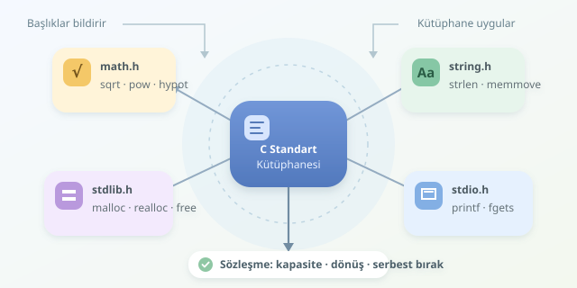

C programlamak, her vidayı kendiniz üretmeniz gerektiği anlamına gelmez. Standart kütüphane; matematik hesaplarından metin karşılaştırmaya, dinamik bellek ayırmadan hata bildirimine kadar hazır araçlar sunar. Ancak bu araçları güvenli kullanmak için yalnızca isimlerini değil, çalışma sözleşmelerini de bilmek gerekir.

``

## Önce mantık: Başlık dosyası ne sağlar?

`#include`, ilgili başlık dosyasını programa dahil eder. Başlıklar, fonksiyon bildirimlerini, türleri ve gerekli makroları sunar; fonksiyonların gerçek uygulamaları ise kütüphanelerdedir. Derleyici çağrının türlerini denetler, bağlayıcı gerekli uygulamaları birleştirir. Kısacası başlık dosyası menüdür; yemeği hazırlayan mutfak, kütüphanenin uygulamasıdır. Bu ayrım, derleme hatasıyla bağlama hatasını birbirinden ayırmayı kolaylaştırır.

| Başlık | Temel görev | Örnek fonksiyonlar |
|---|---|---|
| `<math.h>` | Matematiksel hesaplama | `sqrt`, `pow`, `sin`, `fabs` |
| `<string.h>` | Metin ve bayt işlemleri | `strlen`, `strcmp`, `memcpy`, `memmove` |
| `<stdlib.h>` | Bellek ve dönüşüm | `malloc`, `calloc`, `realloc`, `free`, `strtol` |
| `<ctype.h>` | Karakter sınıflandırma | `isdigit`, `isspace`, `toupper` |
| `<stdio.h>` | Girdi ve çıktı | `printf`, `fgets`, `fputs` |

## Matematik: Formülü yeniden icat etmeyin

`<math.h>`, kayan noktalı hesaplamalar için temel araç kutusudur. `sqrt(x)` karekök, `pow(x, y)` üs, `fabs(x)` mutlak değer hesaplar. Tamsayılar için kullanılan `abs` ise `<stdlib.h>` içindedir. `floor`, `ceil` ve `round` farklı yuvarlama kurallarına sahiptir; özellikle negatif sayılarda birbirlerinin yerine kullanılmamalıdır.

İki noktanın uzaklığı şu bağıntıyla bulunur:

$$d = \sqrt{(x_2-x_1)^2 + (y_2-y_1)^2}$$

Bu hesap için `hypot(dx, dy)`, ara işlemlerde taşma ve aşırı küçülme riskini azaltabilir. Trigonometrik fonksiyonlar radyan bekler. Ayrıca kayan nokta sonuçları yaklaşık olabilir; matematikteki eşitlik, bilgisayarda her zaman birebir eşitlik değildir. Negatif bir değerin karekökü gibi tanım dışı girdilerin hata davranışı da kontrol edilmelidir.

## Metin işleme: Sonlandırıcı karakteri unutmayın

C dizeleri, `\0` karakteriyle biten karakter dizileridir. `strlen`, bu sonlandırıcıdan önceki baytların sayısını verir; UTF-8 metindeki görünen harf sayısını garanti etmez. `strcmp` eşitlik durumunda sıfır döndürür, diğer durumlarda işaretine bakılır; yalnızca `-1` veya `1` döneceğini varsaymayın.

`memcpy`, belirtilen sayıda baytı kopyalar ve bölgeler örtüşmemelidir. Örtüşme ihtimali varsa `memmove` kullanılır. `strncpy` ise her durumda sonlandırıcı eklemez; adı güvenlik garantisi değildir. Dize fonksiyonları sonlandırıcıya, bellek fonksiyonları verilen uzunluğa güvenir.

`<ctype.h>` fonksiyonlarına sıradan bir `char` verirken `(unsigned char)` dönüşümü yapmak önemlidir; negatif karakter değerleri tanımsız davranışa neden olabilir.

## Bellek yönetimi: Alanın sahibi sizsiniz

Dinamik bellek, boyutu çalışma sırasında belirlenen verileri saklamaya yarar. Ayırdığınız alanın kapasitesi ile içine koyduğunuz verinin uzunluğu farklı kavramlardır. Dize için gereken kapasite genellikle $uzunluk + 1$ bayttır; fazladan bayt sonlandırıcı içindir. Ayırma işleminin başarısız olabileceğini de unutmamak gerekir.

| Fonksiyon | Davranış | Dikkat noktası |
|---|---|---|
| `malloc` | Alan ayırır | İçerik başlatılmaz |
| `calloc` | Alan ayırıp baytları sıfırlar | Eleman sayısı ve boyut verilir |
| `realloc` | Alanın boyutunu değiştirir | Adres değişebilir |
| `free` | Alanı serbest bırakır | Aynı alan iki kez bırakılmaz |

## Birlikte çalışan küçük bir örnek

Aşağıdaki program bir metni dinamik belleğe kopyalar, kapasitesini artırır ve matematik fonksiyonlarıyla sonuç üretir. Böylece üç araç kutusunu aynı yerde görürüz.

```c
#include <math.h>
#include <stdio.h>
#include <stdlib.h>
#include <string.h>

int main(void) {
    const char *kaynak = "Merhaba C";
    size_t kapasite = strlen(kaynak) + 1;
    char *metin = malloc(kapasite);
    if (metin == NULL) {
        return EXIT_FAILURE;
    }

    memcpy(metin, kaynak, kapasite);
    char *yeni = realloc(metin, kapasite + 16);
    if (yeni == NULL) {
        free(metin);
        return EXIT_FAILURE;
    }
    metin = yeni;
    strcat(metin, "!");

    printf("%s | Uzunluk: %zu | Kok: %.2f | Us: %.2f\n",
           metin, strlen(metin), sqrt(9.0), pow(2.0, 3.0));
    free(metin);
    return EXIT_SUCCESS;
}
```

`memcpy`, sonlandırıcı dahil bütün diziyi kopyalar. Eklenen kapasite, ünlem ve sonlandırıcı için yeterlidir. `realloc` sonucu geçici işaretçide tutulur: Sıfırdan büyük boyutla yapılan çağrı başarısız olursa eski alan geçerliliğini korur. Sonucu doğrudan `metin` üzerine yazmak, eski adresi kaybettirebilir.

Birçok Unix benzeri ortamda matematik kütüphanesini ayrıca bağlamak gerekir:

```sh
cc -std=c11 -Wall -Wextra main.c -o uygulama -lm
```

Son kontrol listesi basittir: Kapasiteleri doğrulayın, dönüş değerlerini inceleyin ve ayırdığınız belleği bırakın. Genel boyut hesaplarında `n * sizeof(eleman)` çarpımının taşmasını önceden denetleyin. Serbest bırakılmış belleğe erişmeyin. Hazır fonksiyonlar işi hızlandırır; güvenli kullanım ise hâlâ programcının sorumluluğudur.



