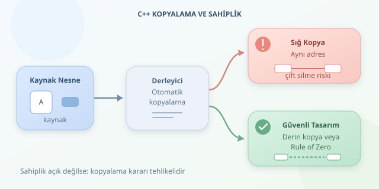

C++ derleyicisi, yazmadığınız bazı özel üye fonksiyonlarını sizin yerinize hazırlayabilir. Kopyalama kurucusu ve kopyalama atama operatörü de bu yardımcılar arasındadır. Ancak derleyici, bir işaretçinin yalnızca adres tuttuğunu bilir; o adresin arkasındaki belleğin kime ait olduğunu bilmez. Tehlike tam da bu sahiplik belirsizliğinde başlar.

``

## Önce mantık: Nesne mi, kaynak mı kopyalanıyor?

Kopyalama kurucusu yeni bir nesneyi mevcut nesneden oluşturur: `Buffer b = a;`. Kopyalama atama operatörü ise zaten yaşayan bir nesnenin değerini değiştirir: `b = a;`. İkinci durumda hedefin önceki kaynakları da hesaba katılmalıdır.

Derleyicinin ürettiği işlemler, taban sınıfları ve üyeleri kendi kopyalama davranışlarıyla kopyalar. Bu nedenle otomatik kopyalama, her zaman “sığ kopyalama” demek değildir: `std::vector` kendi elemanlarını kopyalar. Fakat ham işaretçi üyesinde yalnızca adres kopyalanır:

$$p_a = p_b$$

İki farklı nesne artık aynı kaynağa bakmaktadır. Bunun doğru olup olmadığı, sınıfın sahiplik sözleşmesine bağlıdır.

| Üye türü | Otomatik kopyalamanın sonucu | Değerlendirme |
|---|---|---|
| `int`, `double` | Değer kopyalanır | Genellikle güvenli |
| `std::string`, `std::vector` | Üyenin değer semantiği uygulanır | Genellikle güvenli |
| Sahip olan ham işaretçi | Aynı adres paylaşılır | Tehlikeli |
| Sahip olmayan ham işaretçi | Aynı nesneye bakılır | Yaşam süresi kontrol edilmeli |
| `std::unique_ptr` | Kopyalama işlemi silinir | Hatalı kopyalama engellenir |




## Tehlikenin klasik hali: İki sahip, tek bellek

Aşağıdaki sınıf belleği kendisi ayırıyor ve yok edilirken serbest bırakıyor. Dolayısıyla işaretçinin sahibi olduğunu varsayıyor:

```cpp
struct BadBuffer {
    char* data = new char[16];

    ~BadBuffer() {
        delete[] data;
    }
};

void example() {
    BadBuffer a;
    BadBuffer b = a; // Yalnızca adres kopyalanır.

    BadBuffer c;
    c = a;          // c'nin eski belleği kaybolur.
}
```

Kopyalama kurucusu burada iki nesneye aynı adresi verir. Nesneler yok edildiğinde aynı bellek tekrar serbest bırakılmaya çalışılır: **tanımsız davranış** ortaya çıkar. Program çökebilir, sessizce bozulabilir veya şimdilik çalışıyor gibi görünebilir.

Atama daha da sinsidir: `c` kendi eski adresini kaybettiği için bellek sızıntısı oluşturur; ardından ortak adres nedeniyle aynı serbest bırakma sorununa katılır. Derleyici fotokopi çekmiştir, ama herkes belgenin tek sahibi olduğunu sanmaktadır!

Benzer riskler dosya tanıtıcıları ve işletim sistemi tutamaçlarında da vardır. Ayrıca başka bir üyeye işaret eden iç işaretçiler kopyalandığında, yeni nesne yanlışlıkla eski nesnenin içine bakabilir. Sorun yalnızca `delete` değildir; sınıfın değişmezlerinin bozulmasıdır.

## Elle çözüm: Derin kopyalama ve güvenli atama

Bağımsız sahiplik istiyorsak, yeni bellek ayırıp içeriği kopyalamalıyız. Atamada ise mevcut kaynağı koruyarak ilerlemek önemlidir. Aşağıdaki **copy-and-swap** yaklaşımı, önce kopyayı hazırlar; başarılı olursa kaynakları değiş tokuş eder:

```cpp
#include <algorithm>
#include <cstddef>
#include <utility>

class Buffer {
    std::size_t size_;
    char* data_;

public:
    explicit Buffer(std::size_t size)
        : size_(size), data_(new char[size]{}) {}

    Buffer(const Buffer& other)
        : Buffer(other.size_) {
        std::copy_n(other.data_, size_, data_);
    }

    ~Buffer() {
        delete[] data_;
    }

    void swap(Buffer& other) noexcept {
        std::swap(size_, other.size_);
        std::swap(data_, other.data_);
    }

    Buffer& operator=(Buffer other) {
        swap(other);
        return *this;
    }
};
```

Değerle alınan `other`, bağımsız kopyadır. Bellek ayırma başarısız olursa hedef nesne değişmez. Takastan sonra hedefin eski belleğini `other` temizler. Bu yaklaşım kendine atamayı da güvenle karşılar; ancak gereksiz bir kopyalama yapabilir.

$n$ baytlık veri için derin kopyalamanın zaman ve ek bellek maliyeti yaklaşık $O(n)$ düzeyindedir. Doğruluk bedava değildir, fakat tanımsız davranış çok daha pahalıdır.

## Daha iyi seçenek: Rule of Zero

**Rule of Three**, yıkıcı, kopyalama kurucusu veya kopyalama atamasını özelleştiriyorsanız diğerlerini de değerlendirin der. Modern C++’ta taşıma işlemleriyle birlikte **Rule of Five** gündeme gelir. Yukarıdaki sınıf güvenli kopyalanır, fakat özel taşıma işlemleri sağlamaz; taşıma beklenen bazı durumlarda kopyalama yapılabilir.

Çoğu uygulamada en temiz çözüm, kaynak yönetimini hazır türlere devretmektir:

```cpp
#include <vector>

struct Buffer {
    std::vector<char> data;
};
```

Bu tasarımda **Rule of Zero** uygulanır: özel yıkıcı veya kopyalama işlemleri yazmanız gerekmez. `std::unique_ptr` ise tek sahipliği ifade eder; onu içeren sınıfın otomatik kopyalama işlemleri genellikle silinir.

Son kontrol sorusu şudur: **Bu nesneyi kopyaladığımda kaynak paylaşılmalı mı, çoğaltılmalı mı, yoksa kopyalama yasaklanmalı mı?** Cevap açık değilse, otomatik üretilen işlemlere güvenmeden önce sahiplik modelini netleştirin.
