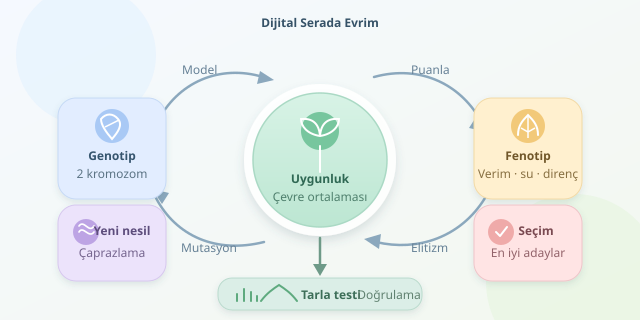

Bir tarlada binlerce bitki yetiştirip en başarılı olanları seçmek yerine, önce bilgisayarda küçük bir “dijital sera” kurabiliriz. Genetik algoritmalar, aday genetik kombinasyonları nesiller boyunca değerlendirerek verim, su ihtiyacı ve hastalık direnci arasında iyi dengeler arar. Amaç sihirli tohumu bulmak değil, gerçek ıslah deneylerinde sınanabilecek umut verici adayları daraltmaktır.

``

## Genotipten fenotipe: Modelin kalbi

Her aday bitki, kalıtsal özelliklerini temsil eden bir **genotip** taşır. Ancak gözlediğimiz özellikler, yani **fenotip**, yalnızca genotipten doğmaz; çevre ve genotip–çevre etkileşimi de sonucu değiştirir. Aynı çeşit sulanan tarlada yıldızlaşırken kurak arazide sıradan kalabilir. Dolayısıyla simülasyon, genetik bilgiyi özelliklere dönüştüren açık bir modele ihtiyaç duyar.

Örneğimizde bitkiyi, aynı kromozomun iki kopyasında bulunan altı lokusla temsil edeceğiz. Her lokusta iki olası alel vardır: `0` ve `1`. Bu, gerçek bir türün ayrıntılı genetik haritası değil, kalıtım mantığını öğrenmek için sadeleştirilmiş bir oyuncak modeldir.

| Temsil | Avantajı | Sınırlaması |
|---|---|---|
| Tek bit dizisi | Kolay uygulanır | Diploid kalıtımı göstermez |
| İki kromozom kopyası | Alel aktarımını modeller | Bağlantı haritası basitleşir |
| Gerçek marker verisi | Deneylerle ilişkilendirilebilir | Veri ve doğrulama gerektirir |

## İyi bitkiyi nasıl puanlarız?

Üç normalize özellik kullanalım: potansiyel verim $Y$, su tüketimi $W$ ve hastalık direnci $R$. Her özellik, lokuslardaki alel dozlarının ağırlıklı toplamından hesaplanır. Ağırlıklar örnekte keyfîdir; gerçek uygulamada kontrollü deneylerden veya genomik tahmin modellerinden öğrenilmelidir.

Kuraklık şiddeti $s$ arttıkça yüksek su tüketiminin verimi daha fazla düşürdüğünü varsayalım:

$$F(g)=\frac{1}{\vert E\vert }\sum_{s\in E}\left[0.55Y(g)(1-sW(g))+0.25R(g)-0.20W(g)\right]$$

Burada $E$, sınanan çevreler kümesidir. Büyük $F$ daha iyi aday demektir. Katsayılar yetiştiricinin önceliklerini yansıtır; evrensel biyoloji yasaları değildir. Özellikleri normalize etmek, farklı ölçüm birimlerinin puanı kazara ele geçirmesini önler. Kod eklemeli gen etkileri kullanır; dominans ve epistaz sonraki geliştirmelerdir.

## Evrim döngüsünü Python ile kurmak

Algoritma rastgele bir popülasyonla başlar. Turnuva seçimi güçlü adaylara üreme avantajı sağlar. Ebeveynlerin kromozomlarından tek kesim noktalı rekombinasyonla gametler üretilir; iki gamet yavruyu oluşturur. Düşük oranlı mutasyon çeşitliliği destekler. Elitizm ise en iyi iki adayın sonraki nesilde korunmasını sağlar.

Aşağıdaki NumPy kodu, bu döngüyü üç kuraklık seviyesinde çalıştırır ve son popülasyonun en iyi adayını yazdırır:

```python
import numpy as np

rng = np.random.default_rng(42)
L, N = 6, 80
E = np.array([0.0, 0.3, 0.6])
A = np.array([[3, 2, 4, 1, 2, 3],
              [2, 3, 1, 4, 2, 1],
              [1, 4, 2, 1, 3, 2]])
pop = rng.integers(0, 2, size=(N, 2, L))

def fitness(g):
    d = g.mean(axis=0)
    y, w, r = (A @ d) / A.sum(axis=1)
    return float(np.mean(0.55*y*(1-E*w)+0.25*r-0.20*w))

def select(scores):
    ids = rng.choice(N, 3, replace=False)
    return pop[ids[np.argmax(scores[ids])]]

def gamete(g):
    cut = rng.integers(1, L)
    h = rng.integers(2)
    c = np.r_[g[h, :cut], g[1-h, cut:]].copy()
    c ^= (rng.random(L) < 0.01).astype(int)
    return c

for _ in range(60):
    scores = np.array([fitness(g) for g in pop])
    new = [g.copy() for g in pop[np.argsort(scores)[-2:]]]
    while len(new) < N:
        new.append(np.stack([gamete(select(scores)),
                             gamete(select(scores))]))
    pop = np.array(new)

best = max(pop, key=fitness)
print(round(fitness(best), 4), best.tolist())
```

`g.mean(axis=0)`, iki kromozomdaki alel dozunu sıfır ile bir arasına taşır. `A` matrisinin satırları özellik etkilerini belirler. Mutasyon burada aleli diğer ikili duruma çevirir. Sabit rastgelelik tohumu sonucu yeniden üretmeyi kolaylaştırır; tek koşunun güvenilir olduğunu göstermez.

## Sonucu gerçekten test etmek

Sadece son puana bakmayın. Nesiller boyunca en iyi ve ortalama uygunluğu, ayrıca genetik çeşitliliği kaydedin. Ortalama yükselirken çeşitlilik hızla çöküyorsa popülasyon erken yakınsamış olabilir. Farklı rastgelelik tohumlarıyla tekrarlar yapın; aynı değerlendirme bütçesi altında rastgele aramayı da karşılaştırmaya ekleyin.

| Deney | Asıl soru |
|---|---|
| Yeni kuraklık seviyeleri | Aday farklı çevrelere dayanıyor mu? |
| Farklı amaç ağırlıkları | Kazanan tercihlere duyarlı mı? |
| Tarla denemeleri | Model gerçek performansı öngörüyor mu? |

Seçimde kullanılan çevrelerden ayrı test çevreleri ayırmak, modele aşırı uyumu yakalamaya yardımcı olur. Gerçek veride eğitim ve değerlendirme ayrımı da korunmalıdır. Son olarak, hiçbir simülasyon tohumu doğrudan şampiyon ilan edemez: dijital sera aday önerir, tarla karar verir. En iyi başlangıç, varsayımları görünür olan küçük bir modeldir.
