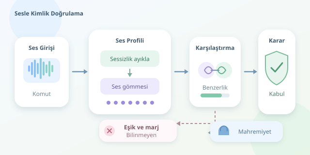

Evde herkes aynı asistana “En sevdiğim şarkıyı aç” dediğinde farklı listelerin çalması küçük bir sihir gibi görünür. Oysa asistanın içinde aile albümü değil, seslerden çıkarılmış matematiksel temsiller vardır. Peki babanın sabah mahmurluğunu, annenin fısıltısını ve kardeşinizin taklidini nasıl değerlendirir? Gelin bu dijital kulakların çalışma mantığını keşfedelim.

``

## Ne söylendiği ile kimin söylediği farklı sorulardır

Otomatik konuşma tanıma, sesi metne dönüştürür. Konuşmacı tanıma ise sesin sahibini araştırır. Burada iki ayrı görev bulunur: **kimlik belirleme**, kayıtlı kişiler arasından konuşmacıyı seçer; **kimlik doğrulama**, öne sürülen bir kimliğin doğru olup olmadığını sınar.

Dolayısıyla kişisel müzik listesini seçmek ile “Ben Ayşe’yim, hesabıma erişmek istiyorum” iddiasını değerlendirmek aynı problem değildir. Üstelik sistem her duyduğu sesi aileden birine zorla eşlememelidir; misafirler de kapıyı çalabilir!

| Görev | Temel soru | Örnek çıktı |
|---|---|---|
| Konuşmayı metne çevirme | Ne söylendi? | “Işığı aç” |
| Konuşmacı belirleme | Kim konuşuyor? | Ayşe veya bilinmeyen |
| Konuşmacı doğrulama | Gerçekten Ayşe mi? | Kabul veya ret |

## Ses nasıl matematiksel bir profile dönüşür?

İlk adım, konuşma etkinliği algılama ile sessizlikleri ayıklamaktır. Ardından ses uygun örnekleme hızına getirilir; modelin beklediği biçimde log-Mel spektrogram gibi özellikler hazırlanır. Bunlar, frekans içeriğinin zaman boyunca nasıl değiştiğini gösterir.

ECAPA-TDNN gibi eğitilmiş modeller bu özelliklerden **konuşmacı gömmesi**, yani sabit uzunluklu bir vektör üretir. Eğitim sırasında amaç, aynı kişinin farklı kayıtlarını yakın; farklı kişilerin kayıtlarını uzak konumlandırmaktır. Model yalnızca sesin kalınlığına bakmaz; konuşmacıya özgü çeşitli akustik örüntüleri birlikte değerlendirir.

Kayıt aşamasında farklı cümleler, günler ve makul mikrofon uzaklıkları kullanmak faydalıdır. Normalize edilmiş örneklerin ortalaması, yeniden normalize edilerek kişinin referans profiline dönüştürülebilir. Böylece tek bir hapşırık profilin başrol oyuncusu olmaz.

İki temsil arasındaki yakınlık için kosinüs benzerliği kullanılabilir:

$$s(\mathbf{x},\mathbf{p})=\frac{\mathbf{x}\cdot\mathbf{p}}{\\vert \mathbf{x}\\vert \\vert \mathbf{p}\\vert }$$

Bu ölçü, vektörlerin büyüklüğünden çok yönlerinin benzerliğini değerlendirir. Ancak yüksek benzerlik, tek başına kesin kimlik kanıtı değildir.

## Python ile küçük bir karar mekanizması

Aşağıdaki kod ham sesi işlemez; önceden eğitilmiş bir modelin ürettiği, aynı boyuttaki gömme vektörlerini kullanır. `profiller`, kişi adlarını referans vektörlerine bağlayan bir sözlüktür. Örnek, en az iki kayıtlı kişi varsayar.

```python
import numpy as np


def birim(v):
    v = np.asarray(v, dtype=float)
    norm = np.linalg.norm(v)
    if norm < 1e-8:
        raise ValueError("Geçersiz temsil")
    return v / norm


def profil_olustur(ornekler):
    ortalama = np.mean([birim(v) for v in ornekler], axis=0)
    return birim(ortalama)


def tanila(vektor, profiller, esik=0.75, marj=0.08):
    sorgu = birim(vektor)
    puanlar = sorted(
        ((ad, float(sorgu @ birim(p)))
         for ad, p in profiller.items()),
        key=lambda sonuc: sonuc[1], reverse=True
    )
    (ad, en_iyi), (_, ikinci) = puanlar[:2]
    if en_iyi < esik or en_iyi - ikinci < marj:
        return "Bilinmeyen"
    return ad
```

`profil_olustur`, birden fazla kaydı tek referansa indirger. `tanila` ise en güçlü eşleşmeyi bulur. İkinci adayla fark küçükse karar vermekten kaçınır. Buradaki sayılar yalnızca gösterim içindir; her model için geçerli güvenlik sınırları değildir.

## Eşik seçimi: Fazla şüpheci mi, fazla misafirperver mi?

Doğrulamada karar genellikle $s \geq \tau$ koşuluna dayanır. Eşik yükseldikçe yabancıları kabul etmek zorlaşır; fakat gerçek kullanıcıları reddetmek de kolaylaşabilir. Bu dengeyi ölçmek için yanlış kabul oranı ve yanlış ret oranı birlikte izlenir.

Eşikler, aile üyeleriyle birlikte kayıtlı olmayan kişilerden alınmış izinli test verileriyle ayarlanmalıdır. Kayıt ve test oturumlarını ayırmak önemlidir: aynı kaydı iki tarafta kullanmak, sınavdan önce cevap anahtarını dağıtmaya benzer. Gürültü, hastalık ve kısa komutlar ayrıca sınanmalıdır.

## Gerçek evlerde güvenlik ve mahremiyet

Televizyon sesi, üst üste konuşmalar ve uzaktaki mikrofon performansı düşürebilir. Sistem emin olmadığında yeniden konuşma istemeli veya kişiselleştirmeden devam etmelidir. Ses kayıtları ve gömmeler hassas biyometrik verilerdir; açık onay, şifreleme, silme seçeneği ve mümkünse cihaz üzerinde işleme gerekir.

Kayıt oynatma ve sentetik ses saldırıları da unutulmamalıdır. Canlılık kontrolleri riski azaltabilir ama kusursuz değildir. Kapı açma veya ödeme gibi işlemlerde ses, tek doğrulama faktörü olmamalıdır. Akıllı asistanın en değerli becerisi bazen doğru kişiyi tanımak değil, “Emin değilim” diyebilmektir.
