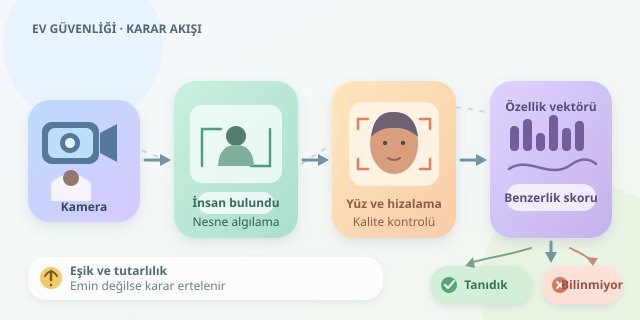

Kapı açıldı: İçeri giren siz misiniz, misafiriniz mi, yoksa kameranın insan sandığı askılık mı? Ev içi güvenlik kameraları bu soruları tek bir sihirli algoritmayla yanıtlamaz. Nesne algılama, yüz tespiti ve kimlik eşleştirme birlikte çalışır. Gelin, bu dijital kapıcının karar mekanizmasını ve neden bazen tereddüt etmesi gerektiğini inceleyelim.




``

## Önce nesneyi bul, sonra kimliği araştır

Görüntü, bilgisayar açısından piksel değerlerinden oluşan bir matristir. Derin öğrenme modelleri bu değerlerden kenar, doku, biçim ve daha karmaşık görsel örüntüler çıkarır. Ancak **bir insanı bulmak**, **yüzünü bulmak** ve **kim olduğunu belirlemek** farklı problemlerdir. Kamera önce sahneyi anlamalı, sonra uygun yüz görüntülerini incelemelidir. Böylece koltuk desenini aile üyesi olarak kaydetme gibi komik ama maliyetli hatalar azalır.

| Aşama | Yanıtladığı soru | Tipik çıktı |
|---|---|---|
| Nesne algılama | Görüntüde ne var? | İnsan, kedi, paket ve kutu koordinatları |
| Yüz tespiti | Yüz nerede? | Yüz kutusu ve belirgin noktalar |
| Yüz tanıma | Kayıtlı kişilerden biri mi? | Kimlik adayı veya bilinmiyor |

## Kameradan karşılaştırmaya uzanan yol

İlk adımda YOLO benzeri bir nesne algılayıcı insanları işaretleyebilir. Ardından ayrı bir yüz tespit modeli, insan bölgelerinde yüz arar. Göz ve burun gibi referans noktalarıyla yapılan **hizalama**, başın eğikliğinin karşılaştırmayı gereksiz yere bozmasını azaltır.

Kırpılan yüz, modelin beklediği boyuta ve renk düzenine dönüştürülür. Bulanık, çok küçük veya aşırı karanlık görüntüler elenebilir. Bu kalite kontrolü önemlidir: Algoritmaya belirsiz bir görüntü verip kesin cevap beklemek, buğulu gözlükle kimlik kontrolü yapmaya benzer. Her karede işlem yapmak yerine takip algoritmalarıyla aynı kişiyi izlemek de hesaplama yükünü azaltabilir.

## Yüzün sayısal özeti: embedding

Yüz tanıma modeli, görüntüyü çoğunlukla yüzlerce bileşenden oluşan bir **özellik vektörüne**, yani embedding'e dönüştürür. Eğitim sırasında aynı kişinin görüntülerinin birbirine yakın, farklı kişilerin görüntülerinin daha uzak temsil edilmesi hedeflenir. Bu vektör doğrudan isim içermez; isim, izinle oluşturulmuş kayıtlı örneklerle eşleştirme sonucunda bulunur.

İki vektör arasındaki kosinüs benzerliği şöyle hesaplanabilir:

$$s(a,b)=\frac{a\cdot b}{\lVert a\rVert\lVert b\rVert}$$

Birim uzunluğa normalize edilmiş vektörlerde hesap, yalnızca iç çarpıma dönüşür. Yüksek benzerlik aynı kişiye işaret edebilir; fakat skor, kendiliğinden bir doğruluk olasılığı değildir. Örneğin $0.80$, otomatik olarak “yüzde 80 kesinlik” anlamına gelmez.

## Tanıdık mı, yoksa sadece benziyor mu?

Ev ortamında sistem **açık küme tanıma** yapmalıdır: Görülen herkesin kayıtlı kişilerden biri olduğunu varsayamaz. En yüksek benzerlik bile belirlenen eşikten düşükse sonuç “bilinmiyor” olmalıdır.

Eşik düşürülürse tanıdıkları kaçırma azalabilir, ancak yabancıları yanlış kabul etme artabilir. Eşik yükseltilirse bunun tersi yaşanabilir. Doğru değer; kamera açısı, ışık, model ve kayıt kalitesiyle değişir. Bu nedenle yanlış kabul ve yanlış ret oranları, farklı koşullarda toplanmış doğrulama örnekleriyle birlikte değerlendirilmelidir.

## Python ile küçük bir eşleştirme katmanı

Aşağıdaki kod yüzü görüntüden çıkarmaz; aynı modelden alınmış embedding'leri karşılaştırır. `kayitlar`, kişi adlarını referans vektörlerine bağlayan bir sözlüktür.

```python
import numpy as np

def birim(vektor):
    v = np.asarray(vektor, dtype=float)
    uzunluk = np.linalg.norm(v)
    if uzunluk < 1e-12:
        raise ValueError("Geçersiz embedding")
    return v / uzunluk

def eslestir(yuz, kayitlar, esik=0.65):
    if not kayitlar:
        return "bilinmiyor", None
    sorgu = birim(yuz)
    skorlar = {
        kisi: float(sorgu @ birim(referans))
        for kisi, referans in kayitlar.items()
    }
    aday = max(skorlar, key=skorlar.get)
    skor = skorlar[aday]
    sonuc = aday if skor >= esik else "bilinmiyor"
    return sonuc, skor
```

Buradaki `0.65` yalnızca örnektir; başka modellerde güvenilir olmayabilir. Gerçek uygulamada kişi başına farklı ışıklarda birkaç referans tutulabilir. Yakın skorlu iki aday varsa karar ertelenebilir. Ayrıca birkaç ardışık karede tutarlı eşleşme aramak, tek karelik hataları azaltır; ancak hataları tamamen ortadan kaldırmaz.

## Güvenlik, mahremiyet ve son karar

Yüz embedding'leri biyometrik veri niteliği taşıyabilir; zararsız sayı dizileri gibi görülmemelidir. Ev sakinlerinin bilgilendirilmesi, uygun izinlerin alınması, yerel işleme, şifreleme, erişim kısıtlamaları ve kısa saklama süreleri önemlidir. Gereksiz görüntüler tutulmamalı, misafirler için mahremiyet seçenekleri sunulmalıdır.

Fotoğraf veya ekranla kandırılmaya karşı canlılık kontrolleri eklenebilir; bunlar da kusursuz değildir. “Bilinmiyor” etiketi yalnızca güvenilir eşleşme bulunamadığını söyler, kötü niyet göstermez. En iyi dijital kapıcı, herkesi tanıdığını iddia eden değil; emin olmadığında bunu söyleyen ve önemli kararları insana bırakan sistemdir.
