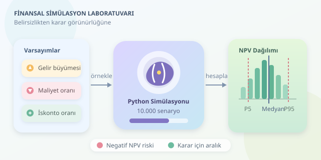

Bir yatırımın geleceğini tek hücrelik Excel tahminine bağlamak, hava durumuna bakmadan pikniğe çıkmaya benzer: Bazen güneş açar, bazen sandviçler yüzer. Bilgisayar destekli finansal modelleme, gelirleri, maliyetleri ve belirsizlikleri açık varsayımlara dönüştürür. Böylece yalnızca “Ne kadar kazanırız?” sorusunu değil, “Hangi koşullarda zarar ederiz?” sorusunu da araştırabiliriz. Üstelik farklı kararları aynı deney düzeneğinde karşılaştırabiliriz.

``

## Önce teori: Paranın zaman makinesi

Bugünkü 100 lira ile beş yıl sonraki 100 lira aynı ekonomik değere sahip değildir. Enflasyon, alternatif yatırım getirileri ve risk nedeniyle gelecekteki nakit akışlarını bugüne indirgeriz. Net bugünkü değer, yani NPV, bu yaklaşımın temel araçlarından biridir:

$$NPV=-I_0+\sum_{t=1}^{T}\frac{CF_t}{(1+r)^t}$$

Burada $I_0$ başlangıç yatırımı, $CF_t$ ilgili yılın nakit akışı, $r$ iskonto oranı ve $T$ modelin süresidir. Pozitif NPV, kullanılan iskonto oranı ve varsayımlar altında yatırımın değer yaratabileceğini gösterir; kesin kazanç sözü vermez.

Örneğimizde başlangıç yatırımı bir milyon lira, başlangıç yıllık gelir seviyesi 800 bin liradır. Değişken maliyetleri gelir üzerinden, sabit giderleri ayrı hesaplayacağız. Vergileri, işletme sermayesini, ek yatırımları ve terminal değeri dışarıda bırakıyoruz. Dolayısıyla bu, gerçek yatırım kararına hazır bir değerleme değil, öğretici bir prototiptir.

## Senaryodan olasılık dağılımına

Önce üç anlaşılır senaryo tanımlayalım. Bu tablo, değişkenlerin etkisini sezmek içindir; simülasyonun yüzdelik sonuçlarını temsil etmez.

| Varsayım | Kötümser | Temel | İyimser |
|---|---:|---:|---:|
| Yıllık gelir büyümesi | %0 | %8 | %14 |
| Değişken maliyet / gelir | %65 | %55 | %45 |
| İskonto oranı | %16 | %12 | %9 |

Monte Carlo yöntemi, bu üç fotoğraf yerine binlerce olası kombinasyon üretir. Her kombinasyonda nakit akışları ve NPV yeniden hesaplanır. Sonuç, tek bir tahmin değil, varsayımlara bağlı bir sonuç dağılımıdır. Bilgisayarın yaptığı sihir değil; sistematik biçimde çok sayıda “ya şöyle olursa?” sorusu sormaktır.

## Python ile finansal deney düzeneği

Önce `pip install numpy` komutuyla NumPy’ı kurun. Aşağıdaki kod 10.000 senaryo oluşturur. Büyüme ve iskonto oranlarını sınırlandırılmış normal dağılımlardan, maliyet oranını ise minimum, en olası ve maksimum değerleri tanımlanabilen üçgensel dağılımdan örnekler:

```python
import numpy as np

rng = np.random.default_rng(42)
n = 10_000
years = np.arange(1, 6)

growth = np.clip(
    rng.normal(0.08, 0.04, (n, 1)), -0.08, 0.22
)
cost_ratio = rng.triangular(0.45, 0.55, 0.65, (n, 1))
discount = np.clip(
    rng.normal(0.12, 0.02, (n, 1)), 0.05, 0.20
)

revenue = 800_000 * (1 + growth) ** years
fixed_cost = 170_000 * 1.04 ** years
cash_flow = revenue * (1 - cost_ratio) - fixed_cost

npv = (
    cash_flow / (1 + discount) ** years
).sum(axis=1) - 1_000_000

p5, median, p95 = np.quantile(npv, [0.05, 0.50, 0.95])
print(f"NPV yüzdelikleri: {p5:,.0f}, {median:,.0f}, {p95:,.0f} TL")
print(f"Negatif NPV oranı: {np.mean(npv < 0):.1%}")
```

Rastgele sayı üretecindeki `42`, deneyin tekrarlanabilmesini sağlar. `(n, 1)` biçimindeki diziler, beş yıllık zaman dizisiyle yayınlama sayesinde birleşir; Python döngüsü yazmadan bütün senaryolar hesaplanır. Her senaryoda seçilen büyüme, maliyet ve iskonto oranı beş yıl boyunca sabittir. Yani burada yıllık şokları değil, model parametrelerindeki belirsizliği örnekliyoruz. Ayrıca 800 bin lira başlangıç seviyesidir; ilk yıl geliri büyüme uygulanarak bulunur.

## Sonuçları doğru okumak

Medyan, sonuçların ortasındaki değerdir. Beşinci yüzdelik, simülasyon sonuçlarının yaklaşık %5’inin altında kaldığı eşiği gösterir. Beşinci ve doksan beşinci yüzdelikler arasındaki bölge, model sonuçlarının merkezdeki yaklaşık %90’ını kapsar; medyan için bir güven aralığı değildir.

Negatif NPV oranı da şirketin iflas olasılığı değildir. Yalnızca seçilen dağılımlar altında yatırımın iskonto edilmiş değerinin başlangıç maliyetini karşılamama sıklığıdır. Modeli bir kristal küre değil, varsayımlarınızı sorgulayan bir laboratuvar olarak düşünün.

## Modeli gerçek hayata yaklaştırmak

- **Veriyle kalibre edin:** Dağılımları geçmiş satışlar, maliyetler ve piyasa verileriyle gerekçelendirin. Kırpma işlemi sınır noktalarında olasılık yığılması oluşturur.
- **Bağımlılıkları modelleyin:** Örnekte değişkenler bağımsızdır. Gerçekte yüksek büyüme, yüksek maliyet veya farklı risk primiyle birlikte gelebilir.
- **Tutarlılığı koruyun:** Nominal nakit akışlarını nominal iskonto oranıyla değerlendirin. Sabit giderlerin yıllık %4 artması açık bir varsayımdır.
- **Duyarlılığı ölçün:** Bir varsayımı değiştirip diğerlerini sabit tutarak NPV’nin hangi girdiye daha hassas olduğunu inceleyin.
- **Nakit ile kârı ayırın:** Tahsilat gecikmeleri, vergiler ve stok finansmanı eklenmeden muhasebe kârını nakit akışı sanmayın.

Son olarak senaryo sayısını artırıp yüzdeliklerin kararlı olup olmadığını kontrol edin. Daha fazla simülasyon örnekleme gürültüsünü azaltır; yanlış varsayımları düzeltmez. Finansal modellemenin asıl gücü geleceği bilmek değil, belirsizliği görünür ve tartışılabilir hâle getirmektir.
