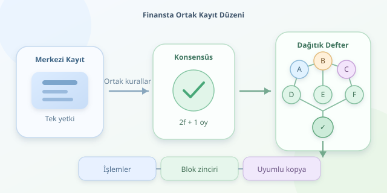

Bir bankanın hesap kayıtlarını dev bir Excel dosyası gibi düşünün: Dosyanın sahibi banka, güncelleme yetkisi de onda. Peki aynı finansal kayıtları birbirine tamamen güvenmeyen kurumlar birlikte tutmak isterse? Blockchain burada sahneye çıkar. Ancak mesele, dosyayı herkese kopyalamak değil; hangi güncellemenin geçerli olduğunda anlaşabilmektir. Asıl sihir, ortak kayıt düzenindedir.

``

## Önce teori: Dağıtık defter neyi değiştirir?

Merkezi kayıt sisteminde işlemlerin sırası ve geçerliliği tek bir yönetim alanında belirlenir. Yedek sunucular bulunabilir; dolayısıyla merkezi olmak, mutlaka tek bilgisayar kullanmak demek değildir. Dağıtık defterde ise birden fazla katılımcı, ortak kurallarla kayıtların uyumlu kopyalarını sürdürür. Temel problem, farklı düğümlerin aynı işlem geçmişinde anlaşmasıdır.

Blockchain, dağıtık defter teknolojilerinin bir türüdür; her dağıtık defter blok zinciri kullanmaz. Blockchain’de işlemler bloklarda toplanır ve her blok öncekinin kriptografik özetine bağlanır. Basitleştirilmiş ilişki şöyledir:

$$ h_i = H(h_{i-1}, T_i) $$

Burada $H$ özet fonksiyonu, $T_i$ ise bloktaki işlemlerdir. Eski bir kayıt değişirse sonraki bağlantılar bozulur. Fakat hash bağlantısı tek başına doğruluk sağlamaz: Geçerli geçmişin hangisi olduğu konsensüs kurallarıyla belirlenir. Defteri çoğaltmak, muhasebe kurallarını otomatik olarak doğru yapmaz!

| Boyut | Merkezi kayıt | Dağıtık defter |
|---|---|---|
| Yetki | Tek yönetim alanı | Protokol ve katılımcı kuralları |
| Güven | İşletmeciye dayanır | Katılımcılara ve mekanizmaya dağılır |
| Performans | Genellikle daha yüksek | Koordinasyon maliyeti vardır |
| Düzeltme | Yetkili değişiklik kolaydır | Çoğunlukla telafi kaydı kullanılır |
| Gizlilik | Erişim merkezi yönetilir | Ek gizlilik tasarımı gerekebilir |

## Konsensüs: Dijital muhasebenin toplantı odası

Finansal sistemlerde sorun yalnızca sunucunun kapanması değildir. Bir katılımcı çelişkili mesajlar gönderebilir veya geçersiz işlem önerebilir. Bizans hata toleransı, bu davranışlara rağmen ortak karar üretmeyi hedefler.

Yaygın BFT tasarımlarında, uygun ağ ve kimlik doğrulama varsayımları altında, $f$ kötü niyetli düğüme dayanmak için şu ilişki kullanılır:

$$ n = 3f + 1 $$

Tipik karar eşiği $q = 2f + 1$ olur. Örneğin dört doğrulayıcı, bir hatalı doğrulayıcıya tolerans sağlayabilir; karar için üç oy gerekir. Bu formül bütün blockchain ağlarının evrensel kuralı değildir. İş kanıtı ve hisse kanıtı farklı güvenlik varsayımlarına sahiptir.

## Python ile hash zincirini görmek

Aşağıdaki örnek, blok bağlantılarını ve sonradan yapılan değişiklikleri denetler. Gerçek bir ödeme ağı değil, mekanizmayı anlamak için küçük bir laboratuvardır:

```python
import hashlib
import json


def digest(body: dict) -> str:
    raw = json.dumps(body, sort_keys=True, separators=(",", ":"))
    return hashlib.sha256(raw.encode("utf-8")).hexdigest()


def append_block(chain: list, transfers: list) -> None:
    previous = chain[-1]["hash"] if chain else "0" * 64
    body = {"previous": previous, "transfers": transfers}
    chain.append({"body": body, "hash": digest(body)})


def verify(chain: list) -> bool:
    previous = "0" * 64
    for block in chain:
        body = block["body"]
        if body["previous"] != previous or digest(body) != block["hash"]:
            return False
        previous = block["hash"]
    return True


ledger = []
append_block(ledger, [{"from": "A", "to": "B", "amount": "125.50"}])
ledger[0]["body"]["transfers"][0]["amount"] = "999.00"
print(verify(ledger))  # False
```

`digest`, tutarlı JSON gösteriminin özetini üretir; `verify`, bağlantıları kontrol eder. Tutar metindir; gerçek hesaplamalarda uygun hassasiyetle `Decimal` kullanılmalıdır. Bu örnekte imza, bakiye kontrolü ve konsensüs yoktur. Saldırgan bütün özetleri yeniden hesaplayabilir; güvenilir bir referans veya konsensüs olmadan hash zinciri tek başına koruma sağlamaz.

## Finans tarafında nerede anlamlı?

**Kurumlar arası mutabakat**, güçlü adaylardan biridir. Her bankanın ayrı kayıt tutup sonradan karşılaştırması yerine, ortak defter uyuşmazlıkları azaltabilir. İzinli ağlarda doğrulayıcıların kimlikleri bilinir; katılım, yönetişim ve denetim kuralları sözleşmelerle desteklenebilir.

**Tokenizasyon**, tahvil veya fon payı gibi hakların dijital temsillerini oluşturabilir. Ancak token kaydı, hukuki mülkiyeti kendiliğinden yaratmaz. Saklama, yatırımcı hakları ve mevzuat bağlantısı ayrıca kurulmalıdır.

**Akıllı sözleşmeler**, ödeme ve teslim koşullarını otomatikleştirebilir. Buna karşılık dış dünyadan gelen fiyat veya teslim bilgisi oracle gerektirir. Yanlış veri gelirse program, yanlış sonucu gayet disiplinli biçimde uygular.

## Her kayıt sistemi blockchain olmak zorunda mı?

Tek bir güvenilir işletmeci varsa, yüksek hız ve kolay veri düzeltme gerekiyorsa geleneksel veritabanı daha sade olabilir. Blockchain özellikle ortak kayıt isteyen, fakat tek bir kuruma tam yetki vermek istemeyen taraflar arasında değerlidir.

Son kontrol listesi nettir: Katılımcılar kim, işlemi kim onaylıyor, kesinleşme ne zaman oluşuyor, hata nasıl düzeltiliyor ve hassas veriler nasıl korunuyor? Blockchain güveni yok etmez; onu teknoloji, yönetişim ve hukuk arasında yeniden dağıtır.



