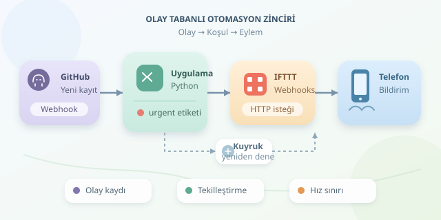

Telefonunuz yağmur başlayınca sizi uyarsa, önemli bir GitHub kaydı açıldığında cebinize bildirim düşse nasıl olurdu? IFTTT, farklı servisleri birbirine bağlayarak bu küçük dijital yardımcıları kurmanızı sağlar. Ancak iyi otomasyon, yalnızca uygulamaları eşleştirmek değildir: olayların, koşulların ve yan etkilerin nasıl çalıştığını anlamaktır. Haydi domino taşlarını devirmeden önce doğru sıraya dizelim!




``

## Temel Mantık: Olay, Koşul ve Eylem

IFTTT adı, “If This Then That” ifadesinden gelir: “Bu olursa, şunu yap.” Platformdaki otomasyon tariflerine **Applet** denir. Basit bir Applet, bir servisin tetikleyicisini başka bir servisin eylemine bağlar.

Burada üç kavramı ayırmak önemlidir. **Olay**, sistemde gerçekleşen değişikliktir. **Koşul**, olayın işlenmeye değer olup olmadığını belirler. **Eylem** ise başka bir sistemde oluşturulan sonuçtur. Örneğin yeni bir kayıt olaydır; kaydın acil olması koşuldur; bildirim göndermek eylemdir.

Bu ilişkiyi şöyle gösterebiliriz:

$$A = E \land C$$

Burada $E$, ilgili olayın gerçekleşmesini; $C$, ek koşulun sağlanmasını; $A$ ise eylemin çalıştırılmasını temsil eder. Yalnızca tetikleyici kullanan basit tariflerde ek koşulu sürekli doğru kabul edebilirsiniz.

| Bileşen | Cevapladığı soru | Örnek |
|---|---|---|
| Tetikleyici | Ne gerçekleşti? | Yeni GitHub issue kaydı |
| Koşul | İşlem yapılmalı mı? | `urgent` etiketi var mı? |
| Eylem | Ne yapılacak? | Telefona bildirim gönder |

Önemli ayrıntı: İki bağımsız tetikleyiciyi otomatik olarak “VE” mantığıyla birleştiremezsiniz. Ek filtreler, çoklu eylemler ve kullanılabilir servisler hesap planına veya entegrasyona göre değişebilir. Karmaşık kararlar için araya kendi küçük uygulamanızı koyabilirsiniz.

## Zincirler Neden Asenkron Çalışır?

Servisler aynı programın fonksiyonları değildir. Aralarında ağ bağlantıları, kimlik doğrulama ve bekleme süreleri bulunur. Bazı tetikleyiciler değişiklikleri belirli aralıklarla kontrol eder; bazıları ise olay geldiğinde doğrudan haber verir. Bu ikinci yaklaşımın yaygın araçlarından biri **webhook** mekanizmasıdır.

Webhook, kabaca “Bir şey olduğunda şu adrese HTTP isteği gönder” anlaşmasıdır. Kapıyı sürekli kontrol etmek yerine zil takmak gibi düşünün. Yine de zilin çalması, içerideki herkesin işini tamamladığı anlamına gelmez!

Bir zincirin yaklaşık gecikmesi şöyle modellenebilir:

$$T_{toplam} \approx \sum_{i=1}^{n}(T_{bekleme,i} + T_{işlem,i})$$

Bu yüzden bildirim otomasyonları için uygun bir zincir, milisaniyelik tepki gerektiren kontrol sistemleri için uygun olmayabilir.

## Uygulama: Acil GitHub Kaydını Telefona Taşıyalım

Örnek mimarimiz şöyle olsun: **GitHub webhook → Python uygulaması → IFTTT Webhooks → telefon bildirimi**. GitHub olayını alan uygulama, issue verisini inceler; yalnızca `urgent` etiketli kayıtları IFTTT’ye iletir.

IFTTT tarafında önce Webhooks servisindeki **Receive a web request** tetikleyicisini seçin. Olay adını `urgent_issue` yapın. Ardından Notifications servisindeki bildirim eylemini seçerek mesajda `Value1` ve `Value2` alanlarını kullanın. Webhooks anahtarınızı ortam değişkenine kaydedin; kaynak koduna veya herkese açık depoya koymayın.

Aşağıdaki fonksiyon, sunucunuzun doğruladığı webhook içeriğindeki `issue` nesnesini işler. `requests` paketinin kurulu olması gerekir:

```python
import os
import requests

processed = set()

def route_issue(issue):
    issue_id = str(issue["id"])
    labels = {item["name"] for item in issue.get("labels", [])}

    if "urgent" not in labels or issue_id in processed:
        return "atlandı"

    key = os.environ["IFTTT_WEBHOOK_KEY"]
    url = f"https://maker.ifttt.com/trigger/urgent_issue/with/key/{key}"
    response = requests.post(
        url,
        json={"value1": issue["title"], "value2": issue["html_url"]},
        timeout=5,
    )
    response.raise_for_status()
    processed.add(issue_id)
    return "iletildi"
```

Fonksiyon etiketi denetler, başlık ve bağlantıyı gönderir, başarılı HTTP yanıtından sonra kaydı işaretler. Bu yanıt, telefon bildiriminin kesin teslim edildiğini kanıtlamaz. GitHub webhook imzasının doğrulanması ve ilgili olay türlerinin seçilmesi, bu fonksiyonu çağıran sunucunun sorumluluğudur.

## Sağlam Zincirin Görünmeyen Kuralları

Örnekteki bellek kümesi yalnızca prototip içindir: uygulama yeniden başladığında temizlenir ve eşzamanlı çağrılarda yarış koşullarını engellemez. Üretimde kalıcı kayıtlar ve atomik kontroller kullanın. Aynı girdinin tekrar işlenmesinin istenmeyen ek sonuç üretmemesine **idempotent davranış** denir.

| Risk | Sonuç | Önlem |
|---|---|---|
| Tekrarlanan olay | Çift bildirim | Kalıcı tekilleştirme |
| Geçici bağlantı hatası | Eksik işlem | Gecikmeli yeniden deneme |
| Servis kotası | Reddedilen istek | Kuyruk ve hız sınırı |
| Döngüsel tetikleme | Bitmeyen zincir | Kaynak veya derinlik kontrolü |

Son olarak her adımı kaydedin, ancak anahtarları ve hassas verileri loglardan çıkarın. Başarısızlıkları görünür kılın ve yeniden denemeleri sınırlayın. İyi otomasyon, her şeyi körlemesine yapan değil; ne zaman duracağını da bilen dijital yardımcıdır.
