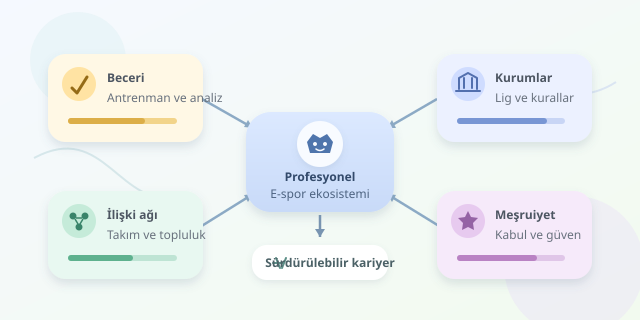

Bir zamanlar ailelerin “Bilgisayarı kapat artık!” dediği faaliyet, bugün antrenörlerin “Tekrarı aç, pozisyonu inceleyelim!” dediği bir mesleğe dönüşebiliyor. Ancak rekabetçi oyunculuğun profesyonel spor kimliği kazanması, yalnızca yüksek reflekslerden veya büyük ödül havuzlarından kaynaklanmıyor. Bu dönüşüm; kurumların, toplulukların, ekonomik ilişkilerin ve toplumsal kabulün birlikte ürettiği bir hikâye. Klavye aynı klavye, fakat etrafındaki dünya değişiyor.




``

## Oyundan kuruma: Profesyonelleşmenin zemini

Sosyolojik açıdan profesyonelleşme, bir etkinliğin düzenli kurallara, uzmanlaşmış rollere ve tanınan kariyer yollarına kavuşmasıdır. Arkadaşlar arasında oynanan karşılaşmayla sözleşmeli bir takımın lig maçı arasındaki fark, yalnızca oyuncuların beceri seviyesi değildir. İkinci durumda hakemlik, yayıncılık, sponsorluk ve disiplin süreçleri devreye girer.

Bu kurumlar, performansı karşılaştırılabilir ve kariyeri anlaşılabilir hâle getirir. Sıralamalar kimin başarılı olduğunu görünür kılarken lig takvimleri çalışma ritmini düzenler. Bununla birlikte e-sporun hukuki veya resmî spor statüsü ülkeler ve oyunlar arasında değişebilir. Dolayısıyla profesyonel bir ekosistemin oluşması, her yerde aynı biçimde spor olarak tanınması anlamına gelmez.

## Oyuncu kimliği nasıl değer kazanır?

Pierre Bourdieu’nün sermaye yaklaşımı burada kullanışlıdır. Oyuncunun oyun bilgisi kültürel sermaye, takım arkadaşları ve organizasyonlarla ilişkileri sosyal sermaye, itibarı ise simgesel sermaye olarak düşünülebilir. Bu kaynaklar belirli koşullarda maaşa, sponsorluk anlaşmasına veya takım davetine dönüşür.

Süreci düşünmek için şu kavramsal ifadeyi kullanabiliriz:

$P = f(B, K, A, L)$

Burada $P$ profesyonelleşmeyi; $B$ beceriyi, $K$ kurumsallaşmayı, $A$ ilişki ağlarını, $L$ toplumsal meşruiyeti temsil eder. Bu, hesaplama yapan doğrulanmış bir model değil, açıklayıcı bir çerçevedir. Tek başına yüksek beceri, sürdürülebilir meslek garantisi vermez. Görünürlük, bağlantılar ve güvenilir organizasyonlar da önemlidir.

| Boyut | Geleneksel spor | E-spor |
|---|---|---|
| Rekabet ortamı | Saha, salon, pist | Sunucu, oyun istemcisi, arena |
| Uzmanlaşma | Antrenör, fizyoterapist, analist | Antrenör, analist, teknik ekip |
| Kural yönetimi | Federasyonlar ve ligler | Yayıncı şirketler ve organizatörler |
| Topluluk ritüeli | Tribün, forma, tezahürat | Canlı sohbet, takım etiketi, tezahürat |

Bu karşılaştırma birebir eşitlik kurmaz. Özellikle oyunun fikrî mülkiyetinin bir şirkete ait olması, e-sporun yönetişimini farklılaştırır: Bir güncelleme, rekabetin koşullarını bir gecede değiştirebilir.

## Sahne arkasındaki görünmez takım

Profesyonel oyuncu ekranda tek başına görünebilir; başarısı ise kolektif emeğe dayanır. Antrenör strateji geliştirir, analist rakip örüntülerini inceler, yöneticiler seyahat ve sözleşmeleri düzenler. Yayın ekipleri de karşılaşmayı izlenebilir bir gösteriye dönüştürür.

Erving Goffman’ın dramaturjik yaklaşımıyla bakarsak, maç sahne önü; hazırlık, toplantılar ve antrenmanlar sahne arkasıdır. Taraftar çoğunlukla sonucu görür, o sonucu üreten koordinasyonu değil. “Doğuştan yetenekli oyuncu” anlatısı eğlencelidir; ancak iş bölümünü perdeleyebilir. Profesyonel kimlik, bu görünmeyen çalışmanın da tanınmasıyla güçlenir.

## Küçük bir veri deneyi

Bir yazılımcı, ekosistemin kolektif yapısını basit bir analizle görünür kılabilir. Aşağıdaki Python örneği, tamamen kurgusal iki takımda farklı rollerin haftalık çalışma saatlerini toplar ve takım içindeki paylarını hesaplar:

```python
import pandas as pd

kayitlar = pd.DataFrame([
    ("A", "oyuncu", 150),
    ("A", "antrenör", 35),
    ("A", "analist", 25),
    ("B", "oyuncu", 140),
    ("B", "antrenör", 40),
    ("B", "analist", 30),
], columns=["takim", "rol", "saat"])

saatler = (
    kayitlar.groupby(["takim", "rol"])["saat"]
    .sum()
    .unstack(fill_value=0)
)
paylar = saatler.div(saatler.sum(axis=1), axis=0)
print((paylar * 100).round(1))
```

`groupby` rol bazında toplamları çıkarır; `unstack` karşılaştırma tablosunu kurar; `div` yüzdelik dağılımı üretir. Sonuç, oyuncular dışındaki emeği tartışmaya açar. Ancak saat payı, katkının kalitesini veya başarı üzerindeki etkisini ölçmez. Gerçek verilerde mahremiyet, çalışan rızası ve ölçüm amacı ayrıca değerlendirilmelidir.

## Herkes için aynı kariyer mi?

Profesyonelleşmenin kapısı herkese eşit açılmaz. Donanım maliyeti, bağlantı kalitesi, dil ve coğrafya fırsatları etkiler. Topluluklardaki cinsiyetçi tutumlar ve taciz de bazı oyuncuların katılımını zorlaştırabilir. Bu yüzden yalnızca “en iyi olan yükselir” demek, başlangıç koşullarını görünmez kılar.

Sözleşme güvencesi, eğitimle kariyerin dengelenmesi, dinlenme ve psikolojik destek de spor kimliğinin parçasıdır. Uzun antrenman saatlerini romantikleştirmek yerine sürdürülebilir çalışma koşullarını tartışmak gerekir. Taraftarların ortak ritüelleri aidiyet üretirken, organizasyonların sorumluluğu bu aidiyeti güvenli ve kapsayıcı ortamlara taşımaktır.

Sonuçta e-spor, oyunların ciddileşmesinden fazlasıdır: İnsanların beceriyi mesleğe, rekabeti kuruma ve izleyiciliği topluluğa dönüştürmesidir. Profesyonel kimliğin asıl sınavı yalnızca kupanın kaldırıldığı an değil, o kupaya giden emeğin nasıl örgütlendiği ve kimlerin bu yolculuğa katılabildiğidir.
