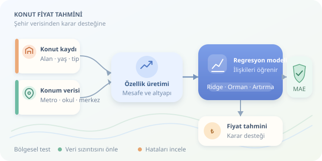

Aynı büyüklükteki iki daire neden bambaşka fiyatlara satılır? Cevap çoğu zaman duvarların içinde değil, mahallenin sokaklarında gizlidir. Metro erişimi, okul yakınlığı, altyapı kalitesi ve merkeze uzaklık, emlak değerini birlikte etkiler. Makine öğrenmesiyle bu ilişkileri veriden öğrenebiliriz; ancak modelimize yalnızca hesap makinesi değil, biraz şehircilik gözlüğü de takmalıyız.

``

## Önce mantık: Fiyat hangi ilişkiden doğar?

Konut fiyat tahmini, hedef değişkeni sayısal olan bir **regresyon** problemidir. Her konut bir gözlem; alan, bina yaşı ve ulaşım mesafeleri ise özelliklerdir. Temel düşünce şöyledir:

$$y = f(X) + e$$

Burada $y$ satış fiyatını, $X$ özellikleri, $f$ öğrenilen ilişkiyi, $e$ ise açıklanamayan etkileri temsil eder. Manzara, pazarlık veya ölçülmeyen yapı kalitesi bu hata payına katkıda bulunabilir.

Doğrusal regresyon, özelliklerin katkılarını ağırlıklı toplamla açıklar. Ağaç tabanlı modeller ise eşikler ve etkileşimler öğrenir: Metro yakınlığı, merkezdeki küçük bir daireyle çeperdeki büyük bir ev için aynı anlamı taşımayabilir. Ancak **tahmin ilişkisi nedensellik değildir**; metroya yakın evlerin pahalı olması, farkın tamamını metronun yarattığını kanıtlamaz.

## Veriyi şehrin haritasıyla buluşturmak

Başlangıçta gerçekleşmiş satış kayıtlarını bina özellikleriyle birleştirin. İlan fiyatları kullanılabilir, fakat bunlar satış fiyatıyla aynı hedef değildir. Koordinatlardan ulaşım duraklarına, okullara ve hizmet noktalarına mesafe üretilebilir. Kuş uçuşu mesafe kolaydır; yol ağı üzerinden seyahat süresi ise günlük yaşamı daha iyi temsil edebilir.

| Özellik | Temsil ettiği bilgi | Dikkat noktası |
|---|---|---|
| Alan ve bina yaşı | Fiziksel nitelikler | Eksik veya hatalı kayıtlar |
| Metroya mesafe | Ulaşım erişimi | Yürüme güzergâhı önemlidir |
| Merkeze mesafe | Merkezi konum | Şehirde birden çok merkez olabilir |
| Altyapı puanı | Hizmetlerin yeterliliği | Kaynak ve ölçek açıklanmalı |




Altyapı puanını ulaşım, internet ve belediye hizmetleri gibi bileşenlerden oluşturabilirsiniz. Bileşenleri ortak ölçeğe getirip ağırlıkları gerekçelendirin. Satış tarihinden sonra açılan metro hattını geçmiş satışa eklemeyin: Modelin geleceği görmesi başarı değil, **veri sızıntısıdır**. Farklı tarihlerdeki fiyatları da uygun bir endeksle ortak döneme taşımayı değerlendirin.

## Hangi modelle başlayalım?

Önce basit bir referans model kurun; ardından karmaşıklığın gerçekten fayda sağlayıp sağlamadığını ölçün.

| Model | Güçlü tarafı | Sınırlaması |
|---|---|---|
| Ridge regresyon | Hızlı, anlaşılır başlangıç | Karmaşık ilişkileri kaçırabilir |
| Random Forest | Etkileşimleri yakalar | Eğitim aralığı dışına zayıf geneller |
| Gradient Boosting | Tablo verilerinde güçlü aday | Ayarlara ve doğrulamaya duyarlıdır |

Ridge için sayısal özellikleri ölçeklemek yararlıdır. Ağaçlar genellikle buna ihtiyaç duymaz. Hiçbir modelin bütün şehirlerde kazanacağına dair garanti yoktur; yarışmanın hakemi doğrulama verisidir, modelin havalı adı değil.

## Python ile bölgesel test

Aşağıdaki örnek, belirtilen sütunları içeren bir CSV dosyası bekler. Mahalleleri eğitim ve test arasında ayırarak modelin görmediği bölgelerdeki başarısını sınar. Mahalle kodu tahmin özelliği değil, ayırma grubu olarak kullanılır.

```python
import pandas as pd
from sklearn.compose import ColumnTransformer
from sklearn.impute import SimpleImputer
from sklearn.preprocessing import OneHotEncoder
from sklearn.pipeline import Pipeline
from sklearn.ensemble import RandomForestRegressor
from sklearn.model_selection import GroupShuffleSplit
from sklearn.metrics import mean_absolute_error

df = pd.read_csv("konutlar.csv").dropna(
    subset=["fiyat_tl", "mahalle_kodu"]
)
num = ["alan_m2", "bina_yasi", "merkeze_km",
       "metroya_m", "okula_m", "altyapi_puani"]
cat = ["yapi_tipi"]
X, y = df[num + cat], df["fiyat_tl"]

categorical = Pipeline([
    ("fill", SimpleImputer(strategy="most_frequent")),
    ("encode", OneHotEncoder(handle_unknown="ignore"))
])
prep = ColumnTransformer([
    ("numeric", SimpleImputer(strategy="median"), num),
    ("categorical", categorical, cat)
])
model = Pipeline([
    ("prep", prep),
    ("forest", RandomForestRegressor(
        n_estimators=300, min_samples_leaf=5,
        random_state=42, n_jobs=-1))
])
split = GroupShuffleSplit(test_size=0.2, random_state=42)
train, test = next(split.split(X, y, df["mahalle_kodu"]))
model.fit(X.iloc[train], y.iloc[train])
pred = model.predict(X.iloc[test])
print("MAE (TL):", mean_absolute_error(y.iloc[test], pred))
```

`Pipeline`, eksik değer doldurma ve kategori kodlama işlemlerini yalnızca eğitim verisinden öğrenir. Böylece test verisi hazırlık aşamasına sızmaz. `min_samples_leaf`, çok küçük örnek gruplarına aşırı uyumu sınırlar.

## Sonucu doğru okumak

Ortalama mutlak hata, tahminlerin fiyatlardan ortalama ne kadar saptığını gösterir:

$$MAE = \frac{1}{n}\sum_{i=1}^{n}\vert y_i-\hat{y}_i\vert $$

MAE'yi testte, eğitim fiyatlarının medyanını sürekli tahmin eden basit referansla karşılaştırın. Bölge ve fiyat dilimi bazında hataları da inceleyin; genel ortalama, pahalı konutlardaki başarısızlığı gizleyebilir.

Komşu mahalleler hâlâ birbirine benzeyebilir. Daha güçlü değerlendirme için coğrafi tamponlar, birden fazla bölgesel bölme ve gelecekteki satışları sınayan zamansal test kullanın. Hiperparametreleri eğitim içindeki doğrulamayla seçin; nihai testi saklı tutun.

Sonuçta model, otomatik ekspertiz sertifikası değil, karar destek aracıdır. Güvenilir tahmin; temiz veri, gerçekçi test ve açıklanabilir hata analiziyle gelir. Şehrin ritmini öğrenmek, yalnızca daha büyük bir algoritma çalıştırmaktan önemlidir.
