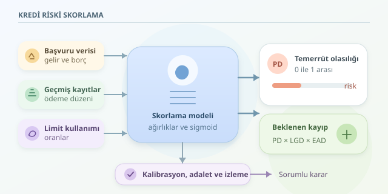

Bilgisayar kredi başvurunuzu değerlendirirken geleceği gören dijital bir falcıya dönüşmez. Geçmiş verilerdeki örüntülerden yararlanarak belirli bir sürede borcun geri ödenmeme olasılığını tahmin eder. Yani yaptığı şey, karakterinizi puanlamak değil; belirsizliği sayıya çevirmektir. Peki bu sayı nasıl üretilir ve neden bazen yanıltıcı olabilir?




``

## Önce hedef: Hangi riski ölçüyoruz?

Kredi skorlama genellikle bir **ikili sınıflandırma** problemidir. Örneğin hedef, kredi açıldıktan sonraki 12 ay içinde müşterinin temerrüde düşüp düşmeyeceğini tahmin etmektir. Temerrüdün tanımı baştan belirlenmelidir; örneğin ödemenin 90 günü aşan gecikmesi kullanılabilir.

Modelin çıktısı çoğunlukla **temerrüt olasılığıdır**, yani PD. Lojistik regresyonda önce özelliklerin ağırlıklı toplamı hesaplanır, ardından sonuç sigmoid fonksiyonuyla olasılığa dönüştürülür:

$$z=b+w_1x_1+w_2x_2+\cdots+w_nx_n$$

$$PD=\frac{1}{1+e^{-z}}$$

Burada $x_i$ müşteri özelliklerini, $w_i$ öğrenilen ağırlıkları, $b$ ise sabit terimi temsil eder. Sigmoid, herhangi bir gerçek sayıyı sıfır ile bir arasına sıkıştırır. Ancak bu çıktının güvenilir bir olasılık olması, modelin ayrıca değerlendirilmesini ve gerektiğinde kalibre edilmesini gerektirir.

## Her risk aynı parasal kayıp değildir

Temerrüt olasılığı tek başına bankanın kaybını anlatmaz. Beklenen kayıp için üç bileşen kullanılır:

$$EL=PD\times LGD\times EAD$$

**LGD**, temerrüt halinde kaybedilecek pay; **EAD**, temerrüt anındaki risk tutarıdır. Örneğin PD yüzde 4, LGD yüzde 50 ve EAD 100.000 TL ise beklenen kayıp 2.000 TL olur. Bu, belirli bir müşterinin kesin kaybı değil, benzer durumların ortalamasına ilişkin tahmindir.

## Modelin masasına hangi veriler gelir?

Önemli olan yalnızca veri toplamak değil, başvuru anında gerçekten bilinen verileri kullanmaktır. Gelecekteki bir gecikmeyi özelliklere eklemek, sınavdan önce cevap anahtarını görmek gibidir: Buna **veri sızıntısı** denir.

| Özellik | Ne anlatır? | Dikkat edilmesi gereken |
|---|---|---|
| Borç/gelir oranı | Ödeme yükünün gelire oranı | Gelirin doğruluğu önemlidir |
| Geçmiş gecikmeler | Önceki ödeme davranışı | Yalnızca geçmiş kayıtlar kullanılmalıdır |
| Limit kullanım oranı | Kullanılan limitin toplam limite oranı | Dönemsel dalgalanmalar yanıltabilir |

Düşük gelir otomatik olarak yüksek risk demek değildir. Borç yükü, ödeme düzeni ve ürün özellikleri birlikte değerlendirilir. Ayrıca eğitim verisi yalnızca geçmişte kredi verilen kişilerden oluşuyorsa, reddedilen başvurular hakkında modelin bilgisi sınırlıdır.

## Hangi algoritma daha iyi?

Tek bir şampiyon yoktur. Seçim, tahmin başarısı kadar açıklanabilirlik ve bakım maliyetine de bağlıdır.

| Yaklaşım | Güçlü yönü | Sınırlaması |
|---|---|---|
| Puan kartı | Kararları açıklamak kolaydır | Karmaşık ilişkileri sınırlı yakalar |
| Lojistik regresyon | Basit, güçlü bir başlangıçtır | Etkileşimler ayrıca modellenebilir |
| Gradyan artırmalı ağaçlar | Doğrusal olmayan örüntüleri yakalar | Açıklama ve kalibrasyon dikkat ister |

## Python ile küçük bir prototip

Aşağıdaki örnek, varsayımsal bir CSV dosyasındaki sayısal özelliklerle model kurar. `temerrut_12ay` hedefi 0 veya 1 olmalıdır. Satırlar başvuru tarihine göre sıralanarak daha yeni dönem test için ayrılır.

```python
import pandas as pd
from sklearn.pipeline import make_pipeline
from sklearn.impute import SimpleImputer
from sklearn.preprocessing import StandardScaler
from sklearn.linear_model import LogisticRegression
from sklearn.metrics import roc_auc_score, brier_score_loss

df = pd.read_csv("kredi_ornek.csv", parse_dates=["tarih"])
df = df.sort_values("tarih")
features = ["borc_gelir", "gecikme_sayisi", "limit_kullanimi"]
cut = int(len(df) * 0.8)
train, test = df.iloc[:cut], df.iloc[cut:]

model = make_pipeline(
    SimpleImputer(strategy="median"),
    StandardScaler(),
    LogisticRegression(max_iter=1000)
)
model.fit(train[features], train["temerrut_12ay"])
pd_hat = model.predict_proba(test[features])[:, 1]

print("ROC-AUC:", roc_auc_score(test["temerrut_12ay"], pd_hat))
print("Brier:", brier_score_loss(test["temerrut_12ay"], pd_hat))
```

Pipeline, eksik değer doldurma ve ölçekleme parametrelerini yalnızca eğitim verisinden öğrenir. ROC-AUC sıralama başarısını, Brier skoru olasılık tahminlerinin hatasını ölçer. Gerçek uygulamada eğitim etiketlerinin test dönemi başlamadan olgunlaşması ve aynı müşterinin tekrarlarının sızıntı yaratmaması ayrıca kontrol edilmelidir.

## Skor kararın tamamı değildir

Temerrüt nadirse doğruluk yanıltabilir: Herkese “öder” diyen model bile başarılı görünebilir. PR-AUC, kalibrasyon ve farklı müşteri gruplarındaki hata oranları da incelenmelidir. Kredi verme eşiği ise maliyetler, risk politikası ve mevzuatla belirlenir.

Hassas özellikleri çıkarmak tek başına adaleti garanti etmez; diğer değişkenler bunların vekili olabilir. Veri gizliliği, anlaşılır gerekçeler ve itiraz süreçleri önemlidir. Ekonomi değiştikçe model de izlenmelidir. Kısacası iyi skorlama, yalnızca akıllı algoritma değil; temiz veri, dürüst ölçüm ve sorumlu karar sürecidir.
