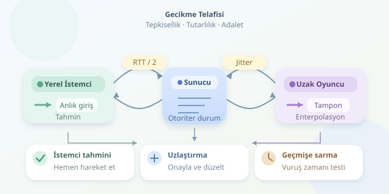

Çevrimiçi bir oyunda siz tetiğe bastığınızda rakibiniz çoktan duvarın arkasına geçmiş olabilir. Yine de oyun, iki tarafın ekranında mümkün olduğunca tutarlı görünmelidir. İşin sırrı interneti hızlandırmak değil; geçmişi saklamak, geleceği tahmin etmek ve küçük hataları ustaca düzeltmektir. Gelin bu dijital illüzyonun nasıl çalıştığını inceleyelim.

``

## Önce fizik: Ağ neden bekletir?

Bir komutun istemciden sunucuya ulaşması zaman alır. Gidiş-dönüş süresi **RTT**, paketin gidip yanıtın geri gelmesini kapsar. Yolların yaklaşık simetrik olduğu varsayılırsa tek yönlü gecikme $d \approx RTT / 2$ olarak tahmin edilebilir; gerçek bağlantılarda bu eşitlik garanti değildir.

Üstelik sorun yalnızca gecikme değildir. **Jitter**, paketlerin değişken aralıklarla gelmesi; paket kaybı ise bazı güncellemelerin hiç ulaşmamasıdır. Sunucunun **tick rate** değeri de simülasyonun saniyede kaç kez ilerlediğini belirler. Örneğin 60 Hz sunucuda bir adım yaklaşık 16,7 milisaniyedir.

Çoğu rekabetçi oyunda sunucu otoriterdir: İstemci hareket talep eder, nihai sonucu sunucu belirler. Böylece oyuncunun bilgisayarı hem gösteri sahnesi olur hem de güvenilmeyen bir veri kaynağı olarak değerlendirilir.

## Dört teknik, dört farklı görev

Bu yöntemler birbirinin alternatifi değildir. Genellikle aynı oyunda birlikte çalışırlar; çünkü kendi karakterinizi kontrol etmekle uzaktaki oyuncuları izlemek farklı problemler doğurur.

| Teknik | Kullanıldığı yer | Kazancı | Bedeli |
|---|---|---|---|
| İstemci tahmini | Yerel karakter | Anında tepki | Yanlış tahmin |
| Sunucuyla uzlaştırma | Yerel karakter | Doğru duruma dönüş | Görünür düzeltme |
| Enterpolasyon | Uzak karakterler | Akıcı hareket | Ek görüntü gecikmesi |
| Geçmişe sarma | Vuruş kontrolü | Gecikmeye rağmen isabet değerlendirmesi | Adalet tartışmaları |

## İstemci tahmini ve sunucuyla uzlaştırma

Karakterinizin yürümesi için sunucuyu beklerseniz kontrol ağırlaşır. Bunun yerine istemci girdiyi hemen uygular, aynı girdiyi sunucuya gönderir. Basitleştirilmiş hareket modeli $x_{yeni} = x_{eski} + v a dt$ şeklindedir; burada $a$ yön, $v$ hızdır.

Aşağıdaki JavaScript örneği, tek boyutlu hareketi tahmin eder ve sunucu yanıtıyla yeniden hesaplar:

```javascript
const speed = 6;
let sequence = 0;
let pending = [];
let predicted = { x: 0 };

function step(state, input) {
  return { x: state.x + speed * input.axis * input.dt };
}

function move(axis, dt) {
  const input = {
    seq: ++sequence,
    axis: Math.max(-1, Math.min(1, axis)),
    dt
  };
  pending.push(input);
  predicted = step(predicted, input);
  send(input);
}

function onSnapshot({ state, lastProcessedSeq }) {
  pending = pending.filter(i => i.seq > lastProcessedSeq);
  predicted = pending.reduce(step, { ...state });
}
```

Burada `send`, ağ katmanının sağladığı gönderim fonksiyonudur. Sunucu, işlediği son girdi numarasını bildirir. İstemci onaylanan girdileri siler, sunucu durumundan başlayıp kalanları tekrar uygular. Böylece sunucunun henüz görmediği hareketler kaybolmaz. Örnekteki `dt` güvenilir sayılmamalıdır; sunucu süreyi, sırayı ve hareket sınırlarını doğrulamalıdır. Gerçek uygulamada sabit simülasyon adımları tercih edilir.

Görsel düzeltme yumuşatılabilir; fakat çarpışma hesabı sırf görüntü güzel olsun diye yanlış konumda bırakılmamalıdır.

## Enterpolasyon: Bilerek biraz geriden bakmak

Uzak oyuncuların gelecekteki girdilerini bilemezsiniz. Bunun yerine görüntüyü kısa bir tampon süresi kadar geriden oynatırsınız. İki sunucu örneği arasındaki konum $p(t) = (1-\alpha)p_0 + \alpha p_1$ ile hesaplanır; $\alpha$, iki örnek arasındaki ilerleme oranıdır.

Bu yaklaşım, düzensiz paket gelişlerini akıcı harekete dönüştürür. Tampon küçülürse tepki hızlanır ama takılmalar artabilir. Paket gelmediğinde kullanılan **ekstrapolasyon** ise son hızdan geleceği tahmin eder; ani dönüşlerde kolayca yanılır. Bu yüzden genellikle kısa süreyle sınırlandırılır.

## Geçmişe sarma: Mermiyi hangi zamana göre değerlendirmeli?

Sunucu oyuncu konumlarının kısa bir geçmişini saklar. Ateş komutu geldiğinde, atıcının ekranda gördüğü zamana karşılık gelen konumlarla vuruş testi yapabilir. Basitleştirilmiş hesap $t_{test} = t_{gelis} - d_{yukleme} - D$ şeklindedir; $D$ görüntü tamponudur.

Örneğin yaklaşık 60 milisaniye yükleme gecikmesi ve 80 milisaniye tampon varsa test, komutun gelişinden yaklaşık 140 milisaniye öncesine bakabilir. Gerçek sistemler zaman damgalarını ve saat farklarını ayrıca doğrular.

Bedeli şudur: Hedef, kendi ekranında siper arkasına geçtiği hâlde vurulabilir. Bu nedenle geri sarma penceresi sınırlanır; istemcinin istediği herhangi bir geçmiş zaman kabul edilmez. Dinamik engellerin geçmişi de değerlendirmeyi zorlaştırabilir.

## İyi hissettiren oyun ölçülerek yapılır

Tek bir sihirli tampon değeri yoktur. RTT dağılımını, jitter seviyesini, düzeltme miktarını ve reddedilen vuruşları ölçün. Yapay gecikme ve paket kaybıyla test yapın; yalnızca yerel ağda akıcı görünen oyun yanıltıcıdır. Rekabetçi nişancı oyunuyla sıra tabanlı oyunun ihtiyaçları aynı değildir. Amaç gecikmeyi yok etmek değil, tepkisellik, doğruluk ve adalet arasında bilinçli bir denge kurmaktır.



