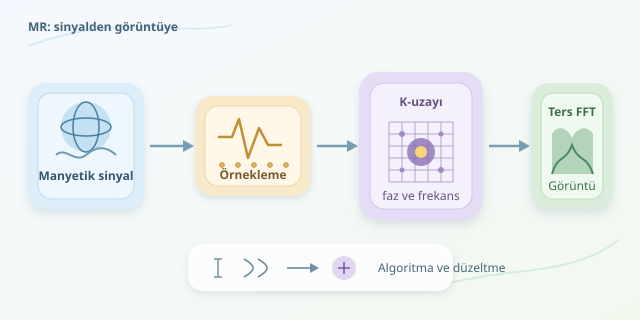

MR cihazı, vücudun içine bakan dev bir fotoğraf makinesi değildir. Daha çok, atom çekirdeklerinden gelen zayıf sinyalleri dinleyen ve bunlardan bir görüntü hesaplayan bilimsel bir dedektiftir. Peki dedektifin büyüteci nedir? Manyetik alanlar, sayısal sinyal işleme ve Fourier dönüşümü! Gelin, manyetik fısıltıların nasıl piksellere dönüştüğünü yazılımcı gözlüğüyle inceleyelim.
``

## 1. Önce fizik: Dinlediğimiz şey ne?

Vücuttaki su ve yağ molekülleri bol miktarda hidrojen içerir. Hidrojen çekirdeklerinin manyetik özellikleri, güçlü bir ana manyetik alan içinde ölçülebilir bir toplam mıknatıslanma oluşturur. Çekirdeklerin karakteristik dönme hareketinin frekansı, Larmor bağıntısıyla açıklanır:

$$\omega_0 = \gamma B_0$$

Burada $B_0$ ana manyetik alan, $\gamma$ ise jiromanyetik orandır. Protonlar için $\gamma/(2\pi)$ yaklaşık $42{,}58$ MHz/T olduğundan, 3 teslalık bir cihazda rezonans frekansı yaklaşık 128 MHz olur.

Radyo frekansı darbesi mıknatıslanmayı dengeden uzaklaştırır. Darbe sonrasında değişen mıknatıslanma, alıcı bobinlerde elektriksel sinyal indükler. Dokuların $T_1$ ve $T_2$ gevşeme özellikleri farklıdır; çekim parametreleriyle birlikte görüntü kontrastını belirler. Yani parlaklık, yalnızca “burada ne kadar hidrojen var?” sorusunun cevabı değildir.

## 2. Konum bilgisi sinyale nasıl eklenir?

Tek bir toplu sinyal, hangi dokunun nerede olduğunu söylemez. Bu, kalabalık bir odadaki bütün konuşmaları tek mikrofonla kaydetmeye benzer. MR’ın çözümü, manyetik alanı konuma göre değiştiren **gradyan alanlarıdır**.

Kesit seçimi sırasında gradyanla birlikte uygulanan uygun frekans aralığındaki bir RF darbesi, hedeflenen kesiti uyarır. Diğer gradyanlar, sinyale konuma bağlı faz ve frekans farklılıkları ekler.

Her eksendeki k-uzayı koordinatı, ilgili gradyanın zaman içindeki birikimiyle ilişkilidir:

$$k(t)=\frac{\gamma}{2\pi}\int_0^t G(\tau)\,d\tau$$

Burada önemli programlama fikri şudur: Cihaz doğrudan piksel adreslerini okumaz. Ölçüm zamanlamasını ve gradyanları kontrol ederek görüntüyü hesaplamaya yetecek veriyi toplar. Böylece donanımın zaman çizelgesi, yazılımın veri koordinatlarına dönüşür.

## 3. K-uzayı: Görüntünün frekans günlüğü

Toplanan veriler **k-uzayı** denen uzaysal frekans alanına yerleştirilir. Basitleştirilmiş iki boyutlu model şöyledir:

$$s(k_x,k_y)=\iint m(x,y)e^{-i2\pi(k_xx+k_yy)}\,dx\,dy$$

$m(x,y)$, proton yoğunluğu, gevşeme ve faz etkilerini içeren etkin görüntüdür. Bu sade modelde bobin duyarlılığını sabit kabul ediyoruz.

| Alan | Ne temsil eder? | Sezgisel karşılığı |
|---|---|---|
| Görüntü uzayı | Konuma bağlı doku sinyali | Ortaya çıkan resim |
| K-uzayı merkezi | Düşük uzaysal frekanslar | Geniş, yumuşak yapılar |
| K-uzayı dış bölgeleri | Yüksek uzaysal frekanslar | İnce ayrıntılar ve kenarlar |




Ancak tek bir k-uzayı noktası, tek bir görüntü pikseline karşılık gelmez. Her ölçüm, görüntünün tamamına yayılan bir örüntü hakkında bilgi taşır. Asıl sürpriz burada!

## 4. Bilgisayarın iş akışı

Alıcı sistem sinyali yükseltir, sayısallaştırır ve demodülasyonla karmaşık taban bant verisine dönüştürür. Karmaşık sayılar hem genliği hem fazı saklar; fazı erkenden atmak, konum bilgisini kaybetmek demektir.

Kartezyen örneklemede rekonstrüksiyonun temel adımı ters ayrık Fourier dönüşümüdür. FFT algoritmaları bu hesabı yaklaşık $O(N\log N)$ maliyetle gerçekleştirir. Ardından bobin görüntüleri birleştirilir, gerekli düzeltmeler uygulanır ve sonuç görüntülenir. Kartezyen olmayan örneklemelerdeyse doğrudan standart FFT yerine yeniden örnekleme veya farklı dönüşüm yöntemleri gerekir.

## 5. Python ile minik bir sanal deney

Aşağıdaki kod, yapay bir nesneden k-uzayı üretir ve ters dönüşümle nesneyi geri getirir. Gerçek MR fiziğini bütünüyle simüle etmez; Fourier ilişkisinin hesaplama tarafını gösterir.

```python
import numpy as np
import matplotlib.pyplot as plt

n = 128
axis = np.linspace(-1, 1, n, endpoint=False)
x, y = np.meshgrid(axis, axis)
phantom = np.exp(-6 * (x**2 + y**2))
phantom += 0.6 * ((x - 0.3)**2 + y**2 < 0.08)

kspace = np.fft.fftshift(
    np.fft.fft2(np.fft.ifftshift(phantom))
)
image = np.fft.fftshift(
    np.fft.ifft2(np.fft.ifftshift(kspace))
)

fig, axes = plt.subplots(1, 2)
axes[0].imshow(np.log1p(np.abs(kspace)), cmap="gray")
axes[1].imshow(np.abs(image), cmap="gray")
plt.show()
```

`fftshift`, sıfır frekansı merkeze taşır. Logaritmik gösterim, k-uzayındaki geniş genlik aralığını görünür kılar. Son görüntüde `abs`, karmaşık sonucun büyüklüğünü gösterir; bazı MR uygulamalarında faz görüntüsü de ayrıca değerlidir.

## 6. Gerçek dünya neden daha zor?

Hasta hareketi, gürültü ve alan düzensizlikleri ideal modeli bozar. Eksik veri toplamak çekimi hızlandırabilir, fakat bedelsiz değildir:

| Yaklaşım | Kazanç | Bedel veya gereksinim |
|---|---|---|
| Tam örnekleme | Daha doğrudan rekonstrüksiyon | Daha uzun çekim |
| Paralel görüntüleme | Daha kısa çekim | Bobin duyarlılıkları, gürültü artışı |
| Sıkıştırılmış algılama | Daha az ölçüm | Uygun örnekleme ve düzenlileştirme |

Modern algoritmalar bu dengeyi yönetir. MR’ın bilgisayar bilimi tam da burada parlar: Görüntü, yalnızca ölçülen bir şey değil; fiziksel model, örnekleme stratejisi ve sayısal hesaplamanın birlikte ürettiği bir sonuçtur.
