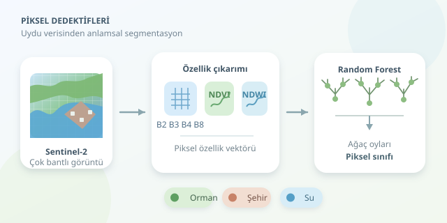

Bir uydu görüntüsüne bakarken göllerin mavisini, ormanların yeşilini ve şehirlerin karmaşasını kolayca ayırt edebiliriz. Bilgisayarın ise biraz dedektiflik eğitimi alması gerekir. Bu projede, çok bantlı görüntülerden özellikler çıkarıp her piksele orman, şehir veya su etiketi atayacağız. Üstelik başlangıç için dev bir derin öğrenme modeli gerekmiyor: Random Forest sağlam bir ilk durak!

``

## Segmentasyonun arkasındaki fikir

**Anlamsal segmentasyon**, görüntüdeki her pikselin bir sınıfa atanmasıdır. Nesne tespitinden farklı olarak yalnızca bir gölün çevresine kutu çizmez; gölün kapladığı pikselleri belirler. Burada problemi denetimli piksel sınıflandırması olarak ele alacağız.

Her piksel, farklı dalga boylarında ölçülen yansıtımlardan oluşan bir özellik vektörüdür. Model, etiketlenmiş örneklerle bu ölçümler arasındaki ilişkileri öğrenir. Random Forest, birçok karar ağacının oylarını birleştirir; böylece tek bir ağacın ezberleme eğilimini azaltır. Ancak komşuluk ilişkilerini doğrudan modellemez, dolayısıyla sonuçta küçük benekler oluşabilir.

## Önce veriyi doğru hazırlayalım

Örneğimiz, Sentinel-2 yüzey yansıtımı verilerinden hazırlanmış dört bantlı bir GeoTIFF kullanıyor. Bant sırası **B2, B3, B4, B8**, yani mavi, yeşil, kırmızı ve yakın kızılötesi olmalı. Bunlar doğal olarak 10 metre çözünürlüklüdür.

Bulutları ve gölgeleri kalite maskesiyle önceden dışlayın; dışlanan pikselleri NoData olarak kaydedin. Yansıtım ölçeğini ve varsa ofsetleri ürün metadatasından uygulayın. Aşağıdaki kod, bu işlemler tamamlanmış gerçek yansıtım değerlerini bekliyor; ham tamsayı ürünler için doğrudan kullanılmamalı.

Eğitim etiketleri aynı koordinat sisteminde, piksel boyutunda ve ızgarada bulunmalı. `etiket.tif` içinde `1=orman`, `2=şehir`, `3=su`, `0=etiketsiz` kullanacağız. Referansları arazi gözlemleri veya güvenilir haritalardan oluşturabilirsiniz.

| Sınıf | Tipik spektral ipucu | Karışabilecek yüzey |
|---|---|---|
| Orman | Yakın kızılötesinde güçlü yansıtım | Tarım alanları |
| Şehir | Değişken bant tepkileri | Çıplak toprak |
| Su | Yakın kızılötesinde düşük yansıtım | Koyu gölgeler |




## İki küçük indeks, büyük yardım

Bitki örtüsünü belirginleştiren NDVI ve suyu vurgulayan NDWI şöyle hesaplanır:

$$NDVI = \frac{NIR - Red}{NIR + Red}$$

$$NDWI = \frac{Green - NIR}{Green + NIR}$$

Sağlıklı bitkiler kırmızı ışığı soğururken yakın kızılötesini güçlü yansıtır. Su ise yakın kızılötesinde genellikle koyudur. İndeksler bu karşıtlıkları sıkıştırılmış özelliklere dönüştürür. Yine de tek bir eşik evrensel çözüm değildir; mevsim, bulanıklık ve yüzey türleri değerleri değiştirir.

## Python ile sınıflandırma

`numpy`, `rasterio` ve `scikit-learn` paketlerini kurduktan sonra aşağıdaki akışı kullanabilirsiniz. Etiketleriniz birden fazla uzamsal bloğa yayılmalı; eğitim bölümünde üç sınıf da temsil edilmelidir.

```python
import numpy as np
import rasterio
from sklearn.ensemble import RandomForestClassifier
from sklearn.model_selection import GroupShuffleSplit
from sklearn.metrics import classification_report

with rasterio.open("sentinel.tif") as src, rasterio.open("etiket.tif") as ref:
    if src.shape != ref.shape or src.crs != ref.crs or src.transform != ref.transform:
        raise ValueError("Görüntü ve etiket ızgaraları eşleşmiyor.")
    bands = src.read([1, 2, 3, 4], masked=True).astype("float32").filled(np.nan)
    labels = ref.read(1, masked=True).filled(0)
    profile = src.profile.copy()

blue, green, red, nir = bands
ndvi = (nir - red) / (nir + red + 1e-6)
ndwi = (green - nir) / (green + nir + 1e-6)
features = np.stack([blue, green, red, nir, ndvi, ndwi], axis=-1)
valid = np.isfinite(features).all(axis=-1)
training = valid & np.isin(labels, [1, 2, 3])

rows, cols = np.nonzero(training)
blocks_per_row = (labels.shape[1] + 255) // 256
groups = (rows // 256) * blocks_per_row + cols // 256
X, y = features[training], labels[training]
splitter = GroupShuffleSplit(n_splits=1, test_size=0.25, random_state=42)
train_idx, test_idx = next(splitter.split(X, y, groups))

if set(np.unique(y[train_idx])) != {1, 2, 3}:
    raise ValueError("Eğitim bölümünde bütün sınıflar bulunmalı.")

model = RandomForestClassifier(
    n_estimators=200, class_weight="balanced", n_jobs=-1, random_state=42
)
model.fit(X[train_idx], y[train_idx])
print(classification_report(
    y[test_idx], model.predict(X[test_idx]),
    labels=[1, 2, 3], target_names=["orman", "şehir", "su"], zero_division=0
))

segmentation = np.zeros(labels.shape, dtype="uint8")
segmentation[valid] = model.predict(features[valid])
profile.update(count=1, dtype="uint8", nodata=0, compress="lzw")
with rasterio.open("segmentasyon.tif", "w", **profile) as dst:
    dst.write(segmentation, 1)
```

Kod, dört bant ile iki indeksi birleştirir, modeli eğitir ve coğrafi referansı korunmuş bir sınıf haritası üretir. Küçük görüntüler için uygundur; büyük sahnelerde bellek tüketimini azaltmak amacıyla pencere bazlı okuma ve tahmin yapılmalıdır.

## Güzel harita, güvenilir sonuç mu?

Rastgele piksel ayırmak, birbirine benzeyen komşuları hem eğitim hem teste taşıyabilir. Bloklarla ayırma daha gerçekçidir; blok sınırlarında tampon bırakmak değerlendirmeyi güçlendirir. Sınıf bazlı F1 değerlerini inceleyin: yüksek toplam doğruluk, az bulunan su alanlarının başarısızlığını gizleyebilir.

Son olarak, bu model her geçerli pikseli üç sınıftan birine zorlar. Tarla, kar veya çıplak toprak varsa ek sınıflar tanımlayın. Haritayı QGIS üzerinde referanslarla karşılaştırın; piksel dedektifinizin gerçekten doğru iz sürdüğünü kontrol edin!
