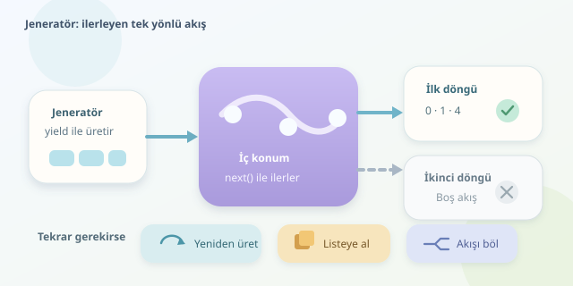

Python’da bir jeneratörü ilk döngüde gezersiniz, her şey harika çalışır. Aynı nesneyi ikinci döngüye soktuğunuzda ise ne sonuç vardır ne hata mesajı. Program sanki kahve molasına çıkmıştır! Aslında burada bir arıza yoktur: Jeneratörler, tüketildikçe ilerleyen ve kendiliğinden başa dönmeyen iterator nesneleridir. Gelin bu sessizliğin arkasındaki mekanizmayı inceleyelim.

``

## Iterable ile Iterator Aynı Şey Değildir

Bir **iterable**, üzerinden iterator elde edilebilen nesnedir. Liste bunun tanıdık örneğidir: `iter(liste)` çağrısı, baştan başlayabilen yeni bir iterator oluşturur. Listenin kendisi, dolaşım konumunu tutmaz; bu görev iterator’a aittir.

Bir **iterator** ise sıradaki öğenin hangisi olduğunu hatırlar. `next()` çağrıldığında ilerler; öğeler bittiğinde `StopIteration` yükseltir. Iterator üzerinde `iter()` çağrısı, aynı nesneyi döndürür. Dolayısıyla yeni bir döngü, yeni bir başlangıç konumu yaratmaz.

Jeneratör de bir iterator’dır. `yield`, fonksiyonun yürütülmesini askıya alır; sonraki `next()` çağrısı yürütmeyi kaldığı yerden sürdürür. Bunu kitaplıktan çok yürüyen bant gibi düşünün: Banttan aldığınız kutu, sonraki turda yeniden önünüze gelmez.

| Özellik | Liste | Jeneratör |
|---|---|---|
| Değerlerin hazırlanması | Genellikle önceden | İstendikçe |
| Döngü başlangıcı | Yeni iterator oluşturulur | Aynı iterator kullanılır |
| Baştan tekrar dolaşma | Mümkün | Aynı nesnede mümkün değil |
| İlerleme konumu | Ayrı iterator’da | Jeneratörün içinde |

## Sessiz Boşluğun Küçük Bir Gösterisi

Aşağıdaki fonksiyon, kareleri talep geldikçe üretir. Fonksiyonu çağırmak bütün kareleri hesaplamaz; çalıştırılmayı bekleyen bir jeneratör oluşturur:

```python
def kareler(sinir):
    for sayi in range(sinir):
        yield sayi ** 2

g = kareler(3)

for deger in g:
    print("İlk tur:", deger)

for deger in g:
    print("İkinci tur:", deger)

print(next(g, "Tükendi"))
```

İlk döngü `0`, `1` ve `4` değerlerini yazdırır. İkinci döngünün gövdesi hiç çalışmaz. Son satır ise `Tükendi` yazar; çünkü `next()` için bir varsayılan değer verdik.

Peki neden hata yok? `for`, iterator’dan değer isterken gelen `StopIteration` sinyalini **normal bitiş** olarak yorumlar. Bu sinyal kullanıcıya hata olarak gösterilmez. Varsayılan değer olmadan `next(g)` çağırırsanız, aynı durum açıkça bir istisna olarak görünür. Yani sessizlik, döngü protokolünün tasarlanmış davranışıdır.

## Tek Kullanımlılık Bir Kusur Değil, Tercihtir

Jeneratörler, tüm sonuçları bellekte saklamak zorunda kalmadan hesaplama yapmayı sağlar. Yukarıdaki gibi yalnızca sınırlı durum tutan bir üreticide, $n$ sonuç için yaklaşık ek bellek karşılaştırması şöyledir:

$$M_{liste}=O(n),\qquad M_{generator}=O(1)$$

Bu karşılaştırma, üretilen öğelerin boyutunu sabit kabul eder. Her jeneratörün toplam bellek tüketimi sabit değildir: İçeride büyük bir liste oluşturuyorsa veya kaynak veriyi bellekte tutuyorsa maliyet değişir. Kazanç, jeneratör etiketinden değil, gerçekten tembel üretim yapmaktan gelir.

## Tekrar Dolaşmak İçin Doğru Strateji

İki temel seçenek vardır: Hesaplamayı yeniden başlatmak veya sonuçları saklamak.

```python
def yeni_akis():
    return kareler(3)

for _ in range(2):
    print(list(yeni_akis()))

degerler = list(yeni_akis())
print(sum(degerler), max(degerler))
```

İlk bölüm, her turda yeni bir jeneratör oluşturur. İkinci bölüm, sonuçları bir kez listeye alır ve farklı işlemlerde tekrar kullanır. Listeye dönüştürmeyi jeneratör tükenmeden yapmalısınız; boş jeneratörden dolu liste çıkmaz!

| Yaklaşım | Avantaj | Bedel |
|---|---|---|
| Yeni jeneratör oluşturmak | Sonuçları saklamaz | Hesaplama tekrarlanır |
| `list()` ile saklamak | Kolay tekrar kullanım | Bellek tüketimi artar |
| `itertools.tee()` | Bağımsız tüketim konumları | Ara tampon büyüyebilir |

Kaynak zamanla değişiyorsa, yeniden üretimin aynı değerleri vereceği de garanti değildir. Dosya, ağ veya rastgelelik içeren akışlarda bu ayrım önemlidir.

## `tee()` Sihirli Bir Fotokopi Makinesi Değildir

İki tüketici aynı akışı farklı hızlarda okuyacaksa `tee()` kullanılabilir:

```python
from itertools import tee

ilk, ikinci = tee(kareler(3), 2)
print(list(ilk))
print(list(ikinci))
```

İki iterator aynı değerleri görür; fakat geride kalan tüketici için öğeler tamponda tutulur. Biri çok ilerlerse bellek kullanımı büyüyebilir. Bölme işleminden sonra özgün iterator yerine döndürülen iterator’ları kullanın.

## Son Tuzak: Kısmen Tüketmek

“Bir kez tüketilir” ifadesi, ilk döngü başladıktan sonra her şeyin kaybolduğu anlamına gelmez. Döngüden `break` ile çıkarsanız, sonraki döngü kalan öğelerden devam eder. `sum()` akışı tamamen tüketirken, `any()` uygun değeri bulunca durabilir. Hata ayıklarken çağırdığınız `list(g)` bile akışı bitirebilir.

Kısacası jeneratör bir koleksiyon değil, ilerleyen bir süreçtir. İkinci tur gerekiyorsa önce karar verin: Yeniden üretecek misiniz, saklayacak mısınız, yoksa tüketicileri ayıracak mısınız?
