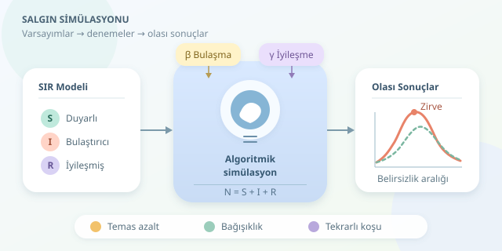

Bir hastalığın toplumda yayılması, birbirini tetikleyen olaylardan oluşur: Bir kişi enfekte olur, başkalarıyla karşılaşır ve bazılarına hastalığı bulaştırır. Bilgisayar simülasyonu, bu zinciri sanal bir laboratuvarda incelememizi sağlar. Üstelik zamanı hızlandırabilir, koşulları değiştirebilir ve aynı senaryoyu yüzlerce kez deneyebiliriz. Ancak ekranımızdaki eğri, geleceği gösteren sihirli bir kristal küre değildir!




``

## Önce mantık: SIR modeli

En yaygın başlangıç modellerinden biri **SIR** modelidir. Toplumu üç gruba ayırır:

- **S — Duyarlı:** Hastalığa yakalanabilecek kişiler.
- **I — Bulaştırıcı:** Hastalığı başkalarına aktarabilen kişiler.
- **R — İyileşmiş:** Bu modelde artık bulaştırmayan ve yeniden enfekte olmayan kişiler.

Doğum, ölüm ve göçü dışarıda bırakırsak toplam nüfus sabittir: $N=S+I+R$. İnsanlar önce S grubundan I grubuna, ardından R grubuna geçer. Bu, herkesin birbirine benzer olasılıkla temas ettiği varsayılan bir modeldir; gerçek hayattaki arkadaş çevreleri ve okul koridorları şimdilik sahne dışında kalır.

Modelin iki temel parametresi vardır. $\beta$, bulaşmayı belirleyen etkin temas hızıdır; $\gamma$ ise iyileşme hızıdır. İkisi de zamanın tersi birimine sahiptir. Sabit iyileşme hızı varsayımında ortalama bulaştırıcılık süresi $1/\gamma$ olur.

$$\frac{dS}{dt}=-\beta\frac{SI}{N},\qquad \frac{dI}{dt}=\beta\frac{SI}{N}-\gamma I,\qquad \frac{dR}{dt}=\gamma I$$

Bu denklemler, grupların değişim hızını anlatır. Yeni enfeksiyonlar hem duyarlı hem bulaştırıcı kişiler bulunduğunda oluşur; iyileşmeler ise bulaştırıcı grubunu küçültür.

Tamamen duyarlı bir toplumda temel üreme sayısı $R_0=\beta/\gamma$ olarak hesaplanır. Örneğin $\beta=0.3$ ve $\gamma=0.1$ için $R_0=3$ çıkar. Fakat duyarlı nüfus azaldıkça etkin üreme sayısı $R_e=R_0S/N$ düşer. Bu modelde $R_e<1$ olduğunda bulaştırıcı sayısının azalma eğilimi beklenir.

## Hangi model, hangi soru?

| Yaklaşım | Güçlü tarafı | Temel sınırlaması |
|---|---|---|
| SIR | Basit, hızlı, anlaşılır | Bulaştırıcılık öncesi dönemi içermez |
| SEIR | Enfekte ama henüz bulaştırıcı olmayan dönemi ekler | Daha fazla parametre gerektirir |
| Ajan tabanlı | Bireyleri ve temas ağlarını temsil eder | Veri ve hesaplama maliyeti yüksektir |

Denklemleri doğrudan çözmek düzgün eğriler üretir. Olasılıksal simülasyonda ise günlük sayılar dalgalanır. Özellikle başlangıçta az sayıda bulaştırıcı varsa, aynı parametrelerle bazı salgınlar büyüyebilir, bazıları erken sönebilir. Rastgelelik burada süs değil, modelin önemli bir parçasıdır.

## Python ile olasılıksal simülasyon

Aşağıdaki örnekte her adım çeyrek gündür. Bir duyarlı kişinin enfekte olma olasılığını $p=1-e^{-\beta(I/N)\Delta t}$, bir bulaştırıcının iyileşme olasılığını ise $q=1-e^{-\gamma\Delta t}$ olarak hesaplıyoruz. Ardından binom dağılımından geçiş sayıları çekiyoruz. NumPy için `pip install numpy` yeterlidir.

```python
import numpy as np

rng = np.random.default_rng(42)
N = 10_000
S, I, R = N - 10, 10, 0
beta, gamma, dt = 0.3, 0.1, 0.25
history = [(0.0, S, I, R)]

for step in range(1, int(120 / dt) + 1):
    p_infection = 1 - np.exp(-beta * I / N * dt)
    p_recovery = 1 - np.exp(-gamma * dt)

    infections = rng.binomial(S, p_infection)
    recoveries = rng.binomial(I, p_recovery)

    S -= infections
    I += infections - recoveries
    R += recoveries

    assert S + I + R == N
    assert min(S, I, R) >= 0
    history.append((step * dt, S, I, R))

peak = max(history, key=lambda row: row[2])
print("Zirve günü:", peak[0])
print("Zirvedeki bulaştırıcı sayısı:", peak[2])
```

Geçişler adımın başındaki sayılardan hesaplanır; yeni enfekte olanlar aynı adımda iyileşmez. Bu, sürekli zamanlı sürecin ayrık zaman yaklaşımıdır. Daha küçük adımlar genellikle yaklaşımı iyileştirir, fakat hesaplama yükünü artırır. Sabit rastgelelik tohumu sonucu tekrarlanabilir kılar; `assert` ifadeleri de nüfus muhasebesini denetler.

## Deney tasarlamak, tek eğriden değerlidir

Şimdi sanal laboratuvarın düğmeleriyle oynayabiliriz:

- **Temasları azalt:** Belirli bir günden sonra $\beta$ değerini düşür; zirvenin yüksekliğini ve zamanını karşılaştır.
- **Başlangıç bağışıklığını değiştir:** Kusursuz koruma varsayımıyla bazı kişileri başlangıçta R grubuna yerleştir.
- **Tekrarlı koşular yap:** Farklı tohumlarla yüzlerce simülasyon çalıştır; yalnızca ortalamayı değil, yüzdelik aralıkları da raporla.

Zirvedeki bulaştırıcı sayısı, toplam enfekte olan kişi sayısıyla aynı değildir. Ayrıca daha alçak bir zirve, salgının daha kısa süreceği anlamına gelmez. Ölçütü araştırma sorusuna göre seçmek gerekir.

## Modelin sınırlarını unutma

Buradaki sayılar varsayımsaldır. Yaş, davranış değişimi, mevsimsellik, yeniden enfeksiyon ve eksik bildirim sonuçları değiştirebilir. Gerçek verilerle çalışırken parametre tahmini, duyarlılık analizi ve bağımsız doğrulama gerekir. İyi simülasyon kesinlik satmaz; varsayımlar açıkça belirtilirse, hangi koşullarda hangi sonuçların mümkün olduğunu anlamamıza yardım eder.
