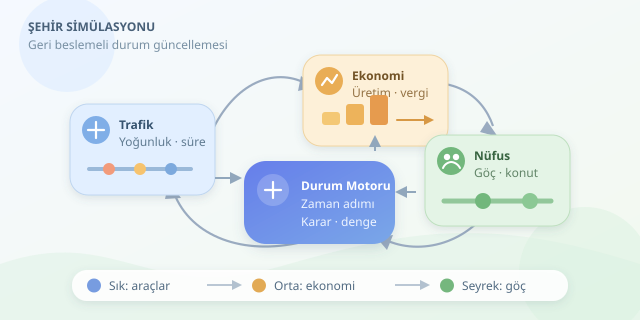

Bir kavşak kilitlenir, fabrikalar yavaşlar, vergi gelirleri düşer ve vatandaşlar taşınmaya başlar. Şehir simülasyonlarında küçük bir trafik sorunu, belediye bütçesine kadar uzanabilir. Peki bilgisayar bu zinciri nasıl hesaplar? SimCity benzeri oyunların perde arkasında, birbirine bağlanan matematiksel modeller ve algoritmalar bulunur. Aşağıdaki yaklaşım, belirli bir oyunun kaynak kodunu değil, bu tür simülasyonlarda kullanılabilecek genel tasarım ilkelerini anlatır.

``

## Şehir, birbirine bağlı durum değişkenleridir

Simülasyonun temelinde bir **durum vektörü** vardır: nüfus, iş sayısı, konut kapasitesi, yol yoğunluğu, fiyatlar ve belediye kasası. Oyun zamanı ilerledikçe bu değerler güncellenir. Genel çerçeve $S_{t+1}=F(S_t, A_t, \Delta t)$ şeklindedir. Burada $A_t$ oyuncunun kararlarını, $\Delta t$ ise simülasyon adımının süresini temsil eder.

Her sistem aynı sıklıkla çalışmak zorunda değildir. Araç hareketleri sık, göç hesapları daha seyrek güncellenebilir. Böylece bilgisayar, her karede bütün şehri yeniden hesaplamak yerine görevleri zaman dilimlerine dağıtır.

| Sistem | Temel girdiler | Başlıca çıktılar |
|---|---|---|
| Trafik | Yol ağı, yolculuk talebi | Seyahat süresi, kuyruk |
| Ekonomi | İşgücü, erişim, talep | Üretim, fiyat, vergi |
| Nüfus | İş, konut, hizmetler | Göç, hane sayısı |

## Trafik: En kısa yol her zaman en hızlısı değildir

Yol ağı bir graf olarak modellenebilir. Kavşaklar düğüm, yol parçaları kenardır. Dijkstra veya uygun bir sezgisel fonksiyonla A*, başlangıç ile hedef arasındaki düşük maliyetli rotayı bulabilir. Kenar maliyeti yalnızca mesafe değildir; seyahat süresi, geçiş ücreti ve ulaşım tercihi de hesaba katılabilir.

Yoğunluğun süreyi nasıl artırdığını göstermek için yaygın bir ulaşım modelinden yararlanabiliriz:

$$T=T_0\left[1+0.15\left(\frac{q}{c}\right)^4\right]$$

Burada $T_0$ boş yoldaki süre, $q$ trafik akışı, $c$ kapasitedir. Akış ve kapasite aynı zaman birimiyle ölçülmelidir. Kapasiteye yaklaşınca gecikmenin hızla büyümesi, oyuncuya tanıdık gelecektir: Birkaç ekstra araç, kavşağı sabır testine dönüştürür.

Ancak bu formül tek başına araç kuyruğunu veya kavşak tıkanmasının geriye yayılmasını modellemez. Daha ayrıntılı simülasyonlarda yol hücreleri, kuyruklar ve sinyal süreleri gerekir. Ayrıca tüm sürücüler aynı anda rota değiştirirse trafik iki yol arasında salınabilir; kararları zamana yaymak bunu azaltır.

## Ekonomi: Para, erişilebilirlikle birlikte akar

Fabrikaya çalışan ulaşamıyorsa boş iş ilanı üretim yapmaz. Bu nedenle ekonomik çıktı, yalnızca bina sayısından değil, etkin işgücünden hesaplanmalıdır. Basitçe $Y=aL_{etkin}$ yazabiliriz: $a$ verimlilik, $L_{etkin}$ ulaşım ve istihdam koşullarından etkilenen işgücüdür.

Talep arzı aşınca fiyatların yükselmesi, işletmelerin büyümesini teşvik edebilir. Fakat fiyatları tek adımda sert değiştirmek dengesizlik yaratır. Küçük güncellemeler, gecikmeli yatırımlar ve sınırlı üretim kapasitesi daha inandırıcı sonuç verir. Belediye bütçesi de $B_{t+1}=B_t+Vergi-Gider$ ilişkisiyle bu zincire bağlanır.

## Nüfus: Şehir neden cazip görünür?

Göç modeli, iş bulma olasılığı, konut maliyeti, hizmet kalitesi ve yolculuk süresini bir çekicilik puanında birleştirebilir. Pozitif puan nüfusu artırırken negatif puan ayrılmaları tetikler. Konut kapasitesi ise büyümenin fiziksel sınırıdır.

| Yaklaşım | Güçlü yanı | Bedeli |
|---|---|---|
| Bireysel ajanlar | Farklı davranışlar, görünür yolculuklar | Yüksek işlem maliyeti |
| Toplulaştırılmış model | Büyük şehirlerde hızlı hesaplama | Ayrıntıların ortalamaya dönüşmesi |
| Hibrit model | Görsellik ve ölçek arasında denge | Sistemleri eşleştirme zorluğu |

## Küçük bir simülasyon adımı

Aşağıdaki Python fonksiyonu, bir günlük adımda trafik gecikmesini üretime, üretimi vergiye ve istihdamı göçe bağlar. Nüfusun yarısının işgücüne katıldığı varsayılmıştır; katsayılar öğretici amaçlıdır.

```python
def simulate_day(state):
    s = state.copy()
    population = s["population"]
    workers = population * 0.5
    employed = min(workers, s["jobs"])

    trips = population * 0.6
    capacity = max(1, s["road_capacity"])
    travel = 10 * (1 + 0.15 * (trips / capacity) ** 4)

    accessibility = 10 / travel
    output = employed * 2 * accessibility
    revenue = output * s["price"] * s["tax_rate"]
    s["budget"] += revenue - s["daily_cost"]

    employment_rate = employed / max(1, workers)
    appeal = employment_rate - 0.65 - 0.02 * (travel - 10)
    migration = round(population * 0.01 * appeal)
    s["population"] = max(
        0, min(s["housing"], population + migration)
    )
    s["travel_time"] = travel
    return s
```

Fonksiyon eski durumu kopyalayarak hesaplama sırasında girdilerin değişmesini önler. Üretim kaybı burada basit bir erişim katsayısıyla temsil edilir; gerçekçi bir modelde sektörler, gelir grupları ve toplu taşıma ayrıştırılabilir.

## Asıl mesele: Dengeli geri besleme

Daha fazla nüfus daha fazla trafik, trafik daha düşük üretim, düşük üretim de göç yaratabilir. Bu döngüleri test etmek için sabit rastgelelik tohumları, zaman serileri ve uç senaryolar kullanılır. Başarılı şehir simülasyonu, her vatandaşı kusursuz hesaplayan değil; oyuncunun kararlarına anlaşılır, tutarlı ve eğlenceli karşılık veren sistemdir.
