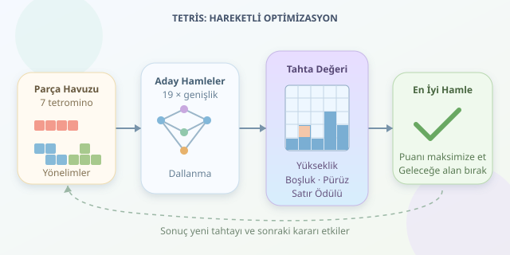

Tetris oynarken yaptığımız şey yalnızca düşen parçaları sağa sola taşımak değildir. Aslında her hamlede küçük bir kombinatorik problem çözer, gelecekteki belirsizliğe karşı alan yönetimi yaparız. Ekrandaki kuyuyu bir depo, parçaları da şekli değişmeyen kutular gibi düşünün: Depocu sizsiniz, fakat kamyon sürekli yeni yük getiriyor ve mola düğmesi pek yardımcı olmuyor!

``

## Dört kare, kaç farklı şekil?

Tetris parçaları, kenarlarından birleşen dört birim kareden oluşan **tetrominolardır**. Döndürme ve yansıtmayı aynı kabul ederseniz beş temel şekil vardır. Ancak standart Tetris, ayna görüntülerini ayrı parçalar olarak kullanır; böylece I, O, T, S, Z, J ve L olmak üzere yedi parçaya ulaşırız.

Dönüşler de seçenek sayısını büyütür. O parçasının bir, I, S ve Z parçalarının ikişer, T, J ve L parçalarının dörder farklı yönelimi bulunur. Toplamda 19 yönelim elde edilir. Üstelik her yönelim, farklı sütunlarda farklı sonuçlar doğurur. Kombinatorik patlama böyle başlar: Küçük seçenek kümeleri, art arda kararlarla dev bir arama ağacına dönüşür.

## Alan hesabı neden tek başına yetmez?

Her parça dört hücre kaplar. Bu nedenle, çizgi silmenin olmadığı bir kaplama probleminde tamamen doldurulacak alan için gerekli koşul şudur:

$$A=4n$$

Ancak alanın dörde bölünmesi, döşemenin mümkün olduğunu garanti etmez. Bölgenin şekli, kullanılabilen parçalar ve bağlantılar da önemlidir. Dört hücrelik düz bir koridorun alanı uygundur; fakat elinizde yalnızca O parçaları varsa onu dolduramazsınız.

Bir başka araç, tahtayı satranç tahtası gibi boyamaktır. Örneğin O parçası iki siyah ve iki beyaz hücre kaplarken T parçası üçe bir dağılım gösterebilir. Böyle değişmezler, bazı imkânsız yerleşimleri denemeden elemenizi sağlar. Matematik burada sabırlı bir güvenlik görevlisi gibi davranır: Uygun olmayan çözümü kapıdan çevirir.

## Tetris, hareketli bir paketleme problemidir

Klasik paketleme problemleri, nesneleri sınırlı bir alana verimli biçimde yerleştirmeyi amaçlar. Tetris buna yerçekimi, geliş sırası ve satır silme kurallarını ekler. Dolayısıyla geometrik olarak sığan bir parça, oyun içindeki hareket kurallarıyla hedef konuma ulaşamayabilir.

Tahtanın genişliği $W$, dolu hücre sayısı $U_t$ ve hamlede silinen satır sayısı $r$ ise:

$$U_{t+1}=U_t+4-Wr$$

Bu denklem doluluğu takip eder; fakat tahtanın sağlığını ölçmez. Aynı sayıda dolu hücreye sahip iki tahtadan biri düzgün bir yüzey, diğeri deliklerle dolu bir labirent olabilir. **Alan optimizasyonu, yalnızca boş hücre miktarını değil, boşluğun kullanılabilirliğini de yönetmektir.**

## Bilgisayar iyi hamleyi nasıl seçer?

Bir bot, aday hamleleri simüle edip oluşan tahtaları puanlayabilir. Yaygın ölçütler toplam sütun yüksekliği, kapalı boşluk sayısı, yüzey pürüzlülüğü ve silinen satırlardır.

| Yaklaşım | Güçlü tarafı | Temel sınırlaması |
|---|---|---|
| Anlık satır silme | Hızlı ödül üretir | Gelecekteki boşlukları kaçırabilir |
| Sezgisel puanlama | Hızlı ve dengelidir | Ağırlık seçimine bağımlıdır |
| Çok hamleli arama | Geleceği hesaba katar | Hesaplama maliyeti büyür |




Aşağıdaki Python fonksiyonu, satırlar silindikten sonraki tahtayı değerlendirir. Tahta boş olmayan dikdörtgen bir matristir; `1` dolu, `0` boş hücreyi gösterir ve ilk satır üsttedir.

```python
def degerlendir(tahta, silinen=0):
    h, w = len(tahta), len(tahta[0])
    yukseklikler = []
    bosluk = 0

    for x in range(w):
        ilk = h
        for y in range(h):
            if tahta[y][x]:
                ilk = min(ilk, y)
            elif ilk < h:
                bosluk += 1
        yukseklikler.append(h - ilk)

    puruz = sum(
        abs(a - b)
        for a, b in zip(yukseklikler, yukseklikler[1:])
    )
    return (10 * silinen - 0.5 * sum(yukseklikler)
            - 3 * bosluk - 0.8 * puruz)
```

Fonksiyon, üstünde dolu hücre bulunan boşlukları cezalandırır. Komşu sütun yükseklikleri arasındaki farklar da pürüzlülüğü oluşturur. Bot, geçerli hamlelerin sonuçları arasında en yüksek puanı seçer. Katsayılar örnektir; oyun kurallarına ve denemelere göre ayarlanmalıdır. Bu puanlama kusursuz çözüm değil, hızlı bir sezgiseldir.

## Neden bütün olasılıkları denemiyoruz?

$W$ genişliğinde ve $H$ yüksekliğinde bir tahtanın ikili doluluk modelinde $2^{WH}$ farklı düzeni vardır; bunların hepsi oyunda erişilebilir değildir. Yalnızca düz düşüşleri inceleyen basitleştirilmiş bir modelde bile her parça için yaklaşık $19W$ adayla karşılaşabilirsiniz. Arama derinliği arttıkça dallanma maliyeti hızla büyür.

Bazı genelleştirilmiş çevrimdışı Tetris karar problemleri NP-zordur. Bu, günlük oyundaki her hamlenin çözülemez olduğu anlamına gelmez; genel durumlarda verimli kesin çözüm bulmanın zorluğunu anlatır.

Sonuçta iyi oyuncu, bugünün satırını silerken yarının parçasına da yer bırakır. Retro ekranın asıl numarası budur: Dört kareyle başlayıp sizi fark ettirmeden algoritma tasarımcısına dönüştürmek.
