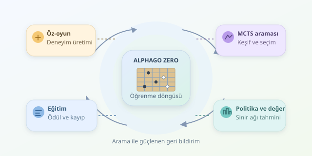

Bir bilgisayarın Go tahtasında dünya şampiyonuna meydan okuması, yalnızca hızlı hesaplama meselesi değildi. Asıl devrim, deneyimden öğrenmek ve kendi hatalarını yeni derslere dönüştürmekti. AlphaGo bu dönüşümün simgesi oldu; AlphaGo Zero ise insan oyunlarını başlangıç noktası olarak kullanmadan aynı yolculuğu daha ileri taşıdı. Peki bu dijital ustalık nasıl doğdu?




``

## Go neden böylesine zor?

Go, siyah ve beyaz taşlarla alan kontrolü kurmaya dayanan bir strateji oyunudur. Kurallar görece basittir, ancak 19×19 tahtadaki olası yasal konumların sayısı yaklaşık $10^{170}$ mertebesindedir. Bütün olasılıkları taramak, okyanusu çay kaşığıyla boşaltmaya benzer.

Üstelik iyi bir hamle hemen ödül getirmeyebilir. Bugün yapılan küçük bir fedakârlık, onlarca hamle sonra büyük bir bölge kazandırabilir. Dolayısıyla sistemin yalnızca mevcut taşları değil, gelecekteki sonuçları değerlendirmesi gerekir.

## Pekiştirmeli öğrenmenin temel mantığı

Pekiştirmeli öğrenmede bir **ajan**, çevreyle etkileşerek karar vermeyi öğrenir. Go için durum $s$ tahta konumunu, eylem $a$ taş yerleştirmeyi veya pas geçmeyi temsil eder. Politika $\pi(a\vert s)$, hangi durumda hangi hamlenin seçileceğini belirler.

Amaç, beklenen toplam ödülü büyütmektir:

$$J(\theta)=\mathbb{E}_{\pi_\theta}\left[\sum_{t=0}^{T}\gamma^t r_t\right]$$

Burada $\theta$ model parametreleri, $r_t$ ödül, $\gamma$ gelecekteki ödüllerin ağırlığıdır. Sonlu Go karşılaşmalarında $\gamma=1$ kullanılabilir. Basitleştirilmiş bir düzende ara hamleler ödülsüzdür; sonuç, ilgili oyuncunun açısından galibiyette $+1$, yenilgide $-1$ olur.

| Kavram | Go karşılığı | Öğrenmedeki görevi |
|---|---|---|
| Durum | Tahta ve oyun bağlamı | Karara temel sağlar |
| Politika | Hamle olasılıkları | Aday hamleleri önerir |
| Değer | Beklenen oyun sonucu | Konumun geleceğini değerlendirir |
| Ödül | Maç sonucu | Öğrenmenin hedefini belirler |

## AlphaGo ile AlphaGo Zero aynı şey değil

2016’da Lee Sedol’u 4–1 yenen AlphaGo, önce insan uzmanların oyunlarından öğrenmişti. Ardından kendi kendine oynayarak politikasını geliştirdi; değer ağı da öz-oyun verilerinden yararlandı. Yani orijinal başarıyı tamamen insan verisinden bağımsızmış gibi anlatmak yanlış olur.

2017’de tanıtılan AlphaGo Zero ise insan oyunlarını kullanmadan, oyun kuralları ve öz-oyun üzerinden öğrendi. Politika ve değer tahminlerini tek sinir ağında birleştirdi.

| Özellik | AlphaGo | AlphaGo Zero |
|---|---|---|
| Başlangıç verisi | İnsan oyunları | İnsan oyunları yok |
| Ağ yapısı | Ayrı politika ve değer ağları | Birleşik politika-değer ağı |
| Gelişim | İnsan verisi ve öz-oyun | Öz-oyun |

## Arama, sezgiyi nasıl güçlendirir?

Sinir ağı tek başına son sözü söylemez. **Monte Carlo Ağaç Araması**, yani MCTS, aday hamlelerin devamlarını araştırır. Politika tahmini aramayı umut verici dallara yönlendirirken değer tahmini ulaşılan konumları değerlendirir.

Arama, daha önce başarılı görünen hamleleri kullanmak ile yeterince incelenmemiş hamleleri keşfetmek arasında denge kurar. Sonunda ziyaret sayılarından bir hamle dağılımı elde edilir. Ağın ilk önerisi böylece aramayla iyileştirilir; bu dağılım, sonraki eğitimin hedefi olur. Öğrenci kendi analizlerinden ders çıkarır!

## Python ile öz-oyun iskeleti

Aşağıdaki kod, hazır bir Go ortamı ve MCTS ajanı varsayar. Tam AlphaGo uygulaması değildir; eğitim örneklerinin nasıl toplandığını gösterir. `search`, pas dâhil yasal hamleler üzerinde normalize edilmiş olasılıklar döndürmelidir.

```python
import numpy as np


def self_play(env, agent):
    env.reset()
    history = []

    while not env.done:
        player = env.current_player  # +1 veya -1
        state = env.canonical_state().copy()
        policy = agent.search(env)
        history.append((state, policy.copy(), player))

        action = np.random.choice(
            env.action_size, p=policy
        )
        env.step(action)

    winner = env.winner()  # +1, -1 veya beraberlikte 0
    return [
        (state, policy, float(winner * player))
        for state, policy, player in history
    ]
```

Her kayıt, bir konumu, aramanın hamle dağılımını ve o konumdaki oyuncunun sonucunu saklar. `canonical_state`, tahtayı sıradaki oyuncunun bakış açısından kodlar. Sonucun oyuncuyla çarpılması önemlidir: aynı maç, kazanan için olumlu, kaybeden için olumsuz örnektir.

## Deneyimden ustalığa

AlphaGo Zero yaklaşımında eğitim kaybı üç parçayı birleştirir:

$$L=(z-v)^2-\sum_a\pi(a)\log p(a)+c\lVert\theta\rVert^2$$

İlk terim değer tahminini gerçek sonuca yaklaştırır. İkinci terim ağ politikasını MCTS dağılımına yaklaştırır. Son terim ağırlıkları düzenler. Oyunlar üretildikçe ağ güncellenir, güçlenen ağ daha kaliteli aramalar yapar ve döngü sürer.

Ancak başarı sınırsız değildir: Go’nun kuralları açık, sonuçları ölçülebilirdir ve deneyim üretmek hesaplama ister. AlphaGo’nun dersi, bütün problemleri çözen sihirli bir formül değil; **öğrenme, arama ve geri bildirimin birlikte insan uzmanlığını aşabilecek kadar güçlü olabilmesidir**.
