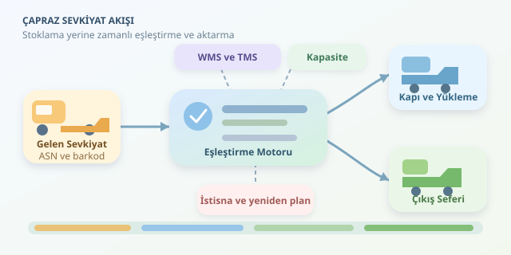

Bir kamyon depoya yanaşıyor, paletler indiriliyor ve ürünler raflara yerleşmeden başka bir kamyona yükleniyor. Kulağa lojistik sihirbazlığı gibi geliyor, değil mi? Çapraz sevkiyat, yani cross-docking, tam olarak bu akışı hedefler. Ancak gösterinin yıldızı forklift değil; doğru ürünü, doğru zamanda, doğru çıkış aracına yönlendiren yazılımdır.
``

## Temel Mantık: Depolamak Yerine Akışı Yönetmek

Geleneksel depolamada ürün kabul edilir, stok alanına taşınır, sipariş geldiğinde toplanır ve sevk edilir. Çapraz sevkiyatta ise gelen ürünün çıkış planı mümkün olduğunca önceden bellidir. Yazılım, giriş sevkiyatlarını müşteri siparişleriyle veya dağıtım noktalarıyla eşleştirir.

Buradaki “bekletilmeden” ifadesi mutlak sıfır bekleme anlamına gelmez. Kontrol, ayrıştırma ve araç senkronizasyonu için kısa süreli tampon alanlar gerekebilir. Amaç, uzun süreli stoklamayı ortadan kaldırmaktır. Bazı operasyonlarda palet doğrudan aktarılırken bazılarında koliler farklı mağazalar için yeniden gruplanır.

| Boyut | Geleneksel depo | Çapraz sevkiyat |
|---|---|---|
| Ana odak | Stok yönetimi | Zaman ve akış yönetimi |
| Ürün hareketi | Raflama ve toplama | Ayrıştırma ve aktarma |
| Kritik bilgi | Stok konumu | Varış ve kalkış zamanı |
| Temel risk | Stok doğruluğu hatası | Bağlantının kaçırılması |

## Teorik Altyapı: Bir Eşleştirme ve Çizelgeleme Problemi

Operasyon, iki taraflı bir eşleştirme problemi gibi düşünülebilir: Bir tarafta gelen ürün partileri, diğer tarafta çıkış araçları vardır. Fakat hedef adresin uyuşması tek başına yetmez. Araç kapasitesi, yükleme süresi, kapı müsaitliği ve ürünün sıcaklık gereksinimi de hesaba katılmalıdır.

Basitleştirilmiş bir optimizasyon hedefi şöyle yazılabilir:

$$\min C = \alpha \sum_i W_i + \beta \sum_i L_i$$

Burada $W_i$ partinin aktarmaya hazır olduktan sonraki bekleme süresi, $L_i$ ise hedeflenen çıkış zamanına göre gecikmesidir. $\alpha$ ve $\beta$, bu süreleri ortak bir maliyet ölçeğine dönüştüren ağırlıklardır. Gecikmenin ticari bedeli yüksekse ikinci ağırlık artırılır. Ancak kapasite ve güvenlik gibi sert kısıtlar, maliyet düşsün diye ihlal edilemez.

## Yazılım Sahada Nasıl Çalışır?

**Ön bildirim:** Tedarikçiden ASN, yani ön sevkiyat bildirimi alınır. Ürün, miktar, taşıma birimi ve tahmini varış bilgileri sisteme girer.

**Planlama:** WMS depo içi hareketleri, TMS ise taşıma planını yönetir. Entegrasyon katmanı bunları birleştirerek ürünleri uygun çıkış seferlerine ve aktarma kapılarına atar.

**Doğrulama:** Kabul sırasında barkod veya RFID okutulur. Beklenen miktarla fiziksel miktar karşılaştırılır; eksik, hasarlı ya da yanlış ürünler istisna akışına alınır.

**Yönlendirme:** El terminali operatöre aktarım alanını gösterir. Yükleme okutması tamamlanınca sevkiyat kaydı güncellenir ve ilgili sistemlere olay gönderilir. Böylece dijital planın sahada gerçekten uygulanıp uygulanmadığı anlaşılır.

## Python ile Küçük Bir Planlayıcı

Aşağıdaki örnek, hazır partileri aynı hedefe giden, zaman penceresine uyan ve yeterli ağırlık kapasitesi bulunan araçlara atar. `hazir`, `kalkis` ve `son_kalkis` değerleri aynı zaman dilimindeki `datetime` nesneleri olmalıdır.

```python
def eslestir(partiler, araclar):
    kalan = {a["id"]: a["kapasite_kg"] for a in araclar}
    plan, istisnalar = [], []

    for parti in sorted(partiler, key=lambda p: p["hazir"]):
        uygun = [
            a for a in araclar
            if a["hedef"] == parti["hedef"]
            and parti["hazir"] <= a["kalkis"] <= parti["son_kalkis"]
            and kalan[a["id"]] >= parti["kg"]
        ]

        if not uygun:
            istisnalar.append(parti["id"])
            continue

        arac = min(uygun, key=lambda a: a["kalkis"])
        kalan[arac["id"]] -= parti["kg"]
        plan.append((parti["id"], arac["id"]))

    return plan, istisnalar
```

Bu, en erken uygun kalkışı seçen açgözlü bir sezgiseldir; küresel optimumu garanti etmez. `hazir` zamanı, gerekli kontrol ve hazırlık işlemlerinin tamamlanmasını temsil eder. Atanamayan partileri gizlemek yerine istisna listesinde döndürmesi önemlidir: Operatör alternatif sefer planlayabilir.

Gerçek sistemde hacim, palet pozisyonu, kapı çakışmaları ve yükleme süreleri de modellenmelidir. Daha karmaşık senaryolarda karma tamsayılı programlama veya kısıt programlama kullanılabilir.

## Üretimde Asıl Sınav: Gecikmeler ve Veri Tutarlılığı

Giriş kamyonu geciktiğinde yazılım kalan bağlantıları yeniden değerlendirmelidir. Ancak her güncellemede bütün planı değiştirmek, sahayı dijital sandalye kapmacaya çevirebilir. Başlamış yüklemeleri sabitlemek ve yalnızca etkilenen partileri yeniden planlamak daha kontrollü bir yaklaşımdır.

Aynı barkodun tekrar okutulması stok hareketini iki kez oluşturmamalıdır. Olay kimlikleriyle idempotent işlem yapmak, eşzamanlı kapasite rezervasyonlarını veritabanı işlemleriyle korumak ve değişiklikleri denetim kaydına yazmak temel gereksinimlerdir.

Başarıyı ortalama bekleme süresi, zamanında çıkış oranı, yanlış yükleme oranı ve araç doluluğuyla ölçün. Yalnızca hızlanmak yetmez; yanlış kamyona hızlı yüklenen palet, sonuçta daha hızlı kaybolmuş sayılmaz. İyi çapraz sevkiyat yazılımı, hızı doğrulukla birlikte yönetir.



