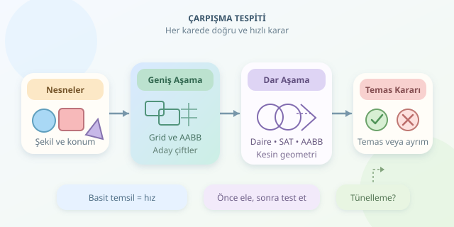

Karakteriniz duvardan geçiyor, mermiler hedefi delmeden kayboluyor veya kutular birbirinin içine yerleşiyorsa, oyun dünyanızın trafik polisi biraz uyukluyor olabilir. Çarpışma tespiti, nesnelerin geometrik olarak temas edip etmediğini belirler. İşin püf noktası yalnızca doğru cevabı bulmak değil, bunu her karede binlerce nesne için yeterince hızlı yapabilmektir.

``

## Önce Geometri, Sonra Performans

Bir nesnenin ekranda görünen şekliyle çarpışma geometrisi aynı olmak zorunda değildir. Karmaşık bir karakter modeli yerine daire, kutu veya kapsül kullanabilirsiniz. Bu temsil, hesaplama maliyetini düşürür; ancak görünür şekle göre yaklaşık sonuçlar üretebilir. Dolayısıyla ilk kararınız, oyunun ne kadar geometrik hassasiyet gerektirdiğidir.

Her nesneyi diğerleriyle karşılaştırırsanız test sayısı $n(n-1)/2$ olur. Bu, $O(n^2)$ büyüme demektir: nesne sayısını ikiye katlamak, iş yükünü yaklaşık dört katına çıkarır.

| Temsil | Güçlü yanı | Sınırlaması |
|---|---|---|
| Daire / küre | Hızlı mesafe testi | Uzun nesnelerde kaba yaklaşım |
| AABB | Basit karşılaştırmalar | Dönmüş nesnelerde boşluk bırakır |
| Dışbükey çokgen | Daha hassas sınırlar | Daha fazla geometrik işlem |

## AABB: Kutularla Hızlı Başlangıç

**Axis-Aligned Bounding Box**, kenarları koordinat eksenlerine paralel bir sınırlayıcı kutudur. İki kutunun çarpışması için hem yatay hem dikey aralıklarının örtüşmesi gerekir. Bir eksende ayrılıyorlarsa, diğer eksene bakmadan sonucu söyleyebilirsiniz.

Aşağıdaki Python kodu, dünya koordinatlarındaki iki kutuyu test eder. Sınırların doğru sıralandığını, yani minimum değerlerin maksimumlardan büyük olmadığını varsayar:

```python
from dataclasses import dataclass

@dataclass(frozen=True)
class AABB:
    min_x: float
    min_y: float
    max_x: float
    max_y: float

def intersects(a: AABB, b: AABB) -> bool:
    separated_x = a.max_x < b.min_x or b.max_x < a.min_x
    separated_y = a.max_y < b.min_y or b.max_y < a.min_y
    return not (separated_x or separated_y)

player = AABB(0, 0, 2, 3)
wall = AABB(2, 1, 4, 5)
print(intersects(player, wall))  # True: kenarlar temas ediyor
```

Burada kenar teması çarpışma sayılır. Yalnızca pozitif alanlı örtüşme istiyorsanız ayırma karşılaştırmalarını `<=` yapabilirsiniz. Bu küçük tercih, platform oyunlarında zeminde durma davranışını bile etkileyebilir!

## Daireler: Karekökü Emekliye Ayırın

İki dairenin merkezleri arasındaki uzaklık, yarıçaplarının toplamından büyük değilse daireler çarpışır. Ancak uzaklığı hesaplamak için karekök almak şart değildir:

$$(x_1-x_2)^2 + (y_1-y_2)^2 \le (r_1+r_2)^2$$

Her iki taraf da negatif olmadığından, karelerini karşılaştırmak eşdeğerdir. Böylece gereksiz karekök işleminden kaçınırsınız. Bu yöntem toplar, basit düşmanlar ve yakınlık kontrolleri için kullanışlıdır. Üç boyutta aynı mantık kürelere uygulanır; yalnızca $z$ farkının karesi eklenir.

## SAT: Dönen Nesnelerin Dedektifi

**Separating Axis Theorem**, iki dışbükey çokgenin çarpışmadığını göstermek için onları ayıran bir eksen arar. İki boyutta her iki çokgenin kenarlarına dik yönler aday eksenlerdir. Köşeleri bu yönlere izdüşürerek minimum ve maksimum değerlerden aralıklar oluşturursunuz.

İzdüşümün temel işlemi noktasal çarpımdır: $p = v \cdot a$. Herhangi bir eksende aralıklar ayrılıyorsa çarpışma yoktur. Bütün aday eksenlerde örtüşme varsa çokgenler kesişir; temasın dahil edilmesi yine karşılaştırma seçiminize bağlıdır.

SAT, dönen kutularda AABB’den daha hassastır. Ancak içbükey şekillere doğrudan uygulanmaz; önce dışbükey parçalara ayırmak gerekir. Ayrıca sıfır uzunluklu kenarlar gibi bozuk geometrileri temizlemelisiniz.

## Asıl Kazanç: Gereksiz Testleri Eleme

Pratik sistemler iki aşama kullanır. **Broad phase**, çarpışma ihtimali bulunan çiftleri seçer; **narrow phase**, bu adaylara kesin geometrik test uygular. AABB ilk aşamada kaba sınır, ikinci aşamada ise kutu biçimli nesnenin gerçek çarpışma şekli olabilir.

| Yaklaşım | Uygun senaryo | Dikkat edilmesi gereken |
|---|---|---|
| Uniform grid | Benzer boyutlu nesneler | Hücre boyutu seçimi |
| Quadtree | Bölgesel yoğunluğu değişen 2B dünya | Güncelleme maliyeti |
| Sweep and prune | Hareketi görece tutarlı sahneler | Yoğun örtüşen aralıklar |

Grid kullanırken nesneyi kapladığı bütün hücrelere ekleyin; yalnızca merkez hücresi yeterli değildir. Birden fazla hücrede bulunan çiftleri tekilleştirin. Bu yöntemler çoğu sahnede işi azaltır, fakat kötü dağılımlarda yine karesel maliyete yaklaşabilir.

## Hızlı Mermiler ve Son Kontroller

Ayrık çarpışma tespiti yalnızca belirli zamanlardaki konumlara bakar. Hızlı bir mermi, iki kare arasında ince bir duvarı tamamen geçebilir: buna **tünelleme** denir. Sürekli çarpışma tespiti, hareket boyunca ilk temas zamanını araştırır; swept testler bunun için kullanılır.

Son olarak temas kurallarını tutarlı belirleyin, kayan nokta toleranslarını dünya ölçeğine göre seçin ve çarpışma şekillerini ekranda çizdirin. Görünmez trafik polisini denetlemenin en iyi yolu, ona görünür bir üniforma giydirmektir!
