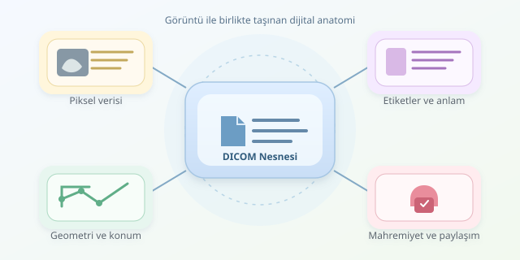

Bir tomografi görüntüsünü sıradan bir fotoğraf gibi saklasaydık ne kaybederdik? Pikselin hastanın neresine ait olduğunu, hangi cihazla üretildiğini ve parlaklığının fiziksel anlamını! DICOM, bu bilgileri görüntüyle birlikte taşıyan ortak dildir. Onu, yalnızca fotoğrafı değil, fotoğrafın teknik pasaportunu da saklayan bir zarf gibi düşünebilirsiniz.

``

## DICOM yalnızca bir dosya uzantısı değildir

**DICOM**, “Digital Imaging and Communications in Medicine” ifadesinin kısaltmasıdır. Tıbbi görüntülerin saklanmasını, tanımlanmasını ve sistemler arasında aktarılmasını standartlaştırır. Dosyaların `.dcm` uzantısı taşıması yaygındır; ancak uzantı tek başına güvenilir bir format göstergesi değildir.

Bir DICOM nesnesi, görüntü verisiyle birlikte **veri elemanları** içerir. Her elemanın bir etiketi, veri türü ve değeri bulunur. Örneğin `(0010,0010)` hasta adını, `(0028,0030)` piksel aralığını belirtir. Böylece yazılım, sayıları rastgele yorumlamak yerine standart bir sözlüğe başvurur.

Organizasyon genellikle **hasta → çalışma → seri → nesne** şeklindedir. Bir MR incelemesindeki T1 ve T2 çekimleri farklı seriler olabilir. Üstelik bir nesne her zaman tek kesit değildir: çok kareli DICOM nesneleri birden fazla görüntü barındırabilir.

| Özellik | DICOM | Sıradan PNG/JPEG |
|---|---|---|
| Tıbbi metadata | Standart etiketlerle taşınır | Yerleşik DICOM yapısı yoktur |
| Fiziksel geometri | Konum, yön ve aralık bilgileri bulunabilir | Genellikle yalnızca görüntü boyutu vardır |
| Piksel anlamı | Ölçekleme bilgileriyle yorumlanabilir | Çoğunlukla gösterim değeridir |
| Klinik aktarım | Standart iletişim mekanizmaları vardır | Genel dosya aktarımı kullanılır |

## Piksel değerleri neden doğrudan görüntü değildir?

Bilgisayarlı tomografide saklanan piksel değeri çoğu zaman doğrudan Hounsfield birimi değildir. Yaygın dönüşüm şöyledir:

$$H = mP + b$$

Burada $P$ saklanan değer, $m$ `RescaleSlope`, $b$ ise `RescaleIntercept` değeridir. Örneğin $P=1024$, $m=1$ ve $b=-1024$ için sonuç $0$ HU olur; bu, yaklaşık olarak suyun değeridir. Uygulanacak dönüşüm yine nesnenin etiketlerinden doğrulanmalıdır.

MR görüntülerinde ise tüm çekimler için geçerli bir HU ölçeği bulunmaz. Sinyal; sekansa, cihaz ayarlarına ve rekonstrüksiyona bağlıdır. Dolayısıyla BT için yazılan normalizasyonu MR’a kopyalamak, kahve makinesine çay tarifi yüklemek gibidir: çalışabilir, ama beklediğiniz sonucu vermeyebilir.

**Pencereleme**, geniş yoğunluk aralığının seçilen bölümünü ekranda görünür yapar. Pencere merkezi $c$, genişliği $w$ ile gösterilir. Kemik ve yumuşak doku pencereleri aynı veriyi farklı aralıklarla sunar; alttaki ölçümler değişmez.

## Python ile kontrollü bir ilk okuma

Aşağıdaki örnek için `pip install pydicom numpy` yeterlidir. Kod, tek kareli bir BT dosyasını okuyup modalite dönüşümünü uygular ve seçilen pencereyi 8 bitlik gösterim dizisine dönüştürür:

```python
import numpy as np
import pydicom
from pydicom.pixels import apply_modality_lut

ds = pydicom.dcmread("ornek_bt.dcm")
if ds.Modality != "CT":
    raise ValueError("Bu örnek yalnızca BT içindir.")

pixels = ds.pixel_array
if pixels.ndim != 2:
    raise ValueError("Tek kareli görüntü bekleniyor.")

hu = apply_modality_lut(pixels, ds).astype(np.float32)
center, width = 40.0, 400.0
scaled = (hu - (center - 0.5)) / (width - 1) + 0.5
view = (np.clip(scaled, 0, 1) * 255).astype(np.uint8)
print(view.shape, view.dtype)
```

`apply_modality_lut`, elle katsayı çarpmaktan daha güvenli biçimde ilgili dönüşüm etiketlerini kullanır. Pencere hesabı, $w>1$ için DICOM’un `LINEAR` yaklaşımını izler. `view` gösterim içindir; nicel analizde pencereleme öncesindeki değerleri korumak gerekir. Sıkıştırılmış dosyalarda ayrıca uygun bir piksel çözücü gerekebilir.

## Kesitleri birleştirirken geometriyi unutmayın

Üç boyutlu hacim oluştururken dosya adına veya yalnızca `InstanceNumber` değerine göre sıralamak güvenilir değildir. `ImagePositionPatient` ve `ImageOrientationPatient`, kesitlerin hasta koordinatlarındaki konumunu ve yönünü belirlemeye yardımcı olur. Konumları kesit normaline izdüşürerek sıralamak daha sağlamdır.

Piksel aralığı ve gerçek kesit konumları da önemlidir. Yanlış eksen sırası, ters yön veya göz ardı edilen düzensiz aralıklar; hacim ölçümünü ve model eğitimini bozabilir. Modeliniz anatomiyi öğrenmek yerine veri hazırlama hatalarını ezberlemesin!

## Saklama, paylaşma ve mahremiyet

Hastanelerde görüntüler çoğunlukla **PACS** sistemlerinde yönetilir. DICOM ağ hizmetleri ve DICOMweb, görüntülerin gönderilmesini, sorgulanmasını ve alınmasını sağlar. Ancak standarda uygun olmak, otomatik olarak güvenli olmak değildir; şifreli bağlantı, erişim kontrolü ve denetim kayıtları ayrıca tasarlanmalıdır.

Araştırma öncesinde yalnızca hasta adını silmek yeterli olmaz. Özel etiketler, tarihler, kimlikler ve görüntüye gömülü yazılar da kişisel bilgi taşıyabilir. Kimliksizleştirme, ilişkileri koruyan tutarlı UID eşlemeleriyle ve uygun gizlilik profilleriyle yapılmalıdır.

Kısacası DICOM’u doğru işlemek, piksel okumaktan fazlasıdır: **anlamı, geometriyi ve mahremiyeti birlikte korumaktır.** Klinik kullanımda ayrıca doğrulanmış araçlar ve uzman değerlendirmesi gerekir.



