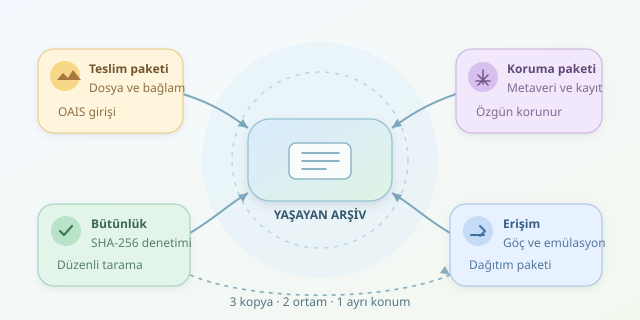

Bir müzenin fotoğrafları, eski bir bilgisayar oyunu veya araştırmacının ses kayıtları… Hepsi dijital olabilir; fakat hiçbiri kendiliğinden ölümsüz değildir. Dosyanın diskte bulunması, gelecekte açılabileceği anlamına gelmez. Dijital arşivcilik, veriyi yalnızca saklamak değil, onu anlayacak geleceğe de hazırlamaktır. Kısacası mesele, dosyaya bir zaman makinesi bileti almaktır!



``

## Dosya yaşıyor, peki anlamı?

Uzun vadeli korumanın üç katmanı vardır: bitlerin bütünlüğü, içeriğin okunabilirliği ve bağlamın korunması. Bir belge değişmeden durabilir; ancak onu açan uygulama kaybolmuşsa okunabilirlik ortadan kalkar. Üstelik belgenin üreticisi, tarihi ve kullanım hakları bilinmiyorsa kültürel değeri de eksik aktarılır.

OAIS referans modeli bu süreci kavramsallaştırır: arşive teslim edilen paket, koruma bilgileriyle zenginleştirilmiş arşiv paketi ve kullanıcıya sunulan dağıtım paketi birbirinden ayrılır. OAIS hazır bir yazılım değil, sorumlulukları ve bilgi akışını tanımlayan bir çerçevedir.

Format eskimesi yalnızca dosya uzantısıyla ilgili değildir. Kodekler, yazı tipleri, eklentiler ve işletim sistemi bağımlılıkları da kaybolabilir. Bir video kapsayıcısının tanınması, içindeki görüntünün çözülebileceğini garanti etmez.

## Göç mü, emülasyon mu?

İki temel yaklaşım, içeriği yeni biçime taşımak ve eski çalışma ortamını yeniden oluşturmaktır. Bunlar rakip değil, tamamlayıcı araçlardır.

| Yaklaşım | Ne korunur? | Güçlü tarafı | Temel risk |
|---|---|---|---|
| Format göçü | İçerik yeni formata aktarılır | Güncel araçlarla erişim | Özellik veya görünüm kaybı |
| Emülasyon | Eski çalışma ortamı taklit edilir | Etkileşimli deneyim | Ortam ve lisans bağımlılığı |
| Bit düzeyinde koruma | Özgün dosyanın bitleri | Bütünlük denetimi | Okunabilirliği garanti etmez |

Metin belgelerinde uygun PDF/A profilleri, görüntülerde TIFF, seslerde WAV veya FLAC değerlendirilebilir. Ancak hiçbir format sihirli ölümsüzlük iksiri değildir. Seçim; açıklık, araç desteği, doğrulanabilirlik ve koleksiyonun ihtiyaçlarına dayanmalıdır. Dönüştürülen dosyaları doğrulayın; sayfa sayısı, renkler, metin katmanı ve ses süresi gibi önemli özellikleri karşılaştırın. Özgün dosyayı da mutlaka koruyun.

## Depolama: Tek kopya, tek macera

3-2-1 yaklaşımı iyi bir başlangıçtır: üç kopya, iki farklı ortam türü ve bir coğrafi olarak ayrı kopya. Fidye yazılımlarına karşı çevrimdışı veya değiştirilemez kopyalar da düşünülmelidir. Ancak yedekleme, tek başına dijital koruma değildir.

Bağımsız kopyaların belirli bir dönemde kaybolma olasılığı $p$ ise, $n$ kopyanın tamamının kaybolması teorik olarak:

$$P_{\text{tam kayıp}} = p^n$$

Bu ifade yalnızca kayıplar bağımsızsa geçerlidir. Aynı binadaki sunucular yangında birlikte kaybolabilir; aynı yönetici hesabına bağlı bulut kopyaları birlikte silinebilir. Kopya sayısı kadar hata alanlarını ayırmak da önemlidir.

## Python ile bütünlük kontrolü

Aşağıdaki örnek, Python 3.9 ve üzerinde dosyaların SHA-256 özetlerini kaydeder; sonraki çalıştırmalarda değişen, eksilen veya eklenen dosyaları bildirir. Büyük dosyalar belleğe bütünüyle alınmaz.

```python
import hashlib
import json
import sys
from pathlib import Path


def digest(path):
    h = hashlib.sha256()
    with path.open("rb") as stream:
        for chunk in iter(lambda: stream.read(1024 * 1024), b""):
            h.update(chunk)
    return h.hexdigest()


root = Path(sys.argv[1]).resolve()
manifest = Path(sys.argv[2]).resolve()
if not root.is_dir():
    raise ValueError("Koleksiyon klasörü bulunamadı.")
if manifest.is_relative_to(root):
    raise ValueError("Manifesti koleksiyon dışında saklayın.")

current = {
    p.relative_to(root).as_posix(): digest(p)
    for p in sorted(root.rglob("*"))
    if p.is_file() and not p.is_symlink()
}

if sys.argv[3] == "init":
    with manifest.open("x", encoding="utf-8") as stream:
        json.dump(current, stream, ensure_ascii=False, indent=2)
else:
    expected = json.loads(manifest.read_text(encoding="utf-8"))
    changes = [
        name for name in sorted(expected.keys() | current.keys())
        if expected.get(name) != current.get(name)
    ]
    print("Değişen, eksik veya yeni dosyalar:", changes)
    sys.exit(bool(changes))
```

İlk kayıt için `python kontrol.py koleksiyon manifest.json init`, denetim için son argümanı `check` yapın. Manifestin yanlışlıkla üzerine yazılması engellenir. Sembolik bağlantılar kapsam dışıdır. Özetler özgünlüğü tek başına kanıtlamaz; güvenilir manifesti ayrı, korumalı bir yerde tutun. Değişiklik saptandığında inceleme yapmadan başlangıç kaydını yenilemeyin.

## Arşivi yaşayan bir sisteme dönüştürün

PREMIS gibi koruma metaverisiyle dönüşümleri, kullanılan araç sürümlerini, kontrol sonuçlarını ve sorumluları kaydedin. Dosyanın özgünüyle türevi arasındaki ilişkiyi açık tutun. Şifreleme kullanıyorsanız anahtarların korunmasını ve erişim yetkilerinin devrini de planlayın.

Düzenli bütünlük taramaları, geri yükleme tatbikatları ve format risk değerlendirmeleri için takvim oluşturun. Depolama ortamlarını gerektiğinde yenileyin; telif ve kişisel veri koşullarını erişim politikalarına yansıtın. Bütçe ve görev sahipleri belirlenmeden hiçbir teknik çözüm sürdürülebilir olmaz. Başarı, gelecekteki kullanıcının yalnızca dosyayı bulması değil, içeriği doğru biçimde anlayabilmesidir.
