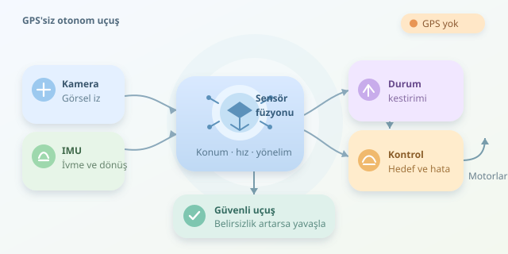

Bir dronun GPS bağlantısı kesildiğinde gökyüzünde şaşkın şaşkın dolaşması gerekmez. Kameralar, hareket sensörleri ve doğru algoritmalar sayesinde uçuşunu sürdürebilir. Ancak mesele yalnızca engelleri görmek değildir: Araç, nerede olduğunu kestirmeli, hedefinden sapmasını hesaplamalı ve motorlarına uygun komutlar üretmelidir. Gelin bu uçan robotun navigasyon defterini açalım.
``

## Önce temel ayrım: Kestirim ve kontrol

Otonom uçuşta iki farklı soru vardır: **“Neredeyim?”** ve **“Nereye, nasıl gitmeliyim?”** İlkini durum kestirimi, ikincisini planlama ve kontrol algoritmaları cevaplar. Bu görevleri karıştırmak, gözlüğün direksiyon çevirmesini beklemek gibidir.

GPS olmadan genellikle kalkış noktasına bağlı yerel bir koordinat sistemi kullanılır. Dron bu sistemde konumunu, hızını ve yönelimini izler. Fakat yerel rotayı korumak, dünya üzerindeki mutlak konumu kusursuz bilmek anlamına gelmez. Harita eşleştirmesi veya bilinen işaretler gibi dış referanslar yoksa hata zamanla birikir.

Kestirilen durum; konum $p$, hız $v$, yönelim $R$ ve sensör sapmalarını içerebilir:

$$x=[p,v,R,b_a,b_g]$$

## IMU, kamera ve sensör füzyonu

IMU, ivmeölçer ve jiroskoptan oluşur. Jiroskop açısal hızı, ivmeölçer ise yerçekiminden ayrıştırılması gereken özgül kuvveti ölçer. Dünya koordinatlarındaki ivme yaklaşık şöyle hesaplanır:

$$a_w=R(a_m-b_a)+g_w$$

Burada $a_m$ ölçüm, $b_a$ ivmeölçer sapması, $g_w$ yerçekimi vektörüdür. İvmenin zaman boyunca entegrasyonu hız ve konum verir. Ne var ki küçük sapmalar büyür: Basitleştirilmiş sabit sapma modelinde konum hatası yaklaşık $b_a t^2/2$ ile artar. Yani IMU hızlıdır, fakat tek başına uzun süre güvenilir bir konum kaynağı değildir.

Kamera bu açığı kapatmaya yardım eder. **Görsel ataletsel odometri**, görüntülerdeki özellik noktalarının hareketini IMU verileriyle birleştirir. SLAM ise konum kestirirken çevrenin haritasını da oluşturur.

| Yaklaşım | Güçlü yanı | Temel sınırlama |
|---|---|---|
| Yalnız IMU | Hızlı hareket takibi | Biriken konum hatası |
| Optik akış ve mesafe sensörü | Zemine göre hız kestirimi | Doku ve yükseklik ölçümüne bağımlılık |
| Görsel ataletsel odometri | Yerel hareket kestirimi | Işık, bulanıklık ve kalibrasyon |
| SLAM ve harita eşleştirme | Tekrar görülen yerlerle düzeltme | İşlem yükü ve yanlış eşleşmeler |

Genişletilmiş Kalman filtresi gibi yöntemler, hareket modeliyle tahmin üretir ve sensör ölçümleriyle tahmini düzeltir. Ölçümlerin belirsizliği önemlidir: Bulanık kameraya daha az güvenmek gerekir. Tek kameralı sistemlerde ölçek de kritik olduğundan, yeterli hareket uyarımı ve doğru IMU kalibrasyonu gerekir.

## Rotayı korumak: Hata üzerinden kontrol

Konum tahmini hazırsa kontrolcü hedef ile mevcut konum arasındaki farkı hesaplar. Yaygın mimaride dış döngü konumdan hız veya ivme hedefi üretir; iç döngüler yönelim ve açısal hızı düzenler. Motorlar bu zincirin son halkasıdır.

Sabit bir yatay hedef için basit bir PD kontrolcü:

$$a_{komut}=K_p(p_{hedef}-p)-K_dv$$

Konum terimi hedefe çeker; hız terimi hareketi sönümleyerek hedef çevresindeki salınımları azaltır. Aşağıdaki örnek, yerel koordinatlardaki komutu sınırlar ve gövde eksenlerine dönüştürür:

```python
import numpy as np


def yatay_komut(p, v, hedef, yaw,
                kp=0.8, kd=1.2, a_max=2.0):
    p, v, hedef = (
        np.asarray(x, dtype=float) for x in (p, v, hedef)
    )
    if any(x.shape != (2,) for x in (p, v, hedef)):
        raise ValueError("İki boyutlu vektörler gerekli.")

    a_dunya = kp * (hedef - p) - kd * v
    norm = np.linalg.norm(a_dunya)
    if norm > a_max:
        a_dunya *= a_max / norm

    c, s = np.cos(yaw), np.sin(yaw)
    dunya_govde = np.array([[c, s], [-s, c]])
    return dunya_govde @ a_dunya
```

Konum metre, hız metre/saniye, `yaw` radyan cinsindedir. Kod yatay ivme isteği üretir; motor komutu üretmez. Pozitif kazançlar ve ivme sınırı varsayılmıştır. Gerçek uçuşta eksen tanımları, itki dönüşümü ve eğim sınırları ayrıca ele alınmalıdır.

## Daha akıllı kontrol, daha güvenli uçuş

PID ailesi düşük hesaplama maliyetiyle pratiktir. Model öngörülü kontrol, yani MPC, gelecekteki hareketi bir modelle tahmin ederek izleme hatasını ve kontrol çabasını birlikte optimize eder. Hız, ivme ve eğim kısıtlarını hesaba katabilir; karşılığında daha fazla hesaplama ister. Engel bilgisi ise ayrıca bir planlayıcıdan veya haritadan gelmelidir.

Başarılı sistem yalnızca iyi hava koşullarını düşünmez. Dokusuz duvarlar, karanlık ve titreşim görsel kestirimi bozabilir. Belirsizlik yükseldiğinde hız azaltılmalı; uygun sensörler varsa kontrollü bekleme veya iniş değerlendirilmelidir. Konum kestirimi kaybolmuşken “olduğun yerde kal” komutu tek başına çözüm değildir.

Sonuç olarak GPS’siz uçuş sihir değil, sürekli düzeltilen tahmin ve geri beslemedir. Önce simülasyonda gecikme, sensör kaybı ve sapma senaryolarını deneyin. Dronun gerçek süper gücü, yalnızca rotasını koruması değil, artık güvenilir biçimde koruyamadığını anlayabilmesidir.



