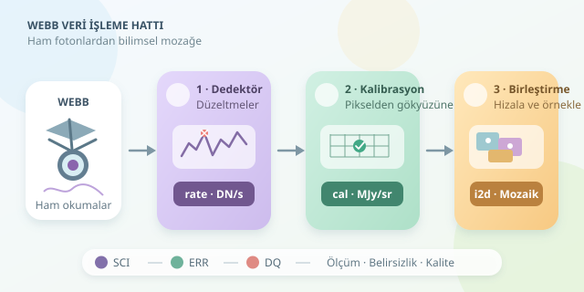

James Webb Uzay Teleskobu’nun büyüleyici görüntüleri, uzaydan hazır duvar kâğıdı olarak gelmez. İlk veriler; dedektör izleri, kozmik ışın etkileri ve ölçüm belirsizlikleriyle doludur. Bilimsel veri işleme hattı, bu karmaşayı fiziksel olarak anlamlı ölçümlere dönüştürür. Gelin, kozmik mutfağın tezgâhına yaklaşalım: Burada filtre değil, kalibrasyon pişiyor!

``

## Önce teori: Dedektör aslında ne ölçer?

Webb’in dedektörleri, poz boyunca biriken sinyali birden fazla kez okur. Bu okumalar, **rampa** denilen bir zaman dizisi oluşturur. İdeal, doğrusal bölgedeki bir pikseli şöyle düşünebiliriz:

$$D(t)=b+rt+\epsilon(t)$$

Burada $b$ başlangıç seviyesi, $r$ sinyalin birikme hızı, $\epsilon(t)$ ise gürültüdür. Amaç yalnızca son okumaya bakmak değil, geçerli okumaların eğiminden güvenilir bir hız ölçmektir. Doygunluk ve kozmik ışın sıçramaları, bu hesabı sıradan bir doğru uydurmaktan daha zor hâle getirir.

Gürültünün iki önemli bileşeni fotonların istatistiksel değişkenliği ve elektronik okuma gürültüsüdür. Kalibrasyon, bunları sihirli biçimde yok etmez; etkilerini modeller ve belirsizlikleri sonraki aşamalara taşır.

| Aşama | Temel girdi | Tipik görüntüleme çıktısı |
|---|---|---|
| Detector1 | Ham okumalar: `uncal` | Sinyal hızı: `rate` |
| Image2 | Hız görüntüsü | Kalibreli görüntü: `cal` |
| Image3 | İlişkilendirilmiş pozlar | Birleşik mozaik: `i2d` |




## 1. Dedektör düzeltmeleri: Elektroniğin izlerini temizlemek

İlk aşamada veri kalite bayrakları hazırlanır; doygun pikseller belirlenir ve dedektöre uygun düzeltmeler uygulanır. Referans piksel düzeltmesi, doğrusal olmayan tepkinin giderilmesi ve karanlık akım düzeltmesi bunlar arasındadır. MIRI ile yakın kızılötesi dedektörlerinin ihtiyaçları aynı olmadığından, adımlar cihaz ve gözlem moduna göre değişir.

Kozmik ışınlar rampada ani sıçramalar bırakabilir. İşlem hattı bu sıçramaları işaretleyerek geçerli rampa parçalarını değerlendirebilir. Böylece tek bir darbe yüzünden bütün poz çöpe gitmez. Rampa uydurması sonucunda, görüntüleme için genellikle DN/s cinsinden bir hız görüntüsü elde edilir.

## 2. Fiziksel kalibrasyon: Pikselden gökyüzüne

İkinci aşama, ölçümü gökyüzüyle ilişkilendirir. **WCS**, piksel koordinatlarını göksel koordinatlara dönüştüren modeli taşır; optik bozulmalar da bu modelin parçasıdır. Düz alan düzeltmesi, piksellerin farklı duyarlılıklarını dengeler. Fotometrik kalibrasyon ise sayısal sinyali fiziksel birimlere çevirir; görüntüleme ürünlerinde yaygın birim MJy/sr’dir.

Basitleştirilmiş bir ilişki şöyle yazılabilir:

$$I=C\frac{R-B}{F}$$

$R$ hız ölçümü, $B$ arka plan, $F$ göreli duyarlılık ve $C$ dönüşüm katsayısıdır. Bu denklem kavramsaldır; gerçek hattın bütün adımlarını veya kesin işlem sırasını temsil etmez. Özellikle arka planın nerede çıkarılacağı gözleme bağlıdır.

## 3. Birleştirme: Kozmik yapbozu tamamlamak

Webb aynı alanı küçük konum kaymalarıyla, yani **dither** uygulayarak gözlemleyebilir. Üçüncü aşamada uygun pozlar hizalanır, gerektiğinde arka plan seviyeleri eşleştirilir, aykırı örnekler belirlenir ve ortak bir koordinat ızgarasına yeniden örneklenir.

Drizzle yaklaşımı, bu birleştirmede örneklemeyi ve kapsama alanını iyileştirebilir. Ancak yeni fiziksel ayrıntılar yaratmaz; yeniden örnekleme komşu pikseller arasında gürültü korelasyonu oluşturabilir. Bu nedenle mozaikteki belirsizlikleri bağımsız piksel varsayımıyla yorumlamak her zaman doğru değildir.

## Python ile hattı çalıştırmak

STScI’nin `jwst` paketini `pip install jwst` ile kurabilirsiniz. Aşağıdaki örnek, iki görüntüleme pozunu işler. Dosya adları temsilidir; son çağrı, oluşan `cal` dosyalarını üye olarak tanımlayan geçerli bir `goruntu_asn.json` ilişkilendirme dosyası gerektirir.

```python
import os

os.environ.setdefault("CRDS_PATH", os.path.abspath("crds_cache"))
os.environ.setdefault("CRDS_SERVER_URL", "https://jwst-crds.stsci.edu")

from jwst.pipeline import Detector1Pipeline, Image2Pipeline, Image3Pipeline

os.makedirs("urunler", exist_ok=True)

for raw in ["jw_ornek01_uncal.fits", "jw_ornek02_uncal.fits"]:
    root = raw.removesuffix("_uncal.fits")
    Detector1Pipeline.call(
        raw, save_results=True, output_dir="urunler"
    )
    Image2Pipeline.call(
        f"urunler/{root}_rate.fits",
        save_results=True, output_dir="urunler"
    )

Image3Pipeline.call(
    "goruntu_asn.json", save_results=True, output_dir="urunler"
)
```

CRDS, gözleme uygun kalibrasyon referanslarını seçer. Tekrarlanabilirlik için paket sürümünü, işlem parametrelerini ve kullanılan `CRDS_CONTEXT` değerini kaydedin. Spektroskopide ikinci ve üçüncü aşamalar için `Spec2Pipeline` ve `Spec3Pipeline` kullanılır; dalga boyu kalibrasyonu ve tayf çıkarımı gibi işlemler devreye girer.

## Son kontrol: Güzel görünmek yetmez

Bilimsel analizden önce çıktıların `SCI`, `ERR` ve `DQ` uzantılarını birlikte inceleyin: Bunlar sırasıyla ölçümü, belirsizliği ve kalite bayraklarını taşır. Hizalama hatalarını, arka plan kalıntılarını ve maskelenmiş bölgeleri kontrol edin. Birleşik ürünlerin kapsama ve ağırlık haritaları da hangi bölgelerin daha güvenilir olduğunu gösterir.

Son olarak, renkli sunum görüntülerindeki kontrast ayarlarını bilimsel kalibrasyonla karıştırmayın. İyi bir Webb görüntüsü yalnızca etkileyici görünmez; birimleri, belirsizlikleri ve işlem geçmişiyle savunulabilir bir ölçüm sunar.
