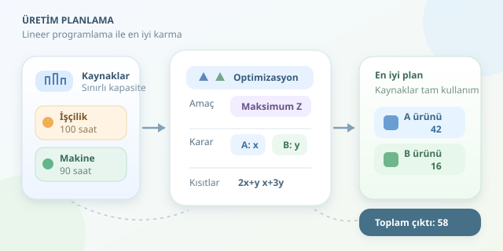

Bir fabrikanın elinde sınırlı işçilik ve makine süresi varsa, hangi üründen kaç adet üretmesi gerekir? Sezgiler başlangıç için güzeldir; ancak kaynaklar daraldığında matematik daha iyi bir vardiya şefi olabilir. Lineer programlama, üretim kararlarını ölçülebilir bir modele dönüştürerek mümkün olan en yüksek çıktıyı bulmamızı sağlar.

``

## Üretim kararlarını matematiğe çevirelim

Lineer programlama üç temel parçadan oluşur: karar değişkenleri, amaç fonksiyonu ve kısıtlar. Karar değişkenleri kontrol edebildiğimiz miktarlardır. Amaç fonksiyonu iyileştirmek istediğimiz sonucu tanımlar. Kısıtlar ise bütçe, zaman, kapasite veya talep gibi sınırları temsil eder. Kısacası model, “Ne istiyorum?” ve “Neye izin var?” sorularını birlikte cevaplar.

Buradaki “lineer” sözcüğü önemlidir: Her ek ürünün aynı miktarda kaynak tükettiğini varsayarız. İki ürün üretmek, bir ürünün iki katı kaynağı gerektirir. Sabit kurulum maliyetleri, miktara bağlı indirimler veya üretim hızındaki değişimler bu basit yapıya doğrudan uymaz. Modelin başarısı, varsayımlarının gerçek üretim ortamına uygunluğuna bağlıdır.

## İki ürün, iki sınırlı kaynak

A ve B ürünlerini üreten küçük bir atölye düşünelim. Planlama dönemi boyunca 100 saat işçilik ve 90 saat makine kapasitemiz var. Malzeme ve talebin üretimi sınırlamadığını varsayalım. Ürün başına kaynak tüketimleri şöyle olsun:

| Kaynak | A ürünü | B ürünü | Kullanılabilir kapasite |
|---|---:|---:|---:|
| İşçilik | 2 saat | 1 saat | 100 saat |
| Makine | 1 saat | 3 saat | 90 saat |

A üretimini $x$, B üretimini $y$ ile gösterelim. Hedefimiz toplam ürün adedini artırmak:

$$\max Z=x+y$$

Kaynak sınırları ve negatif üretimin mümkün olmaması şu kısıtları verir:

$$2x+y\le100$$
$$x+3y\le90$$
$$x\ge0,\qquad y\ge0$$

Burada adetleri eşit ağırlıklandırıyoruz. A ve B farklı ekonomik değerler taşıyorsa, maksimum adet ile maksimum kâr aynı hedef değildir. Kâr optimizasyonunda amaç fonksiyonuna ürünlerin birim katkı payları yazılmalıdır. Matematik aynı kalır; yöneldiğimiz hedef değişir.

## En iyi üretim karması nerede?

Kısıtların birlikte izin verdiği noktalar, uygun çözüm bölgesini oluşturur. Bu örnekte bölge sınırlıdır ve lineer amaç fonksiyonunun optimumu köşe noktalarından birinde bulunabilir. Dolayısıyla rastgele üretim kombinasyonları denemek yerine geometriden yararlanabiliriz.

İki kaynak sınırının kesişimini hesaplayalım:

$$2x+y=100,\qquad x+3y=90$$

Denklemleri çözdüğümüzde $x=42$ ve $y=16$ elde ederiz. Toplam üretim $Z=58$ adettir. Diğer köşeler olan $(0,0)$, $(50,0)$ ve $(0,30)$ daha düşük çıktı verir.

| Üretim yaklaşımı | A adedi | B adedi | Toplam | Durum |
|---|---:|---:|---:|---|
| Yalnızca A | 50 | 0 | 50 | Uygun |
| Yalnızca B | 0 | 30 | 30 | Uygun |
| Eşit miktarda üretim | 20 | 20 | 40 | Uygun |
| Optimize edilmiş karma | 42 | 16 | 58 | Optimal |

Demek ki tek ürüne yüklenmek yerine kaynak tüketimleri birbirini tamamlayan bir karışım seçmek avantajlı. Matematik, atölyenin menüsüne dengeli bir tabak hazırlıyor!

## Python ile modeli çözelim

Önce `pip install scipy numpy` komutuyla gerekli paketleri kurabilirsiniz. SciPy içindeki `linprog` minimizasyon yaptığı için amaç katsayılarını negatif veririz. Böylece $-(x+y)$ değerini küçültmek, toplam üretimi büyütmekle eşdeğer olur.

```python
import numpy as np
from scipy.optimize import linprog

resource_matrix = np.array([[2, 1], [1, 3]])
capacities = np.array([100, 90])

result = linprog(
    c=[-1, -1],
    A_ub=resource_matrix,
    b_ub=capacities,
    bounds=[(0, None), (0, None)],
    method="highs",
)

if not result.success:
    raise RuntimeError(result.message)

x, y = result.x
remaining = capacities - resource_matrix @ result.x
print(f"A: {x:.2f}, B: {y:.2f}")
print(f"Toplam üretim: {-result.fun:.2f}")
print("Kalan kaynak saatleri:", remaining)
```

`A_ub` kaynak tüketimlerini, `b_ub` kapasiteleri taşır. `bounds` negatif üretimi engeller. Son satırlar hem optimum miktarları hem de kullanılmayan kapasiteyi gösterir. Bu örnekte iki kaynak da tamamen kullanılır; sayısal toleranslar nedeniyle sıfıra çok yakın artıklar görülebilir.

## Sonucu doğrulayın, varsayımları unutmayın

Optimumu ayrıca kısa bir matematiksel kontrolle doğrulayabiliriz. İşçilik kısıtını $0{,}4$, makine kısıtını $0{,}2$ ile çarpıp topladığımızda:

$$x+y\le0{,}4(100)+0{,}2(90)=58$$

Bulduğumuz plan bu üst sınıra ulaştığı için optimaldir. Bu katsayılar, mevcut çözüm yapısı değişmediği sürece ek kapasitenin marjinal etkisini de gösterir: Bir saat işçilik yaklaşık $0{,}4$, bir saat makine kapasitesi $0{,}2$ ek ürün sağlar.

Son olarak, standart lineer programlama kesirli üretime izin verir. Burada sonuç tesadüfen tam sayıdır. Bölünemeyen ürünlerde genel çözüm için tamsayılı programlama gerekir; sonucu gelişigüzel yuvarlamak kısıtları bozabilir. Güvenilir üretim planı, yalnızca iyi bir çözücü değil, gerçekçi veriler ve doğru varsayımlar da ister.
