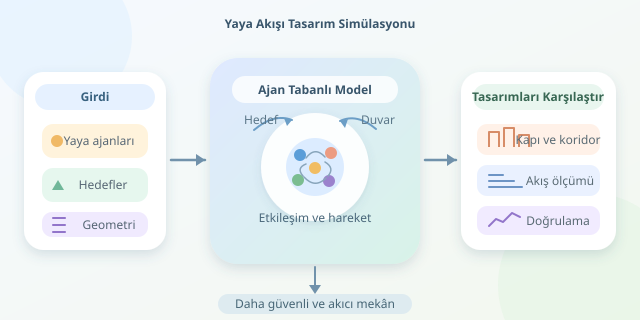

Bir stadyumun kapısını birkaç metre genişletmek gerçekten tahliyeyi hızlandırır mı? Meydandaki büfeyi başka yere taşımak sıkışıklığı azaltır mı? Yaya hareketliliği simülasyonları, bu soruları inşaat başlamadan araştırmamızı sağlar. Üstelik mesele ekranda yürüyen sevimli noktalar değildir: Her nokta, kararları ve fiziksel sınırları olan bir insanı temsil eder.

``

## Kalabalık, tek bir büyük karakter değildir

Ajan tabanlı modellerde her yaya bağımsız bir hesaplama birimidir. Konumu, hızı, hedefi ve tercihleri bulunur. Kalabalığın genel davranışı, bu küçük birimlerin etkileşiminden doğar. Karşılıklı yürüyen insanların kendiliğinden şerit oluşturması, bunun güzel örneklerinden biridir.

Yaygın yaklaşımlardan **sosyal kuvvet modeli**, hareketi hedefe ilerleme isteği ve çevreden gelen etkilerle açıklar:

$$m_i a_i=\frac{m_i(v_i^0 e_i-v_i)}{\tau_i}+\sum_{j\ne i}F_{ij}+F_{i,\mathrm{duvar}}$$

Burada $v_i^0$ istenen sürat, $e_i$ hedef yönü, $\tau_i$ tepki süresidir. Diğer terimler, yayaların ve duvarların etkisini temsil eder. Bunlar psikolojik davranışın birebir fizik yasaları değil, ölçümlerle ayarlanması gereken model bileşenleridir.

| Yaklaşım | Temel mantık | Tasarımdaki kullanım |
|---|---|---|
| Sosyal kuvvet | Sürekli konum ve etkileşim | Kapı çevresindeki hareket |
| Hücresel otomat | Izgarada hücre değiştirme | Çok sayıda senaryoyu tarama |
| Hız engelleri | Çarpışma oluşturacak hızlardan kaçınma | Yerel hareket planlama |

## Geniş kapı neden her zaman çözüm değildir?

Akış yalnızca kapının genişliğine bağlı değildir. Yoğunluk arttığında insanlar daha yavaş ilerleyebilir. Birim genişlik başına akış için temel ilişki şöyledir:

$$J_s=\rho v,\qquad Q=wJ_s$$

Burada $\rho$ kişi/metrekare, $v$ metre/saniye, $w$ geçiş genişliğidir; $Q$ kişi/saniye olarak ölçülür. Bu ilişki muhasebe açısından yararlıdır, ancak hızın yoğunlukla nasıl değiştiğini ayrıca modellemek gerekir. Geniş kapının arkasındaki dar koridor, darboğazı sadece birkaç metre ileri taşıyabilir. Kalabalık, tasarım hatasını sihirli biçimde buharlaştırmaz!

## Python ile küçük bir hareket çekirdeği

Aşağıdaki NumPy kodu, hedefe yönelme ve yayalar arasında uzaklaşma eğilimini hesaplar. `pos`, `vel` ve `goals`, her satırı bir yayaya karşılık gelen `(N, 2)` dizileridir.

```python
import numpy as np


def step(pos, vel, goals, dt=0.05):
    target = goals - pos
    distance = np.linalg.norm(target, axis=1)
    direction = target / (distance[:, None] + 1e-9)
    desired_speed = np.minimum(1.3, distance / 0.5)
    desired = direction * desired_speed[:, None]

    delta = pos[:, None, :] - pos[None, :, :]
    gap = np.linalg.norm(delta, axis=2)
    normal = delta / (gap[:, :, None] + 1e-9)
    strength = 2.0 * np.exp(
        np.clip((0.5 - gap) / 0.3, -30, 10)
    )
    np.fill_diagonal(strength, 0.0)
    repulsion = (strength[:, :, None] * normal).sum(axis=1)

    acceleration = (desired - vel) / 0.5 + repulsion
    new_vel = vel + acceleration * dt
    speed = np.linalg.norm(new_vel, axis=1)
    new_vel *= np.minimum(1.0, 2.0 / (speed + 1e-9))[:, None]
    return pos + new_vel * dt, new_vel
```

İlk bölüm hedef yakınında yavaşlamayı sağlar. İkinci bölüm, yakın komşuların uzaklaşma etkisini toplar; son bölüm hareketi günceller. Sabitler örnek parametrelerdir, güvenlik sınırları değildir. Kod duvarları, fiziksel teması ve rota planlamasını içermez; çarpışmasız hareket garantilemez. Ayrıca tüm çiftleri karşılaştırdığı için maliyeti $O(N^2)$ olur. Büyük kalabalıklarda uzamsal indeksleme gerekir.

## Tasarımı karşılaştırmalı bir deneye dönüştürmek

Meydan veya stadyum geometrisini modele aktardıktan sonra tek bir animasyona bakıp karar vermeyin. Aynı koşullarda farklı tasarımları karşılaştırın:

1. **Başlangıcı tanımlayın:** Giriş hızlarını, hedef dağılımını ve yürüme hızlarındaki çeşitliliği belirleyin. Arkadaş gruplarını ve erişilebilir güzergâhları unutmayın.
2. **Alternatifler üretin:** Kapı genişliği, bariyer yerleşimi ve büfe konumu gibi değişkenleri ayrı ayrı değiştirin.
3. **Ölçün:** Tahliye süresini, yerel yoğunluğu, bekleme sürelerini ve çıkış çizgisini geçen kişi sayısını kaydedin.
4. **Tekrarlayın:** Farklı başlangıç dağılımlarıyla çoklu koşular yapın; yalnızca ortalamayı değil, sonuçların değişkenliğini de raporlayın.

Rota seçimi için en kısa yol her zaman en hızlı yol değildir. Algoritma, mesafeyle birlikte beklenen sıkışıklığı değerlendirebilir. Ancak çok sık rota değiştirmek kararsızlığa yol açabilir; karar güncellemelerini yumuşatmak faydalıdır.

## Animasyon güzel, doğrulama daha güzel

Modeli gerçek sayımlar, anonimleştirilmiş hareket ölçümleri ve geçiş süreleriyle kalibre edin. Parametre duyarlılığını ve zaman adımı küçültüldüğünde sonuçların değişip değişmediğini inceleyin. Simülasyon, tasarımlar arasındaki farkları görünür kılan güçlü bir deney aracıdır; mevzuatın, saha incelemesinin veya uzman güvenlik değerlendirmesinin yerine geçmez.



