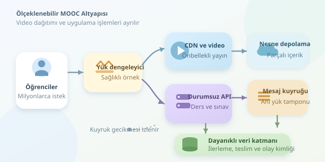

Bir milyon öğrencinin aynı anda ders izlediğini düşünün: Videolar akıyor, sınavlar teslim ediliyor, ilerleme bilgileri kaydediliyor. Bu kalabalığı tek bir güçlü sunucuya emanet etmek, stadyumdaki herkese tek musluktan su dağıtmaya benzer. MOOC altyapısının sırrı, yalnızca daha fazla makine kullanmak değil; işleri doğru parçalara ayırmaktır.

``

## Önce kalabalığı matematiğe çevirelim

Çevrimiçi öğrenci sayısı, eşzamanlı API isteği sayısıyla aynı değildir. Bir milyon öğrenci ortalama yirmi saniyede bir API isteği gönderiyorsa geliş hızı yaklaşık $\lambda = 50.000$ istek/saniyedir.

Kararlı bir sistemde Little Yasası, ortalama sistemdeki iş sayısını verir:

$$L = \lambda W$$

Ortalama yanıt süresi $W = 0{,}2$ saniyeyse, aynı anda işlenen veya bekleyen yaklaşık $10.000$ istek bulunur. Buradaki değerler aynı ölçüm sınırına ait uzun dönem ortalamalarıdır; kuyruk sürekli büyüyorsa kararlılık varsayımı bozulur.

Video tarafında tablo farklıdır: Öğrenci başına ortalama 2 Mbps, bir milyon eşzamanlı izleyicide yaklaşık 2 Tbps trafik demektir. Dolayısıyla uygulama sunucularını büyütmek, video dağıtım sorununu tek başına çözmez.

## Video ile uygulamayı ayırın

Videolar nesne depolamada tutulur; farklı çözünürlüklerde kodlanıp HLS veya DASH parçaları olarak CDN üzerinden dağıtılır. Uyarlanabilir yayın, bağlantı yavaşladığında kaliteyi düşürerek kesintiyi azaltır. Popüler içerikler uç noktalarda önbelleğe alınır; başlangıç sunucusuna binen yük düşer.

| Trafik türü | Uygun yaklaşım | Temel kazanım |
|---|---|---|
| Video parçaları | CDN ve nesne depolama | Bant genişliğini dağıtmak |
| Ders kataloğu | Önbellek ve API | Tekrarlanan okumaları azaltmak |
| Sınav teslimi | Dayanıklı, senkron kayıt | Kritik veriyi korumak |
| İzleme olayları | Mesaj kuyruğu | Ani yükü yumuşatmak |

Uygulama servisleri mümkün olduğunca durumsuz tasarlanır. Oturum bilgisini tek makinenin belleğine bağlamamak, yük dengeleyicinin isteği herhangi bir sağlıklı örneğe yönlendirmesini sağlar. Ancak ortak oturum deposu da kapasitesi ölçülmesi gereken bir bileşendir.

## Kuyruklar sihirli kara delikler değildir

İlerleme güncellemeleri, bildirimler ve analitik olayları kuyruğa aktarılabilir. Fakat kuyruk kapasite üretmez; zamanı satın alır. Her işçi saniyede $\mu$ olay işliyorsa, $n$ işçi için sürdürülebilir çalışma yaklaşık $\lambda < n\mu$ gerektirir.

Ani yoğunlukta gecikme kabul edilebilir; sürekli kapasite açığında birikim büyür. Bu yüzden yalnızca işlemci kullanımını değil, kuyruk uzunluğunu ve en eski mesajın yaşını da izlemek gerekir. Sınav teslimini ise yalnızca kuyruğa yazıldığı için “kalıcı olarak kaydedildi” saymayın; başarı yanıtı, tanımlanan dayanıklılık garantisine dayanmalıdır.

## Aynı mesaj iki kez gelirse?

Birçok mesajlaşma düzeni en az bir kez teslim sunar. İşçi çökerse aynı olay yeniden gelebilir. Aşağıdaki Python örneği, Psycopg ile olay kimliğini ve ilerlemeyi aynı PostgreSQL işlemi içinde kaydeder:

```python
def save_progress(conn, event):
    with conn.transaction():
        inserted = conn.execute(
            '''INSERT INTO processed_event (event_id)
               VALUES (%s)
               ON CONFLICT DO NOTHING
               RETURNING event_id''',
            (event['id'],)
        ).fetchone()

        if inserted is None:
            return

        conn.execute(
            '''INSERT INTO progress (user_id, video_id, max_seconds)
               VALUES (%s, %s, %s)
               ON CONFLICT (user_id, video_id) DO UPDATE
               SET max_seconds = GREATEST(
                   progress.max_seconds, EXCLUDED.max_seconds)''',
            (event['user_id'], event['video_id'], event['seconds'])
        )
```

`processed_event.event_id` birincil anahtar; ilerleme tablosundaki kullanıcı-video çifti benzersiz olmalıdır. Böylece tekrarlar elenir, sırası değişen olaylar en yüksek izlenen konumu geriye götürmez. Bu değer, kullanıcının son oynatma konumuyla aynı şey değildir. Kuyruk mesajı, veritabanı işlemi başarıyla tamamlandıktan sonra onaylanır. Olay kimliklerinin saklama süresi de yeniden teslim penceresine göre belirlenmelidir.

## Darboğazı başka yere taşımayın

API örneklerini çoğaltmak, veritabanına sınırsız bağlantı açmak anlamına gelmemelidir. Bağlantı havuzları, doğru indeksler ve gerektiğinde kullanıcı kimliğine göre bölümleme önemlidir. Okuma kopyaları faydalıdır; fakat gecikmeli çoğaltma yüzünden yeni teslim edilen sınav hemen görünmeyebilir.

| Yaklaşım | Risk | Daha güvenli seçenek |
|---|---|---|
| Sınırsız yeniden deneme | Trafik fırtınası | Gecikmeli, rastgeleleştirilmiş tekrar |
| Her şeyi önbellekleme | Eski veya sızan veri | Süre, geçersizleştirme ve kullanıcı ayrımı |
| Yalnızca CPU ile ölçekleme | Kuyruk gecikmesini kaçırma | Gecikme ve birikimi birlikte izleme |

## Başarıyı öğrenci deneyimiyle ölçün

Ortalama gecikme tek başına yeterli değildir. p95/p99 yanıt sürelerini, video başlangıç süresini, takılma oranını ve teslim hatalarını takip edin. Planlı sınavlar öncesinde kapasiteyi ısıtın; yük testlerinde önbellek kaçırmalarını ve servis arızalarını da deneyin.

Kaynaklar daraldığında öneri sistemini yavaşlatmak, sınav teslimini kaybetmekten iyidir. İmzalı video bağlantıları, yetkilendirme, hız sınırları ve kişisel verilerin korunması da tasarımın parçasıdır. Gerçek ölçeklenebilirlik, milyonlara hizmet verirken tek bir öğrencinin deneyimini unutmamaktır.
