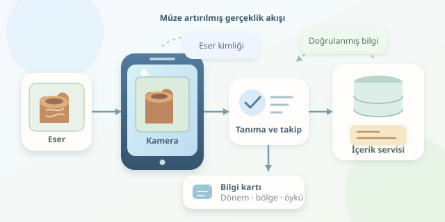

Bir müzede antik bir vazoya telefon kameranızı tuttuğunuzu düşünün: Ekranda üretildiği dönem, bulunduğu bölge ve üzerindeki figürlerin anlamı beliriyor. Üstelik bilgi kartı, siz hareket ederken eserin yanında duruyor. Bu deneyim sihir değil; bilgisayarlı görü, konum takibi ve özenle hazırlanmış içeriklerin birlikte çalışması. Haydi, dijital müze rehberinin kaputunu açalım!
``

## Kamera Tarihi Nasıl Görüyor?

Önemli ayrım şu: Kamera eserin tarihini doğrudan okuyamaz. Sistem önce görüntüdeki eseri tanımlar, ardından bu kimliği müzenin içerik veritabanıyla eşleştirir. Tarihsel bilgi, mümkün olduğunca küratörlerin doğruladığı kayıtlardan gelmelidir; görüntüden serbestçe üretilen tahminlerden değil.

Görüntü hedefi yaklaşımında eserin veya yanındaki tanıtım görselinin ayırt edici noktaları önceden çıkarılır. Kamera görüntüsündeki noktalarla eşleşmeler bulunur; hatalı eşleşmeler elenir ve hedefin kameraya göre pozu hesaplanır.

Üç boyutlu bir noktanın ekrana izdüşümü kabaca $s\mathbf{p}=K[R\mid t]\mathbf{P}$ ilişkisiyle açıklanır. Burada $K$ kamera parametrelerini, $R$ dönüşü, $t$ ötelemeyi gösterir. Böylece sanal etiket, rastgele ekran köşesinde değil, eserle ilişkili bir konumda çizilir.

## Hangi Tanıma Yöntemi Seçilmeli?

Her eser aynı yönteme uygun değildir. Dokulu bir tablo kolay hedef olabilirken parlak, desensiz bir heykel görüntü eşleştirmesini zorlaştırabilir. Seçimi koleksiyona göre yapmak gerekir.

| Yöntem | Avantaj | Sınırlama |
|---|---|---|
| QR veya işaretleyici | Hızlı kimlik tespiti | Görünür etiket gerektirir |
| Görüntü hedefi | Doğal ziyaret deneyimi | Işık ve dokuya duyarlıdır |
| Nesne tanıma | Karmaşık eserleri ayırt edebilir | Eğitim ve hesaplama maliyeti artar |




QR kodun yalnızca bir sayfa açması, tek başına artırılmış gerçeklik değildir. Gerçek AR deneyiminde dijital içerik fiziksel ortamla ilişkilendirilir ve kamera hareketine uygun güncellenir.

## Uygulamanın Veri Akışı

Basit mimari şöyledir: **kamera → tanıma → eser kimliği → içerik servisi → bilgi kartı**. Kullanıcı kamera iznini verir; takip modülü hedefi bulur; uygulama ilgili eserin açıklamasını ister. Web tabanlı yaklaşım indirme zorunluluğunu azaltır, ancak tarayıcı desteği ve cihaz performansı mutlaka sınanmalıdır.

Veritabanında eser kimliği, başlık, dönem, açıklama, kaynak ve dil alanları tutulabilir. Ziyaretçinin seçtiği dil, aynı kimlik için farklı metin döndürür. Tanıma sonucu ile tarihsel içeriği ayırmak, küratörlerin uygulama koduna dokunmadan açıklamaları güncellemesini kolaylaştırır.

## JavaScript ile Bilgi Kartını Yönetmek

Aşağıdaki örnek, hedef dosyasıyla hazırlanmış bir MindAR/A-Frame sahnesini varsayar. `#eser`, `mindar-image-target` bileşeni taşıyan hedef öğesidir; `#bilgi` ise HTML bilgi panelidir. Sahne kurulumu burada gösterilmiyor. Kod, hedef bulununca veriyi getirir; kaybolunca isteği iptal eder. Servisin `ad` ve `oyku` alanları döndürmesi beklenir.

```javascript
const hedef = document.querySelector('#eser');
const panel = document.querySelector('#bilgi');
let istek;

hedef.addEventListener('targetFound', async () => {
  istek?.abort();
  const mevcut = new AbortController();
  istek = mevcut;
  panel.hidden = false;
  panel.textContent = 'Tarih yükleniyor...';

  try {
    const yanit = await fetch('/api/eserler/42', {
      signal: mevcut.signal
    });
    if (!yanit.ok) throw new Error('Servis hatası');
    const eser = await yanit.json();
    if (!mevcut.signal.aborted) {
      panel.textContent = `${eser.ad}: ${eser.oyku}`;
    }
  } catch (hata) {
    if (!mevcut.signal.aborted) {
      panel.textContent = 'Bilgiye ulaşılamadı.';
    }
  }
});

hedef.addEventListener('targetLost', () => {
  istek?.abort();
  panel.hidden = true;
});
```

`AbortController`, eski isteğin geç tamamlanıp yanlış kartı göstermesini önlemeye yardımcı olur. `textContent`, açıklamanın HTML olarak yorumlanmasını engeller. Bu örnek iki boyutlu paneli yönetir; esere sabitlenen üç boyutlu metin veya model, takip edilen sahne öğesinin altına ayrıca eklenmelidir.

## Müze Salonunun Gerçekleri

Laboratuvarda çalışan demo, kalabalık salonda tökezleyebilir. Cam yansımaları, düşük ışık ve ziyaretçilerin hedefi kapatması test senaryolarına dahil edilmelidir. Kısa takip kayıplarında kartı hemen kapatmak yerine küçük bir bekleme süresi kullanmak titremeyi azaltabilir.

İçerik önbelleği de müzenin kalın duvarlarıyla barışmanın iyi yoludur:

| İçerik erişimi | Kazanç | Dikkat noktası |
|---|---|---|
| Çevrimiçi servis | Kolay güncelleme | Bağlantı gecikmesi |
| Yerel önbellek | Hızlı, çevrimdışı erişim | İçerik sürümü kontrolü |

Kamera erişimi güvenli bağlantı ve açık izin gerektirir. Mümkünse görüntüleri cihazda işleyin; sunucuya yükleme gerekiyorsa amacı ve saklama politikasını açıklayın. Büyük yazılar, sesli anlatım ve kamerasız içerik seçeneği erişilebilirliği artırır.

Sonuçta başarılı AR, ekrana olabildiğince çok animasyon doldurmak değildir. Ziyaretçiye doğru anda kısa, güvenilir ve anlamlı bilgi vermektir. Telefon tarih öğretmenine dönüşebilir; yeter ki dersin yıldızı ekran değil, eser olsun!
