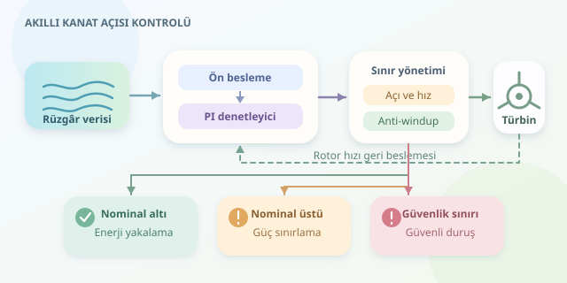

Rüzgâr türbininin kanatları, yalnızca dönen dev pervaneler değildir; sürekli değişen havaya uyum sağlayan aerodinamik araçlardır. Kontrol yazılımı, kanatların kendi ekseni etrafındaki açısını ayarlayarak enerji üretimini ve mekanik güvenliği dengeler. İşin eğlenceli tarafı şu: Daha fazla rüzgâr, her zaman daha fazla elektrik üretmek anlamına gelmez!

``

## Önce fizik: Güç nereden geliyor?

Rüzgârdan rotora aktarılan aerodinamik güç yaklaşık olarak şöyle hesaplanır:

$$P_{aero}=\frac{1}{2}\rho A v^3 C_p(\lambda,\beta)$$

Burada $\rho$ hava yoğunluğu, $A$ rotorun süpürdüğü alan, $v$ rüzgâr hızı, $\beta$ kanat açısıdır. Güç katsayısı $C_p$, mevcut rüzgâr enerjisinin ne kadarının yakalanabildiğini gösterir. İdeal koşullarda bile Betz sınırı nedeniyle bu oran yaklaşık yüzde 59,3'ü aşamaz; gerçek türbinler daha düşük değerlerde çalışır.

Kanat uç hız oranı ise $\lambda=\omega R/v$ ile tanımlanır. Buradaki $\omega$ rotorun açısal hızı, $R$ rotor yarıçapıdır. Her kanat tasarımının kendine özgü bir $C_p$ haritası vardır. Dolayısıyla optimum açı, yalnızca rüzgâr hızından hesaplanan evrensel bir sayı değildir; rotor hızı ve aerodinamik tasarım da denklemin içindedir.

## İki çalışma bölgesi, iki farklı hedef

Kontrol algoritmasının hedefi, türbinin çalışma bölgesine göre değişir. Nominal gücün altında mümkün olduğunca fazla enerji yakalanırken, nominal gücün üzerinde üretim sınırlandırılır. Aksi hâlde jeneratör ve mekanik parçalar, bedava enerjinin pahalı sonuçlarıyla tanışabilir.

| Çalışma bölgesi | Temel hedef | Baskın kontrol |
|---|---|---|
| Nominal altı | Enerji yakalamayı artırmak | Jeneratör torku ve rotor hızı |
| Nominal üstü | Gücü ve hızı sınırlamak | Kanat açısını artırmak |
| Güvenlik sınırı dışı | Türbini korumak | Güvenli duruş prosedürü |




Nominal altında kanat açısı çoğunlukla tasarıma özgü optimum değerde tutulur; bu değer birçok türbinde sıfıra yakındır. Jeneratör torku ayarlanarak optimum $\lambda$ izlenir. Nominal üstünde ise kanatlar rüzgârı daha az yakalayacak şekilde çevrilir; buna feather yönünde hareket denir.

## Rüzgâr tahminiyle başla, geri beslemeyle düzelt

Pratik bir çözüm, rüzgâr hızından hesaplanan ön besleme açısını rotor hızı geri beslemesiyle birleştirir. Ön besleme beklenen çalışma noktasını sağlar; PI denetleyici ise model hatalarını ve bozucuları düzeltir. Rotor hedefinden hızlı dönüyorsa açı artırılır. Böylece kontrol, yalnızca anlık rüzgâr ölçümüne güvenmek zorunda kalmaz.

$$e=\omega-\omega_{ref},\qquad \beta_{istek}=\beta_{ff}+K_p e+I$$

Aşağıdaki Python örneği, nominal üstü bölgedeki toplu kanat açısı kontrolünün öğretici bir iskeletidir. Kalibre edilmiş rüzgâr–açı tablosunu kullanır; açı sınırını, hareket hızını ve integral birikmesini birlikte yönetir. Bütün kanatlar için aynı açı hedefi üretilir.

```python
import numpy as np


def pitch_step(wind, omega, dt, state, cfg):
    if dt <= 0:
        raise ValueError("dt pozitif olmalı")

    feedforward = np.interp(
        wind, cfg["wind_grid"], cfg["pitch_grid"]
    )
    error = omega - cfg["omega_ref"]
    requested = feedforward + cfg["kp"] * error + state["i"]
    bounded = np.clip(requested, cfg["min"], cfg["max"])

    max_change = cfg["rate"] * dt
    change = np.clip(
        bounded - state["beta"], -max_change, max_change
    )
    applied = state["beta"] + change

    state["i"] += dt * (
        cfg["ki"] * error
        + cfg["kaw"] * (applied - requested)
    )
    state["beta"] = float(applied)
    return state["beta"]
```

`state`, önceki açı ile integral durumunu saklar; başlangıç değerleri geçerli sınırlar içinde seçilmelidir. `cfg`, kazançları ve kalibrasyon tablolarını içerir. Açılar derece, hızlar radyan/saniye olabilir; kazançların birimleri buna uymalıdır. `kaw` terimi, eyleyici sınırlara takıldığında integralin gereksiz büyümesini azaltan anti-windup mekanizmasıdır.

## Optimizasyon sahada nasıl doğrulanır?

Tek bir PI ayarı bütün rüzgâr koşullarında aynı performansı vermeyebilir. Bu nedenle kazançlar çalışma noktasına göre değiştirilebilir. Simülasyonda türbülans, ani rüzgâr artışı, sensör gürültüsü ve eyleyici gecikmesi denenmelidir. Karşılaştırma yalnızca üretilen enerjiyle yapılmaz: Rotor hız sapması, yapısal yükler ve kanat hareketlerinin sıklığı da ölçülür. Sürekli hareket eden bir mekanizma, iyi kontrol edildiği için değil, gereksiz yorulduğu için de dikkat çekebilir.

Bu örnek doğrudan gerçek türbine yüklenmemelidir. Üretim yazılımı; sensör doğrulama, bağımsız aşırı hız koruması, güvenli duruş ve donanım testleri gerektirir. Gerçek optimizasyonun özeti şudur: Rüzgârdan mümkün olan enerjiyi al, fakat türbinin ömrünü ve güvenliğini pazarlık konusu yapma.
