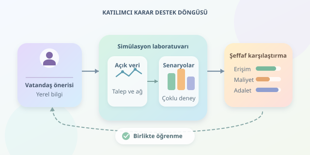

Mahallenizdeki otoparkın parka dönüştürülmesini önerdiniz. Harika! Peki trafik, erişilebilirlik ve belediye bütçesi bundan nasıl etkilenir? Katılımcı şehir planlamasında simülasyon tabanlı karar destek araçları, vatandaş fikirlerini ölçülebilir senaryolara dönüştürür. Böylece tartışma, “Bence güzel olur” seviyesinden “Hangi koşullarda, kimler için güzel olur?” seviyesine taşınır. Şehir, pahalı değişikliklerden önce dijital bir prova yapar.




``

## Vatandaş fikrinden çalıştırılabilir senaryoya

Yazılım, “Daha yaşanabilir bir sokak istiyoruz” cümlesini doğrudan hesaplayamaz. Önce önerinin konumu, kapsamı ve beklenen davranış değişikliği tanımlanmalıdır. Örneğin bir bisiklet yolu önerisi; yol kapasitesi, bisiklete geçiş oranı, kavşak düzeni ve yatırım maliyeti gibi parametrelere ayrılır.

Burada vatandaş yalnızca fikir veren kişi değildir: Senaryonun varsayımlarını doğrulayan bir ortak tasarımcıdır. “Bu güzergâh okul saatinde kalabalıklaşıyor” bilgisi, günlük ortalamaların gizlediği önemli bir ayrıntıyı ortaya çıkarabilir.

| Vatandaş önerisi | Modeldeki karşılığı | İzlenecek gösterge |
|---|---|---|
| Bisiklet yolu açılsın | Kapasite ve ulaşım tercihi değişimi | Yolculuk süresi, güvenlik |
| Otobüs seferleri artırılsın | Sefer aralığı ve araç kapasitesi | Bekleme, erişilebilirlik |
| Otopark parka dönüşsün | Arazi kullanımı değişimi | Yeşil alana erişim, maliyet |

## Simülasyonun teorik motoru

Bir simülasyon; sistemin durumunu, aktörlerini ve zaman içindeki değişimini temsil eder. Ajan tabanlı modellerde insanlar farklı tercihlerle hareket ederken, trafik modelleri araç akışını ve kuyruk oluşumunu hesaplayabilir. SUMO ulaşım simülasyonu, Mesa ise ajan tabanlı deneyler için değerlendirilebilecek araçlardır.

Basitleştirilmiş bir yol bağlantısında seyahat süresi, BPR fonksiyonuyla modellenebilir:

$$t=t_0\left[1+\alpha\left(\frac{v}{c}\right)^\beta\right]$$

Burada $t_0$ serbest akış süresi, $v$ araç akışı, $c$ kapasitedir. $\alpha$ ve $\beta$ yerel ölçümlerle kalibre edilmelidir. Temel fikir şudur: Kapasiteye yaklaşırken gecikme doğrusal artmak zorunda değildir. Ancak bu formül tek başına kavşakları, kuyruk taşmasını veya bütün ulaşım ağını açıklamaz.

## Veriden deney düzenine

Önce mevcut durum modeli kurulur; yol ağı, nüfus, seferler ve anonimleştirilmiş sayımlar birleştirilir. Model, ayrı tutulan gözlemlerle doğrulanır. Ardından her öneri aynı başlangıç koşullarıyla karşılaştırılır. Aksi hâlde yağmurlu pazartesi ile güneşli pazar gününü yarıştırmış oluruz!

Talep belirsizliğini incelemek için Monte Carlo yaklaşımıyla çok sayıda olası gün üretilebilir. Aynı rastgele talepleri bütün senaryolarda kullanmak, karşılaştırmadaki gereksiz gürültüyü azaltır.

## Python ile küçük bir senaryo laboratuvarı

Aşağıdaki örnek, bisiklet yatırımı sonrasında otomobil tercihinin azalabileceği varsayımını test eder. Tam bir şehir modeli değildir; yalnızca tek bağlantının gecikmesini hesaplayan öğretici bir prototiptir.

```python
from dataclasses import dataclass
import numpy as np

@dataclass(frozen=True)
class Scenario:
    capacity: float  # araç/saat
    car_share: float

rng = np.random.default_rng(42)
demand = np.clip(rng.normal(1800, 180, 1000), 0, None)
scenarios = {
    "mevcut": Scenario(1200, 0.70),
    "bisiklet": Scenario(1000, 0.55),
}

def travel_time(scenario: Scenario) -> np.ndarray:
    # Talep kişi/saat; doluluk 1.2 kişi/araç varsayılıyor.
    flow = demand * scenario.car_share / 1.2
    return 12 * (1 + 0.15 * (flow / scenario.capacity) ** 4)

baseline = travel_time(scenarios["mevcut"])
for name, scenario in scenarios.items():
    times = travel_time(scenario)
    delta = times - baseline
    print(name, {
        "ortalama_dakika": round(float(times.mean()), 2),
        "p95_dakika": round(float(np.percentile(times, 95)), 2),
        "iyilesme_orani": round(float(np.mean(delta < 0)), 3),
    })
```

Kod, bin talep örneğinde ortalama süreyi, yüzde 95’lik dilimi ve mevcut duruma göre iyileşme oranını raporlar. Buradaki yüzde 95’lik dilim bir güven aralığı değildir. Otomobil payları, doluluk ve kapasite değerleri varsayımsaldır; sonuçlar gerçek bir yatırımın başarısını kanıtlamaz. Özellikle otomobilden bisiklete geçiş oranı farklı değerlerle tekrar denenmelidir. Ayrıca hesaplanan süre yalnızca otomobillerin bu bağlantıdaki süresidir.

## Tek puan mı, şeffaf karşılaştırma mı?

Karar desteği trafik hızından ibaret olmamalıdır. Çevresel fayda, erişilebilirlik, dağıtımsal adalet ve bütçeye uygunluk birlikte değerlendirilebilir:

$$S=0.35E+0.25A+0.25D+0.15K$$

Burada bütün göstergeler $[0,1]$ aralığına dönüştürülür ve yüksek değer daha iyi durumu gösterir. Ağırlıklar teknik gerçek değil, toplumsal tercihtir. Bu yüzden katılımcılar ağırlıkları değiştirebilmeli; uygulama toplam puanın yanında ham ölçümleri, mahalle bazındaki etkileri ve hangi seçeneğin hangi ölçütte üstün olduğunu göstermelidir.

## Güvenilir katılımın kontrol listesi

Çevrim içi öneriler bütün nüfusu temsil etmeyebilir. Yüz yüze toplantılar, erişilebilir arayüzler ve farklı mahallelerden katılım bu açığı azaltır. Sonuçlar gelir, yaş ve engellilik açısından dağıtımsal etkilerle incelenmeli; hassas bilgiler korunmalıdır. Varsayımlar, veri tarihleri ve model sürümleri kaydedilmelidir. Ayrıca inşaat dönemi gibi geçici etkiler unutulmamalıdır.

Sonuçta iyi bir karar destek aracı belediye başkanı rolüne soyunmaz. Alternatifleri görünür kılar, belirsizliği açıklar ve vatandaşların gerekçeli tartışmasını güçlendirir. En değerli çıktı, tek bir kazanan değil; birlikte anlaşılmış bir karar sürecidir.
