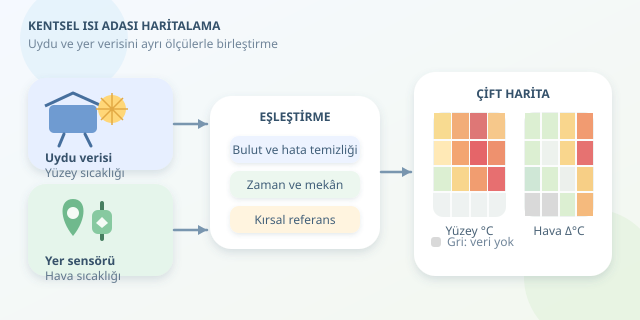

Yazın aynı şehirde bir park serinletirken asfalt bir meydan neden fırın gibi hissettirir? Cevap yalnızca güneşte değil; yapı malzemelerinde, bitki örtüsünde ve hava dolaşımında saklıdır. Uydu görüntülerini yer sensörleriyle birleştirerek bu farkları ölçebilir, şehrin termal dedektifi olabiliriz. Ancak güzel bir harita çizmeden önce, hangi sıcaklığı ölçtüğümüzü anlamamız gerekir.




``

## Isı adasının fiziksel mantığı

Kentsel ısı adası, kentlerin çevresindeki kırsal alanlardan daha sıcak olmasıdır. Beton ve asfalt güneş enerjisini depolar; azalan bitki örtüsü, buharlaşma ve terleme yoluyla soğutmayı sınırlar. Binalar hava akışını değiştirirken trafik ve klimalar ek ısı üretir. Gece olduğunda depolanan enerji yavaşça salınır. Yani şehir, gündüz şarj olan dev bir termal batarya gibi davranabilir.

Hava sıcaklığına dayalı etkiyi şöyle tanımlayabiliriz:

$$\Delta T_{hava}(t)=T_{kent}(t)-T_{kırsal}(t)$$

Burada karşılaştırılan ölçümler aynı zaman aralığına ait olmalıdır. Referans alanın rakımı, denize uzaklığı ve arazi kullanımı da sonucu etkiler. Rastgele seçilen tek bir kırsal sensör, bütün karşılaştırmayı yanıltabilir.

## Uydu ve sensör aynı şeyi ölçmez

Termal uydu ürünleri **yüzey sıcaklığını**, uygun yerleştirilmiş meteorolojik sensörler ise **hava sıcaklığını** temsil eder. Güneşteki asfalt yüzeyiyle iki metre yükseklikteki hava arasında ciddi fark olabilir. Bu nedenle ikisini tek sıcaklık sütununda karıştırmak, elmayla tost makinesini karşılaştırmaya benzer.

| Veri kaynağı | Temel ölçüm | Güçlü tarafı | Sınırlaması |
|---|---|---|---|
| Landsat 8/9 termal ürünleri | Yüzey sıcaklığı | Şehir genelinde karşılaştırma | Bulutlar ve seyrek geçişler |
| Sentinel-2 | Yansıtım ve bitki örtüsü | Yeşil alanları ayrıştırma | Doğrudan termal ölçüm yapmaz |
| Yer sensörleri | Hava sıcaklığı | Sık zamanlı gözlem | Konum ve kurulum yanlılığı |

Landsat termal bantlarının doğal çözünürlüğü yaklaşık 100 metredir; 30 metrelik ürün pikseli, bağımsız 30 metrelik termal ayrıntı anlamına gelmez.

Bitki örtüsünü incelemek için Sentinel-2 üzerinden şu gösterge hesaplanabilir:

$$NDVI=\frac{NIR-Red}{NIR+Red}$$

Yüksek NDVI genellikle daha yoğun bitki örtüsünü gösterir. Ancak düşük sıcaklığın tek açıklaması değildir; gölge, nem ve rüzgâr da önemlidir.

## Analiz hattını hazırlayalım

1. **Veriyi temizleyin:** Uydu kalite bantlarıyla bulutları maskeleyin. Ürünün ölçek ve ofset bilgilerini uygulayıp sıcaklığı Celsius’a dönüştürün. Sensörlerde hatalı kayıtları ve kalibrasyon sorunlarını kontrol edin.
2. **Zamanı eşleyin:** Sensörleri gerçek uydu geçişinin çevresindeki dar bir zaman penceresinde özetleyin. Günlük ortalamayla anlık uydu görüntüsünü karşılaştırmayın.
3. **Mekânı eşleyin:** Verileri aynı, metre birimli yerel koordinat sistemine taşıyın. Örneğin 250 metrelik hücreler oluşturun; bu seçim yeni ayrıntı üretmez.
4. **Referansı belirleyin:** Birden fazla uygun kırsal istasyonu değerlendirin. Kent ve kırsal sensörlerin benzer koşullarda kurulmasına dikkat edin.

## Python ile iki ayrı sıcaklık haritası

Aşağıdaki örnek, hazırlanmış Celsius rasterini hücrelerde özetler ve sensörlerin kırsal referansa göre hava sıcaklığı farkını hesaplar. `geopandas`, `pandas`, `rasterstats` ve `matplotlib` gerekir. Grid ile raster aynı koordinat sisteminde olmalıdır.

```python
import geopandas as gpd
import pandas as pd
import matplotlib.pyplot as plt
from rasterstats import zonal_stats

grid = gpd.read_file('grid_250m.gpkg')
obs = pd.read_csv('sensorler.csv')
obs['zaman'] = pd.to_datetime(obs['zaman'], utc=True)

# Gerçek uydu geçiş zamanıyla değiştirin.
t = pd.Timestamp('2026-07-15T08:00:00Z')
obs = obs[(obs['zaman'] - t).abs() <= pd.Timedelta('15min')]
obs = obs.groupby(
    ['sensor_id', 'lon', 'lat', 'tur'], as_index=False
).agg(t_air=('sicaklik_c', 'mean'))

ref = obs.loc[obs['tur'] == 'kirsal', 't_air'].mean()
if pd.isna(ref):
    raise ValueError('Zaman penceresinde kırsal referans yok.')

points = gpd.GeoDataFrame(
    obs, geometry=gpd.points_from_xy(obs.lon, obs.lat),
    crs='EPSG:4326'
).to_crs(grid.crs)

stats = zonal_stats(grid, 'lst_celsius.tif',
                    stats=['mean'], nodata=-9999)
grid['lst_c'] = [s['mean'] for s in stats]
joined = gpd.sjoin(points, grid[['geometry']],
                   how='inner', predicate='within')
means = joined.groupby('index_right')['t_air'].mean()
grid['delta_air'] = grid.index.map(means) - ref

fig, axes = plt.subplots(1, 2, figsize=(12, 5))
for ax, column in zip(axes, ['lst_c', 'delta_air']):
    grid.plot(column=column, ax=ax, legend=True,
              missing_kwds={'color': 'lightgrey'})
    ax.set_title(column + ' (°C)')
plt.show()
```

Önce her sensörün zaman ortalaması alınır; böylece sık kayıt yapan cihaz referansı gereksizce domine etmez. Mekânsal birleştirme sensörleri hücrelere atar. Sensör bulunmayan hücreler gri kalır: **veri yokluğu, serinlik değildir**.

## Haritayı doğru yorumlamak

Sıcak yüzeylerle düşük NDVI birlikte görülüyorsa yeşil altyapı için aday bölgeler belirlenebilir. Yine de korelasyon, nedensellik kanıtı değildir. Rakım, yapı yoğunluğu ve kıyı etkisini ayrıca değerlendirin.

Tek görüntü yerine farklı günleri ve mümkünse gece ölçümlerini karşılaştırın. İnterpolasyon veya tahmin modeli kullanıyorsanız yakın noktaları rastgele bölmek yerine mekânsal doğrulama yapın; aksi hâlde başarı olduğundan yüksek görünebilir. Son haritaya tarih, birim, bulut boşlukları ve belirsizlik bilgisi ekleyin. Amaç yalnızca kırmızı bölgeler çizmek değil, nerede gölgeye ve serinlemeye ihtiyaç olduğunu güvenilir biçimde göstermektir.
