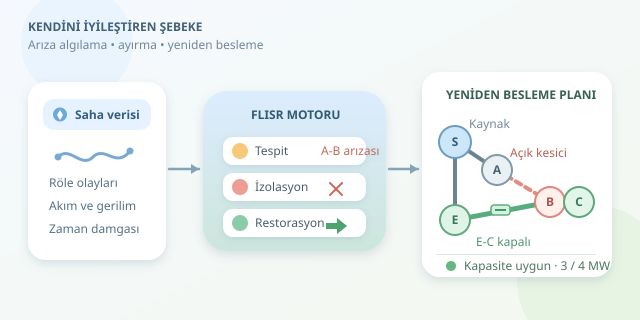

Bir elektrik hattında arıza çıktığında bütün mahallenin karanlıkta kalması şart mı? Akıllı şebekelerde cevap giderek daha güçlü bir “hayır”. **Self-healing grid**, sensörlerden gelen bilgileri değerlendirerek arızalı bölümü belirler, güvenli biçimde ayırır ve sağlam bölgeleri alternatif bağlantılardan yeniden besler. Elektrik şebekesinin navigasyonu gibi düşünün: Yol kapalıysa uygun güzergâh yeniden hesaplanır; ancak burada yanlış dönüşün bedeli çok daha yüksektir.

``

## Üç aşamalı iyileşme: FLISR

Bu yaklaşımın önemli uygulamalarından biri **FLISR**, yani arıza yerini belirleme, izolasyon ve hizmeti geri getirmedir. Amaç arızalı kabloyu sihirli biçimde onarmak değildir. Amaç, hasarlı bölüm onarım beklerken mümkün olduğunca çok sağlam tüketiciyi yeniden enerjilendirmektir.

| Aşama | Temel soru | Kullanılan bilgi |
|---|---|---|
| Tespit | Ne oldu, nerede oldu? | Röle olayları, akım, gerilim |
| İzolasyon | Hangi bölüm ayrılmalı? | Topoloji, kesici ve ayırıcı durumları |
| Restorasyon | Sağlam yükler nereden beslenebilir? | Yük tahminleri, hat kapasitesi, gerilim |




Koruma röleleri genellikle arızaya ilk tepkiyi verir. Üst seviyedeki otomasyon ise olayları birleştirerek yeniden besleme planı üretir. Böylece hızlı koruma ile daha kapsamlı optimizasyon birbirini tamamlar.

## Teorik temel: Şebeke bir graftır

Şebekeyi $G=(V,E)$ grafıyla modelleyebiliriz. Düğümler baraları veya yük noktalarını, kenarlar elektriksel bağlantıları temsil eder. Açık bir anahtarın bağlantısı aktif grafta bulunmaz; kapalı bir anahtarın bağlantısı bulunur.

Birçok dağıtım sistemi normal işletmede radyaldir: Her tüketicinin kaynağa tek besleme yolu vardır. Bağlı bir graf için $\vert E\vert =\vert V\vert -1$ koşulu, ağın ağaç yapısında olduğunu gösterir. Alternatif bağlantı kapatılırken istenmeyen halka oluşturmamak bu yüzden önemlidir.

Fakat bağlantının varlığı tek başına yeterli değildir. Dengeli üç fazlı sistem yaklaşımında:

$$S=\sqrt{P^2+Q^2},\qquad I=\frac{S}{\sqrt{3}\,V_{LL}}$$

Burada $P$ aktif güç, $Q$ reaktif güç, $S$ görünür güç, $V_{LL}$ ise hatlar arası gerilimdir. Yeni güzergâh yükü taşıyabilmeli; akım, gerilim ve koruma koordinasyonu sınırları korunmalıdır. Kısacası elektrik, haritadaki her kestirmeyi sevmez.

## Arıza nasıl anlaşılır?

Tek bir düşük gerilim ölçümüne bakarak karar vermek risklidir. Motor kalkışı, ölçüm hatası veya haberleşme gecikmesi benzer işaretler oluşturabilir. Röle açma bilgisi, komşu ölçümler ve zaman damgaları birlikte değerlendirilmelidir. Eksik veya tutarsız veride otomasyon güvenli bir bekleme durumuna geçebilir.

Örneğimizde normal bağlantılar `S-A-B-C` ve `S-E` olsun. `E-C` bağlantısı normalde açık tutulsun. `A-B` bölümünde doğrulanmış arıza oluştuğunda, bu bölüm uygun anahtarlama cihazlarıyla bütün olası besleme yönlerinden ayrılır. Ardından `E-C` bağlantısı üzerinden `C` ve `B` yeniden beslenebilir.

## Python ile çevrimdışı restorasyon denemesi

Aşağıdaki örnek `networkx` kullanır. Arızalı kenarı kaldırmak yalnızca **izolasyonun yazılımsal temsilidir**; kod fiziksel cihazlara komut göndermez. Model, kayıpları ve reaktif gücü ihmal ederek aktif güç kapasitesini kontrol eder.

```python
import networkx as nx

grid = nx.Graph()
grid.add_edges_from(
    [('S', 'A'), ('A', 'B'), ('B', 'C'), ('S', 'E')],
    capacity_mw=4.0
)
loads = {'B': 1.2, 'C': 1.8}
grid.remove_edge('A', 'B')  # İzolasyon simülasyonu

candidate = grid.copy()
candidate.add_edge('E', 'C', capacity_mw=4.0)

def feasible(graph):
    if not nx.is_tree(graph):
        return False
    flows = {frozenset(edge): 0.0 for edge in graph.edges}
    for node, demand in loads.items():
        path = nx.shortest_path(graph, 'S', node)
        for u, v in zip(path, path[1:]):
            flows[frozenset((u, v))] += demand
    return all(
        flows[frozenset((u, v))] <= data['capacity_mw']
        for u, v, data in graph.edges(data=True)
    )

print('Plan uygun' if feasible(candidate) else 'Plan reddedildi')
```

Fonksiyon önce bağlı ve halkasız yapı arar. Ardından her yükün kaynağa giden yolunu bulur ve ortak hatlarda taşınan güçleri toplar. Böylece yalnızca yol bulunmasıyla yetinmez, kapasiteyi de sorgular. Örnekte alternatif güzergâhın ortak kısmı toplam $3$ MW taşır; tanımlanan $4$ MW sınırını aşmaz.

## Simülasyondan gerçek şebekeye

Gerçek uygulamada bu kontrolün yanına güç akışı analizi, topraklama koşulları, ters güç akışı, dağıtık üretim ve çalışma izinleri eklenir. Sahadaki kilitlemeler, bakım personelinin güvenliği ve cihaz durumlarının doğrulanması zorunludur. Bir anahtarın komut alması, gerçekten konum değiştirdiğini kanıtlamaz.

Birden fazla aday bağlantı varsa, geri kazanılan yük, anahtarlama sayısı ve kritik tüketici önceliği birlikte değerlendirilir. Hastanenin beslenmesi, aynı büyüklükte sıradan bir yükten daha yüksek öncelik taşıyabilir.

İyi bir self-healing sistemi yalnızca hızlı değildir; kararlarını açıklayabilir, başarısız işlemi fark eder ve güvenli biçimde durabilir. İlk proje hedefiniz gerçek anahtarları sürmek değil, farklı arıza senaryolarını simüle etmek olsun. Böylece şebekenizin reflekslerini geliştirirken ışıkları yanlışlıkla siz söndürmezsiniz!
