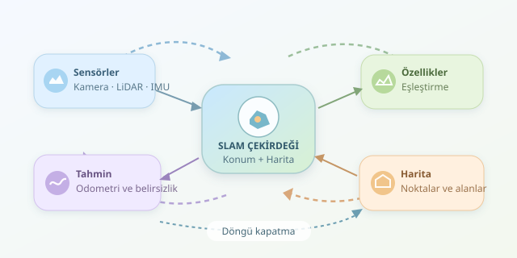

Gözlerinizi ilk kez açtığınız, daha önce hiç görmediğiniz bir binada olduğunuzu düşünün. Elinizde harita yok; üstelik nerede olduğunuzu da bilmiyorsunuz. Yürürken koridorları tanıyor, geçtiğiniz yerleri hatırlıyor ve zihninizde bir plan oluşturuyorsunuz. Otonom araçların bu çetrefilli işi sayılarla yapmasına **SLAM**, yani eşzamanlı konumlandırma ve haritalama denir.

``

## Tavuk mu, harita mı?

SLAM’in temelinde karşılıklı bağımlılık vardır: Konumunuzu bulmak için haritaya, haritayı çizmek için konumunuza ihtiyaç duyarsınız. Çözüm, ikisini birlikte tahmin etmektir.

Araç; kamera, LiDAR, tekerlek enkoderi veya IMU gibi sensörlerden veri toplar. Durumu yalnızca koordinatlardan oluşmaz; yönelimi de içerir. Harita ise uygulamaya göre belirgin noktalar, doluluk hücreleri veya üç boyutlu nokta bulutu olabilir.

Başlangıç konumu genellikle referans kabul edilir. GPS gibi dış referanslar yoksa ortaya çıkan harita, Dünya üzerindeki mutlak konumdan ziyade başlangıca göre anlam taşır. Yani araç kendi mahallesini öğrenir; posta kodunu bilmek zorunda değildir.

## Belirsizlik, sistemin başrol oyuncusu

Sensörler kusursuz değildir. Tekerlek kayabilir, kamera bulanıklaşabilir, lazer camdan beklenmedik biçimde yansıyabilir. Bu yüzden SLAM tek bir kesin cevap yerine belirsizlik içeren tahminlerle çalışır.

Temel hedef şu olasılığı değerlendirmektir:

$$p(x_{0:t}, m \mid z_{1:t}, u_{1:t})$$

Burada $x_{0:t}$ aracın izlediği durum dizisi, $m$ harita, $z$ çevre gözlemleri, $u$ ise hareket bilgisidir. Başka bir ifadeyle: “Gördüklerim ve hareket ölçümlerim doğruysa hangi yol ve harita en tutarlı açıklamadır?”

EKF tabanlı yaklaşımlar durumları ve kovaryanslarını günceller. Graf tabanlı yaklaşımlar ise konumlar arasındaki ölçüm ilişkilerini optimize eder. Her iki yaklaşımda da hareket ve sensör modellerinin gerçekçi olması kritik önem taşır.

## Ölçümden haritaya giden yol

Tipik bir SLAM döngüsü şu adımları izler:

1. **Hareket tahmini:** Odometri veya IMU, yeni konum için ilk tahmini üretir.
2. **Özellik çıkarımı:** Görüntü köşeleri ya da geometrik yüzeyler belirlenir.
3. **Veri ilişkilendirme:** Yeni gözlemlerin önceki hangi noktalara karşılık geldiği araştırılır.
4. **Düzeltme:** Sensör gözlemleriyle hareket tahmini uzlaştırılır.
5. **Harita güncelleme:** Yeni bölgeler eklenir, mevcut tahminler iyileştirilir.

Sensör seçimi bu sürecin karakterini değiştirir:

| Yaklaşım | Güçlü tarafı | Temel zorluğu |
|---|---|---|
| LiDAR SLAM | Doğrudan mesafe ölçümü | Maliyet ve geometrik benzerlik |
| Görsel SLAM | Zengin görüntü özellikleri | Işık değişimi ve doku eksikliği |
| Görsel-ataletsel SLAM | Hızlı hareketlerde destek | Kalibrasyon ve zaman eşleştirme |

Tek kameralı sistemlerde mutlak ölçek ayrıca belirsiz olabilir. Görüntüdeki hareket, ek bilgi olmadan gerçek dünyadaki metreyi kendiliğinden söylemez.

## Döngü kapatma: “Ben burayı görmüştüm!”

Küçük hareket hataları biriktikçe araç başlangıçtan giderek uzak bir konum hesaplayabilir. Buna **sürüklenme** denir. Daha önce ziyaret edilen bir yer tanındığında oluşan döngü kapatma kısıtı, geçmiş tahminlerin yeniden düzenlenmesini sağlar.

Graf yaklaşımında düğümler araç durumlarını, kenarlar ölçüm ilişkilerini temsil eder. Ancak yanlış bir eşleşme bütün haritayı bozabilir. Bu nedenle benzer görüntü bulmak yetmez; eşleşmenin geometrik olarak doğrulanması gerekir.

## Python ile küçük bir optimizasyon deneyi

Aşağıdaki örnek NumPy ve SciPy kullanır. Yönelimleri sabit varsayarak yalnızca iki boyutlu konumları optimize eder; dolayısıyla tam bir SLAM sistemi değildir. Bütün yer değiştirme ölçümleri aynı koordinat çerçevesindedir.

Amaç fonksiyonu şöyledir:

$$X^* = \arg\min_X \sum_{(i,j)} \frac{\\vert (x_j-x_i)-d_{ij}\\vert ^2}{\sigma_{ij}^2}$$

```python
import numpy as np
from scipy.optimize import least_squares

# Son kenar, yeniden tanınan yerden gelen kısıttır.
edges = [
    (0, 1, [1.1, 0.1], 0.15),
    (1, 2, [-0.1, 1.0], 0.15),
    (2, 3, [-0.9, -0.1], 0.15),
    (0, 3, [0.0, 1.0], 0.05),
]

initial = np.array([[1.1, 0.1], [1.0, 1.1], [0.1, 1.0]])

def residual(flat):
    # İlk konumu sabitleyerek referans belirsizliğini gider.
    positions = np.vstack(([0.0, 0.0], flat.reshape(-1, 2)))
    errors = []
    for i, j, displacement, sigma in edges:
        error = positions[j] - positions[i] - displacement
        errors.extend(error / sigma)
    return np.asarray(errors)

result = least_squares(residual, initial.ravel())
print(result.x.reshape(-1, 2))
```

`residual`, ölçülen ve hesaplanan yer değiştirmeler arasındaki farkı döndürür. Standart sapması küçük ölçümler daha yüksek ağırlık kazanır. Optimizasyon, döngü kapatma bilgisini kullanarak hatayı konumlar arasında dağıtır. Gerçek sistemlerde yönelimler, koordinat dönüşümleri ve aykırı ölçümlere dayanıklı kayıp fonksiyonları da hesaba katılır.

## Harita çizmek, dünyayı anlamak değildir

SLAM geometrik tutarlılık sağlar; trafik kurallarını veya yayaların niyetlerini tek başına çözmez. Hareketli nesneler, birbirine benzeyen koridorlar ve sensör zamanlama hataları hâlâ ciddi sorunlardır. Başarılı sistemler bunları filtreleme, doğrulama ve sensör birleştirmeyle yönetir. Kısacası araç, sihirli bir pusulayla değil, sürekli sorguladığı ölçümlerle yolunu bulur.



