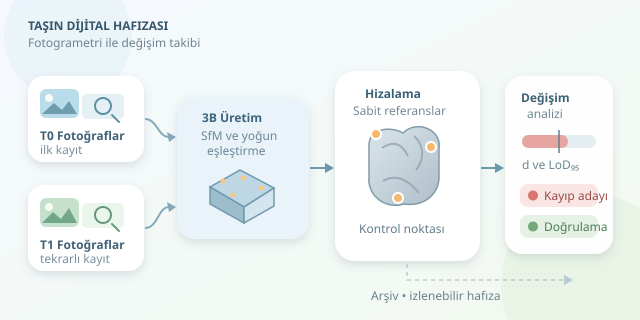

Tarihi bir yapının taşları konuşabilseydi, yağmurun, tuzun ve zamanın bıraktığı izleri uzun uzun anlatırdı. Fotogrametri, bu sessiz hikâyeyi ölçülebilir verilere dönüştürür. Farklı tarihlerde çekilen fotoğraflardan üretilen üç boyutlu modeller sayesinde yüzey kaybını takip edebiliriz. Ancak iki modeli üst üste koymak, tek başına güvenilir bir teşhis değildir!
``

## Önce sağlam bir ölçüm senaryosu

Fotogrametri, aynı yüzeyin farklı açılardan çekilmiş görüntülerindeki ortak özellikleri eşleştirerek kamera konumlarını ve üç boyutlu geometriyi hesaplar. SfM kamera geometrisini kurar; yoğun eşleştirme ise ayrıntılı nokta bulutunu üretir. Sonuç, güzel bir dijital heykelden fazlasıdır: doğru ölçeklendirilmişse ölçüm yapılabilen bir yüzeydir.

Tekrarlı çekimlerde şu kurallar işinizi kolaylaştırır:

- **Benzer çekim düzeni:** Mesafeyi, odak uzaklığını ve görüntü örtüşmesini mümkün olduğunca koruyun.
- **Sabit referanslar:** Kontrol noktalarını bozulması beklenmeyen alanlara yerleştirin; hedefleri tarihi yüzeye zarar vermeden sabitleyin.
- **Bağımsız kontrol:** Model üretiminde kullanılmayan kontrol noktalarıyla doğruluğu sınayın.
- **Kayıt disiplini:** Tarihi, hava koşullarını, kamera ayarlarını ve işlem parametrelerini saklayın.

Özellikle ıslak taş, sert gölgeler ve parlak yüzeyler eşleştirmeyi zorlaştırabilir. Yüksek nokta yoğunluğunu yüksek doğrulukla karıştırmayın: bol veri, hatalı ölçeği düzeltmez.

## İki model gerçekten aynı yerde mi?

Değişim analizinin temeli, farklı tarihlerdeki modelleri aynı koordinat sistemine taşımaktır. Önce kontrol noktalarıyla ölçek ve konum belirlenir; gerekiyorsa kararlı yüzeyler üzerinde ICP gibi yöntemlerle ince hizalama yapılır. Erozyona uğrayan bölgeleri hizalamaya katmak, gerçek değişimin bir bölümünü algoritmanın “düzeltmesine” neden olabilir.

| Yaklaşım | Avantajı | Kritik sınırlaması |
|---|---|---|
| Kontrol noktaları | Ölçek ve ortak referans sağlar | Noktalar yer değiştirmemelidir |
| Kararlı alanlarda ICP | İnce hizalamayı iyileştirir | Başlangıç konumuna duyarlıdır |
| Tüm yüzeyde ICP | Kolay uygulanır | Gerçek değişimi bastırabilir |

Yüzey değişimini yerel normal yönünde ölçmek yararlıdır. Aynı ölçüm bölgesindeki iki yüzey merkezini $C_0$ ve $C_1$, dışa dönük birim normali $n$ kabul edersek:

$$d=(C_1-C_0)\cdot n$$

Bu işaret düzeninde negatif değer yüzey gerilemesini, pozitif değer dışa doğru değişimi gösterir. En yakın noktalar arasındaki mesafe ise eğimli yüzeylerde yanıltıcı olabilir.

## Değişim mi, ölçüm gürültüsü mü?

Milimetrelik bir fark, otomatik olarak milimetrelik erozyon demek değildir. Yüzey pürüzlülüğü, örnekleme ve hizalama belirsizliği birlikte değerlendirilmelidir. Basitleştirilmiş, yaklaşık normal dağılım ve bağımsız hata varsayımıyla yüzde 95 tespit eşiği şöyle yazılabilir:

$$LoD_{95}=1.96\sqrt{\frac{s_0^2}{N_0}+\frac{s_1^2}{N_1}+\sigma_{reg}^2}$$

Burada $s$ normal doğrultusundaki yerel saçılma, $N$ etkin bağımsız örnek sayısı, $\sigma_{reg}$ ise aynı doğrultudaki kayıt belirsizliğidir. Yoğun buluttaki bütün noktaları bağımsız saymak eşiği gereğinden fazla küçültebilir. Bu eşik mutlak garanti değil, kullanılan hata modelinin sonucudur.

## Python ile değişim adaylarını ayıklayalım

Aşağıdaki örnek, önceden hizalanmış bulutlardan aynı yerel ölçüm bölgeleri için hazırlanmış `olcumler.npz` dosyasını okur. `c0` ve `c1` bölge merkezleri, `normals` birim dış normaller, diğer alanlar belirsizlik girdileridir. Koordinatlar ve uzunluk belirsizlikleri metredir; örnek sayıları pozitif olmalıdır.

```python
import numpy as np

veri = np.load("olcumler.npz")
c0, c1 = veri["c0"], veri["c1"]
normaller = veri["normals"]
s0, s1 = veri["s0"], veri["s1"]
n0, n1 = veri["n0"], veri["n1"]
sigma_reg = veri["sigma_reg"]

d = np.einsum("ij,ij->i", c1 - c0, normaller)
lod = 1.96 * np.sqrt(s0**2 / n0 + s1**2 / n1 + sigma_reg**2)
anlamli = np.abs(d) > lod

sonuc = np.column_stack((c0, d, lod, anlamli.astype(int)))
np.savetxt("degisim.csv", sonuc, delimiter=",",
           header="x,y,z,d_m,lod95_m,degisim_adayi", comments="")
```

Vektörleştirilmiş kod, her bölgede normal yönündeki farkı ve tespit eşiğini hesaplar. Bu, M3C2 yaklaşımının mantığını gösteren sade bir örnektir; yerel komşuluk seçimini veya normal kestirimini gerçekleştirmez. Üretilen adaylar mutlaka görsel ve saha kontrolünden geçirilmelidir.

## Haritayı doğru okuyun

| Ölçülen fark | Tespit eşiği | Yorum |
|---|---|---|
| −4,0 mm | 2,5 mm | Yüzey kaybı adayı |
| +1,0 mm | 2,5 mm | Gürültüden ayrılamıyor |
| +5,0 mm | 2,5 mm | Birikim veya başka değişim adayı |

Anlamlı kayıp için yıllık ortalama hız $v=\vert d\vert /\Delta t$ ile hesaplanabilir; bu değer sürecin doğrusal ilerlediğini kanıtlamaz. Pozitif farkı hemen kabarma, negatif farkı hemen tuz hasarı olarak etiketlemeyin. Fotogrametri geometriyi ölçer; nedeni belirlemek için malzeme incelemesi, nem ölçümleri ve uzman değerlendirmesi gerekir.

Son olarak ham fotoğrafları, kontrol noktalarını, işlem sürümlerini ve belirsizlik haritalarını arşivleyin. Böylece sonraki kampanya yalnızca yeni bir model üretmez: tarihi yapının denetlenebilir dijital hafızasına yeni bir sayfa ekler.
