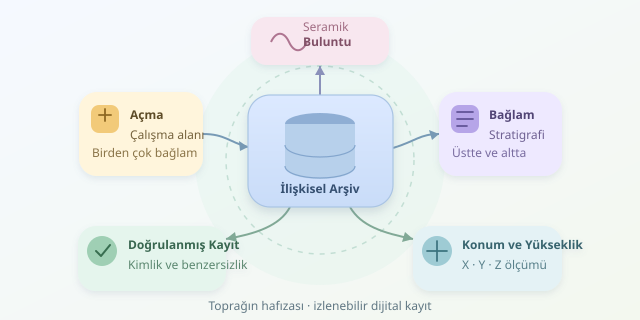

Bir kazı alanında bulunan küçük bir seramik parçası, tek başına pek konuşkan değildir. Ancak hangi açmada, hangi bağlamda ve hangi koordinatta bulunduğunu bilirseniz geçmişin hikâyesine katılır. Veritabanı yönetimi, bu hikâyenin parçalarını birbirine bağlar; defterler, fotoğraflar ve ölçümler arasında kaybolmayı önler. Gelin, toprağın hafızasına düzenli bir dijital arşiv hazırlayalım.

``

## Önce Mantık: Buluntu, Açma ve Bağlam

**Açma**, kazının yürütüldüğü tanımlı çalışma birimidir. **Bağlam** ise stratigrafik olarak ayırt edilen birimdir: toprak tabakası, çukur dolgusu veya duvar olabilir. Dolayısıyla her bağlamı yalnızca katman diye adlandırmak, arkeolojik anlamı daraltabilir.

Bir açmada birçok bağlam, bir bağlamda birçok buluntu bulunabilir. Bu ilişkiler, ilişkisel veritabanında bire-çok bağlantılarla modellenir. Buluntunun bağlamını her satırda uzun uzun açıklamak yerine, ilgili kaydın kimliğini saklarız. Böylece açıklama değiştiğinde yüzlerce kaydı düzeltmek gerekmez.

| Yaklaşım | Avantaj | Temel risk |
|---|---|---|
| Serbest metinli defter | Esnek kayıt | Tutarsız adlandırma |
| Tek elektronik tablo | Hızlı başlangıç | Tekrarlanan bilgiler |
| İlişkisel veritabanı | Denetlenebilir ilişkiler | Başlangıçta tasarım gerektirir |

## Konumun Üç Boyutu, Zamanın Ayrı Mantığı

Konum genellikle $x$, $y$ ve $z$ ile kaydedilir. İlk ikisi yatay konumu, üçüncüsü yüksekliği temsil eder. Aynı metrik koordinat sistemindeki iki buluntu arasındaki yaklaşık mesafe şöyle hesaplanabilir:

$$d = \sqrt{(x_2-x_1)^2 + (y_2-y_1)^2 + (z_2-z_1)^2}$$

Ancak daha derinde bulunmak, otomatik olarak daha eski olmak değildir. Sonradan açılmış çukurlar stratigrafiyi bozabilir. Kronolojik yorum için bağlamların birbirini kesmesi, örtmesi veya doldurması gibi ilişkiler ayrıca kaydedilmelidir. Harris matrisi, bu ilişkileri görünür kılan araçtır; koordinat hesabının yerine geçmez.

## PostgreSQL ve PostGIS ile Temel Şema

Aşağıdaki şema, açmaları ve bağlamları ayrı tutar; buluntuları bağlama ve üç boyutlu konuma bağlar:

```sql
CREATE EXTENSION IF NOT EXISTS postgis;

CREATE TABLE acma (
    id bigint GENERATED ALWAYS AS IDENTITY PRIMARY KEY,
    kod text NOT NULL UNIQUE
);

CREATE TABLE baglam (
    id bigint GENERATED ALWAYS AS IDENTITY PRIMARY KEY,
    acma_id bigint NOT NULL REFERENCES acma(id),
    kod text NOT NULL,
    UNIQUE (acma_id, kod)
);

CREATE TABLE buluntu (
    id bigint GENERATED ALWAYS AS IDENTITY PRIMARY KEY,
    envanter_no text NOT NULL UNIQUE,
    baglam_id bigint NOT NULL REFERENCES baglam(id),
    konum geometry(PointZ, 32636) NOT NULL,
    malzeme text NOT NULL
);
```

Buradaki yabancı anahtarlar, olmayan bağlama buluntu eklenmesini engeller. Benzersizlik kuralları da aynı envanter numarasının yanlışlıkla tekrar kullanılmasını önler. Bağlam kodu açma içinde benzersizdir; farklı açmalarda aynı kod bulunabilir.

Örnekteki `32636`, WGS 84 / UTM 36N yatay referans sistemidir; yalnızca alanın konumuna uygunsa kullanılmalıdır. `PointZ`, yüksekliği saklar fakat bu kod tek başına düşey datumu tanımlamaz. Yükseklik referansı, ölçüm yöntemi ve belirsizlik ayrıca belgelenmelidir.

## Bir Buluntuyu Kaydetmek ve Geri Çağırmak

Önceden oluşturulmuş 12 numaralı bağlama bir seramik parçası ekleyelim. Ardından bağlam kodunu ve yüksekliğini birlikte okuyalım:

```sql
INSERT INTO buluntu
    (envanter_no, baglam_id, konum, malzeme)
VALUES (
    'KAZI-2026-0042',
    12,
    ST_SetSRID(ST_MakePoint(500123.40, 4200456.20, 112.85), 32636),
    'seramik'
);

SELECT b.envanter_no, g.kod AS baglam,
       ST_Z(b.konum) AS yukseklik
FROM buluntu b
JOIN baglam g ON g.id = b.baglam_id
WHERE g.id = 12;
```

`ST_MakePoint` koordinatları oluşturur; `ST_SetSRID` referans sistemini etiketler, koordinat dönüşümü yapmaz. Farklı sistemlerden gelen ölçümler gerçekten dönüştürülecekse `ST_Transform` gerekir. Örnek koordinatlar temsili değerlerdir.

## Saha Disiplini: Veriyi Kurtaran Küçük Kurallar

- **Kontrollü sözlük kullanın:** Seramik, pişmiş toprak ve benzeri terimlerin kapsamını tanımlayın; yazım çeşitlerini sınırlayın.
- **İlişkileri denetleyin:** Bağlamlar arasındaki üstte/altta bağlantılarını ayrı tabloda tutun. Kendine bağlantıları ve döngüleri reddedin; yalnızca yabancı anahtar yeterli değildir.
- **Değişiklik geçmişini koruyun:** Kullanıcı, zaman ve düzeltme gerekçesini kaydedin. İlk saha gözlemi ile sonraki yorum birbirine karışmasın.
- **Yedeklemeyi sınayın:** Düzenli yedek alın, geri yüklemeyi deneyin; fotoğraf ve çizimleri kalıcı kimliklerle ilişkilendirin.

Sonuçta iyi veritabanı yalnızca buluntuları saymaz: gözlemin nereden geldiğini ve yorumun nasıl oluştuğunu korur. Kazı geri alınamaz; bu yüzden kayıt sistemi, geçmişe açılan kapının güvenilir anahtarıdır.
