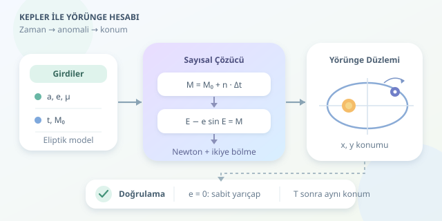

Bir uyduyu uzaya göndermek heyecanlıdır; fakat birkaç dakika sonra nerede olacağını bilmek de oldukça önemlidir! Haberleşme antenleri, gözlem planları ve uzay simülasyonları aynı soruya dayanır: Zaman ilerlediğinde cismin konumu nasıl değişir? Bu yazıda Kepler denklemini sayısal olarak çözüp eliptik bir yörüngenin konumunu Python ile hesaplayacağız.
``

## Önce fizik: İki cisimlik evren

Modelimizde uydu ve merkezî gök cismi dışında kimse yok. Atmosfer, diğer gezegenler ve Dünya’nın basıklığı şimdilik sahne arkasında. Bu **iki cisim yaklaşımında**, bağlı bir yörünge elipstir ve merkezî cisim elipsin odaklarından birinde bulunur.

Yörüngeyi tanımlayan temel büyüklükler, yarı büyük eksen $a$ ve dışmerkezlik $e$ değerleridir. Dairesel yörüngede $e=0$, eliptik yörüngede $0<e<1$ olur. Kütleçekim parametresi $\mu=G(m_1+m_2)$ biçimindedir; küçük bir uydu için Dünya’nın değeri yaklaşık $398600.4418\;\mathrm{km^3/s^2}$ alınabilir.

Ortalama açısal hareket ve yörünge periyodu şöyle hesaplanır:

$$n=\sqrt{\frac{\mu}{a^3}},\qquad T=\frac{2\pi}{n}$$

Kilometre kullanıyorsanız bütün uzunlukları kilometre tutmalısınız. Birim karışıklığı, uydunuzu matematiksel olarak başka bir galaksiye göndermenin hızlı yoludur.

## Zaman neden doğrudan açı değildir?

Kepler’in ikinci yasası nedeniyle uydu, merkezî cisme yakınken daha hızlı hareket eder. Dolayısıyla elips üzerinde sabit açısal hız varsayamayız. Bunun yerine zamanı, düzgün artan **ortalama anomaliye** dönüştürürüz:

$$M(t)=M_0+n(t-t_0)$$

Buradaki $M_0$, başlangıç anındaki ortalama anomalidir. Gerçek konuma geçmek için yardımcı bir açı olan **eksantrik anomaliyi**, yani $E$ değerini bulmalıyız:

$$M=E-e\sin E$$

Bu, meşhur Kepler denklemidir. Genel eliptik durumda $E$ için basit bir kapalı çözüm bulunmadığından sayısal yöntemlere başvururuz. Ortalama anomaliyi doğrudan geometrik açı sanmak, özellikle uzamış elipslerde belirgin konum hataları üretir.

## Sayısal yöntem seçimi

Çözmek istediğimiz fonksiyon $f(E)=E-e\sin E-M$, türevi ise $f'(E)=1-e\cos E$ olur. Eliptik yörüngelerde türev pozitiftir; böylece seçtiğimiz aralıkta kök tektir.

| Yöntem | Avantajı | Dikkat edilmesi gereken |
|---|---|---|
| Newton–Raphson | Kök yakınında çok hızlıdır | Başlangıç tahminine duyarlıdır |
| İkiye bölme | Kökü çevreleyen aralıkta güvenilirdir | Daha yavaş yakınsar |
| Hibrit yöntem | Hız ve güvenilirliği birleştirir | Aralık takibi gerektirir |

Newton güncellemesi $E_{k+1}=E_k-f(E_k)/f'(E_k)$ şeklindedir. Aşağıdaki kod, Newton adımı güvenli aralığın dışına çıkarsa ikiye bölmeye geçer. Böylece yüksek dışmerkezliklerde de daha dayanıklı davranır.

## Python ile konumu hesaplayalım

```python
import math


def kepler(M, e, tol=1e-13):
    M = (M + math.pi) % (2 * math.pi) - math.pi
    lo, hi = -math.pi, math.pi
    E = M if e < 0.8 else math.copysign(math.pi, M)

    for _ in range(80):
        f = E - e * math.sin(E) - M
        if abs(f) < tol:
            return E

        if f > 0:
            hi = E
        else:
            lo = E

        candidate = E - f / (1 - e * math.cos(E))
        E = candidate if lo < candidate < hi else (lo + hi) / 2

    raise RuntimeError('Kepler çözümü yakınsamadı')


def position(dt, a, e, M0=0.0, mu=398600.4418):
    if not (a > 0 and mu > 0 and 0 <= e < 1):
        raise ValueError('Eliptik yörünge parametrelerini kontrol edin')

    n = math.sqrt(mu / a**3)
    E = kepler(M0 + n * dt, e)
    x = a * (math.cos(E) - e)
    y = a * math.sqrt(1 - e**2) * math.sin(E)
    return x, y


print(position(dt=1200, a=7200, e=0.05))
```

`dt`, başlangıçtan itibaren geçen saniyedir; `M0` radyan cinsindendir. Fonksiyon kilometre cinsinden iki koordinat döndürür. Açı normalizasyonu, çözümü tek tur üzerinde tutar. Döngü sınırıysa olası yakınsama sorunlarının sessizce gizlenmesini engeller.

Koordinatların başlangıcı elipsin merkezi değil, kütleçekim odağıdır. Pozitif x ekseni en yakın yaklaşım yönünü gösterir. Kullanılan dönüşüm doğrudan elips geometrisinden gelir:

$$x=a(\cos E-e),\qquad y=a\sqrt{1-e^2}\sin E$$

## Sonuçları nasıl sınarız?

Önce $e=0$ seçin: Yarıçap sürekli $a$ olmalıdır. Ardından bir periyot sonraki konumun başlangıçla yaklaşık aynı olduğunu doğrulayın. $M_0=0$ için başlangıç uzaklığı $a(1-e)$, yarım periyot sonraki uzaklık $a(1+e)$ çıkmalıdır. Bunlar hem açı hesabını hem koordinat dönüşümünü sınayan küçük ama güçlü testlerdir.

Örnekteki yörüngenin periyodu yaklaşık 101 dakikadır. Çözüm toleransı denklem artığını sınırlar; özellikle $e$ bire yaklaşırken aynı artık, aynı konum doğruluğunu garanti etmez.

## Gerçek uzaya bir adım daha

Ürettiğimiz koordinatlar **yörünge düzlemindedir**, henüz Dünya merkezli üç boyutlu konum değildir. Bunun için eğim, çıkış düğümü boylamı ve periapsis argümanıyla dönme dönüşümleri uygulanmalıdır. Dünya’ya bağlı koordinatlar için ayrıca Dünya’nın dönüşü hesaba katılır.

Atmosferik sürükleme ve basıklık etkileri uzun vadede önem kazanır. Buradaki model eğitim ve basit simülasyonlar için harikadır; hassas operasyonel takipte daha kapsamlı modeller gerekir. İlk geliştirme olarak konumları zaman boyunca örnekleyip çizin: Kodunuz artık küçük bir yörünge laboratuvarı!
