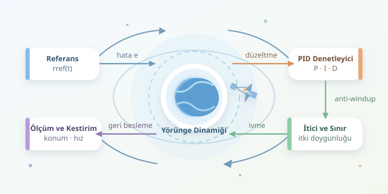

Bir uyduyu istediğimiz yerde tutmak, otomobilin hızını sabitlemeye benzer; fakat burada yol sürekli kıvrılır, yakıt sınırlıdır ve yanlış bir manevranın faturası oldukça kozmiktir. PID kontrolü, ölçülen hareketi hedef hareketle karşılaştırarak düzeltme üretir. Gelin bu tanıdık algoritmanın uzayda nasıl kullanıldığını, nerede işe yaradığını ve neden tek başına sihirli bir çözüm olmadığını inceleyelim.




``

## Önce kavramı düzeltelim: Hangi konum sabit?

Uydu, Dünya çevresinde ilerlerken eylemsiz uzayda aynı noktada durmaz. **Yörünge koruma**, genellikle hedef yörüngeyi veya belirli bir referans hareketine göre konumu korumaktır. Jeostasyoner uydu bile Dünya ile birlikte döner; yalnızca yerdeki gözlemciye yaklaşık sabit görünür.

Bu yüzden kontrol hedefimiz çoğunlukla zamana bağlı bir referans konumudur: $r_{ref}(t)$. Konum hatası $e(t)=r_{ref}(t)-r(t)$ olarak tanımlanır. Ölçüm, kestirim, kontrol hesabı ve itici komutu birbirini izler. Yeni ölçüm geldiğinde döngü yeniden başlar: Uzayın kendine özgü bir “biraz sağa, şimdi biraz sola” dansı!

## Yörünge dinamiği ve PID mantığı

Basitleştirilmiş eylemsiz koordinat modeli şöyledir:

$$\ddot{r}=-\mu\frac{r}{\lVert r\rVert^3}+a_{bozucu}+a_{itki}$$

Burada $\mu$ merkezî cismin kütleçekim parametresidir. Bozucu ivmeler; atmosferik sürükleme, Güneş ışınım basıncı veya başka gökcisimlerinin çekiminden kaynaklanabilir. İticiler ise denetleyicinin fiziksel dünyaya açılan kapısıdır.

PID, bu dinamikler dikkate alınarak uygulanacak düzeltme ivmesini hesaplamak için kullanılabilir:

$$a_{PID}=K_p e+K_i\int e\,dt+K_d\dot{e}$$

| Bileşen | Baktığı bilgi | Katkısı | Fazlasının bedeli |
|---|---|---|---|
| P: Oransal | Şimdiki hata | Hedefe doğru düzeltme | Salınım, sert komutlar |
| I: İntegral | Birikmiş hata | Sürekli sapmayı giderme | İntegral yığılması |
| D: Türev | Hatanın değişimi | Hareketi sönümleme | Gürültüyü büyütme |

P, hedefe uzaklığı önemser. I, küçük ama inatçı sapmaları unutmaz. D ise hedefe fazla hızlı yaklaşırken frene basar. Böylece denetleyici yalnızca “neredeyim?” değil, “nereye doğru gidiyorum?” sorusunu da sorar.

Ancak yörüngeye bağlı dönen koordinatlarda eksenler birbirini etkiler; Coriolis ve kütleçekim gradyanı terimleri ortaya çıkar. Üç bağımsız PID döngüsü, bu etkileşimler modellenmeden güvenilir kabul edilemez.

İdeal, ayrıştırılmış $\ddot{x}=u$ modeli için kapalı çevrim karakteristik polinomu $s^3+K_ds^2+K_ps+K_i$ olur. Pozitif kazançlarla kararlılık için ayrıca $K_dK_p>K_i$ gerekir. Bu koşul gerçek uyduya doğrudan taşınmaz; gecikmeler ve modellenmeyen dinamikler tabloyu değiştirebilir.

## Python ile sınırlı itkiyi hesaba katmak

Aşağıdaki tek eksenli örnek, nominal dinamiklerin model tabanlı telafi edildiği ideal bir düzeltme kanalını temsil eder. Çıktı ivmedir; doğrudan uçuş yazılımı değildir.

```python
class PID:
    def __init__(self, kp, ki, kd, limit):
        self.kp, self.ki, self.kd = kp, ki, kd
        self.limit = limit
        self.integral = 0.0

    def step(self, ref, pos, ref_vel, vel, dt):
        if dt <= 0:
            raise ValueError("dt pozitif olmalı")

        error = ref - pos
        derivative = ref_vel - vel
        candidate = self.integral + error * dt

        def command(integral):
            return (self.kp * error + self.ki * integral
                    + self.kd * derivative)

        raw = command(candidate)
        # Doygunlukta hatayı büyüten integrasyonu durdur.
        if abs(raw) <= self.limit or raw * error < 0:
            self.integral = candidate

        raw = command(self.integral)
        return max(-self.limit, min(self.limit, raw))
```

Kod, türev terimini konum farklarını bölmek yerine hız hatasından hesaplar. Bu tercih, uygun hız kestirimiyle gürültü hassasiyetini azaltabilir. Koşullu integral güncellemesi **anti-windup** sağlar: İtici zaten sınırdayken integralin gereksiz yere büyümesini engeller. Gerçek sistemde hız ölçümleri de filtrelenmeli veya bir durum kestiricisinden alınmalıdır.

## Simülasyondan gerçek uyduya

Kazançları rastgele yükseltmek yerine önce P ve D ile sönümlü tepki oluşturun; ardından kalıcı sapma varsa I ekleyin. Her değişiklikte konum hatasını, hız hatasını ve toplam itki kullanımını izleyin. Daha hızlı toparlanma her zaman daha iyi değildir: Yakıt tüketimini artırabilir.

| Simülasyon testi | Aranan sonuç |
|---|---|
| Başlangıç konum hatası | Kontrollü yaklaşma |
| Sürekli küçük bozucu | Azalan kalıcı sapma |
| Sensör gürültüsü ve gecikme | Kararlı, sakin komutlar |
| İtici doygunluğu | Sınırlı integral birikimi |

Son aşamada ivme isteği, $F=ma$ üzerinden kuvvete çevrilir; itici yönleri, minimum darbe süresi ve yönelim kısıtları dikkate alınır. Düşük itkiyle sürekli düzeltme ve kısa darbeli manevralar aynı uygulamayı gerektirmez.

**Özetle:** PID iyi bir başlangıçtır; fakat başarılı yörünge koruma, doğru referans tanımı, dinamik model, güvenilir kestirim ve fiziksel sınırlarla birlikte tasarlanır. Uzayda mesele yalnızca hedefe dönmek değil, bunu yakıtı bitirmeden yapmaktır.
