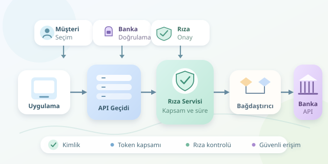

Bütçe uygulamanızın farklı bankalardaki hesaplarınızı tek ekranda göstermesi sihir değil, iyi tasarlanmış bir API mimarisidir. Açık bankacılık, yetkili finansal uygulamaların banka verilerine müşterinin izniyle erişmesini sağlar. Ancak kapıyı açmak yetmez: Kimin girdiğini, hangi odalara erişebildiğini ve anahtarının ne zaman geçersizleşeceğini de yönetmek gerekir. Üstelik kasanın şifresini uygulamaya teslim etmeden!

``

## Önce mantık: Kimlik, yetki ve rıza

Açık bankacılıkta üç kavram sıkça karıştırılır. **Kimlik doğrulama**, kullanıcının veya uygulamanın kim olduğunu belirler. **Yetkilendirme**, hangi işlemleri yapabileceğini tanımlar. **Rıza yönetimi** ise müşterinin hangi hesaplar, amaçlar ve süreler için erişim verdiğini kaydeder.

Basitleştirilmiş bir modelde etkili erişim şöyle düşünülebilir:

$$E = C \cap S \cap R$$

Burada $C$ müşteri rızasını, $S$ token kapsamlarını, $R$ uygulamanın izin verilen yeteneklerini temsil eder. Kesişim önemlidir: Token hesap okuma kapsamına sahip olsa bile ilgili hesap için rıza yoksa erişim verilmez. Süre, iptal durumu ve kaynak sahipliği ayrıca kontrol edilir. Yani tek başına geçerli token, sınırsız yetki anlamına gelmez.

## Standartlar aynı işi yapmaz

Açık bankacılık tek bir protokol değildir. Hukuki çerçeveler, API sözleşmeleri ve güvenlik profilleri birlikte çalışır; birbirlerinin yerine geçmezler.

| Katman | Örnek | Temel görevi |
|---|---|---|
| Düzenleme | Avrupa Birliği PSD2 | Hizmetlerin hukuki çerçevesini belirlemek |
| API sözleşmesi | Berlin Group, UK Open Banking | Kaynakları ve veri modellerini ortaklaştırmak |
| Yetkilendirme | OAuth 2.0 | Sınırlı erişim tokenları sağlamak |
| Kimlik katmanı | OpenID Connect | Kimlik doğrulama bilgisini standartlaştırmak |
| Güvenlik profili | FAPI | Finansal API akışlarını sıkılaştırmak |

Türkiye’de TCMB düzenlemeleri ve ÖHVPS API standartları yerel çerçeveyi oluşturur; BKM GEÇİT altyapısı da ekosistemde rol oynar. Bir ülkedeki entegrasyonun başka ülkede aynen çalışacağını varsaymayın. Sürüm, sertifikasyon ve hizmet kapsamı ayrıca incelenmelidir.

## Referans mimari: İstek hangi yoldan geçer?

Tipik akışta kullanıcı, uygulamada bankasını ve paylaşacağı hesapları seçer. Ardından bankanın yetkilendirme ortamına yönlendirilir; uygulama banka parolasını toplamaz. Banka gerekli doğrulamayı ve onayı gerçekleştirir. Uygulamanın sunucusu, yetkilendirme kodunu uygun OAuth akışıyla tokena dönüştürür.

Sonraki veri istekleri şu zincirden geçer:

**Uygulama → API Gateway → Rıza Servisi → Banka Bağdaştırıcısı → Banka API’si**

Gateway trafik sınırlarını ve giriş kontrollerini uygular. Rıza servisi izinleri değerlendirir. Bağdaştırıcı ise bankaların veri biçimlerini ortak modele çevirir. Böylece iş mantığı, her bankanın tarih formatını öğrenmek zorunda kalmaz; muhasebeci gibi çalışır, tercüman gibi değil.

Tokenlar sunucu tarafında korunmalıdır. Kullanılan profile göre mTLS veya DPoP, tokenı belirli istemci anahtarlarına bağlayarak çalınmış tokenın başka yerde kullanılmasını zorlaştırabilir. Bunlar TLS’nin yerine geçmez.

## Kod: Erişimden önce izin kontrolü

Aşağıdaki TypeScript örneği servis arayüzlerini kısaltarak gösterir. Amaç, banka çağrısını kullanıcıdan gelen rastgele bir adresle değil, doğrulanmış rıza kaydıyla başlatmaktır:

```typescript
async function listAccounts(
  userId: string,
  consentId: string,
  consentStore: ConsentStore,
  bankGateway: BankGateway
) {
  const consent = await consentStore.find(consentId);

  if (!consent || consent.ownerId !== userId) {
    throw new Error("Erişim reddedildi");
  }

  const expired = consent.expiresAt <= Date.now();
  if (consent.revoked || expired ||
      !consent.scopes.includes("accounts:read")) {
    throw new Error("Geçerli hesap okuma izni yok");
  }

  return bankGateway.listConsentedAccounts({
    bankId: consent.bankId,
    consentId: consent.id,
    accountIds: consent.accountIds
  });
}
```

Buradaki kapsam adı örnektir; gerçek değerler seçilen standarda bağlıdır. `BankGateway`, token yönetimini, izinli banka adreslerini, profilin kriptografik gereksinimlerini ve yanıt normalizasyonunu üstlenir. Banka tarafındaki güncel yetkilendirme de korunmalıdır; yerel kayıt tek başına yeterli değildir. Bu parça, üretim sisteminin tamamı değildir.

## Üretimde asıl sınav: Hatalar ve gözlemlenebilirlik

Banka zaman aşımında sınırlı yeniden deneme ve artan bekleme uygulayın. Ödeme başlatma gibi yan etkili işlemleri körlemesine tekrarlamayın; standardın desteklediği idempotency mekanizmasını kullanın. Aksi hâlde küçük bir bağlantı sorunu, büyük bir çift ödeme hikâyesine dönüşebilir.

| Durum | Güvenli yaklaşım |
|---|---|
| Rıza iptal edildi | Erişimi durdur, ilgili önbelleği geçersizleştir |
| Token süresi doldu | İzin veriliyorsa kontrollü yenile |
| Trafik limiti aşıldı | Bekleme talimatına uy, yükü sınırla |
| Banka erişilemiyor | Devre kesici ve anlaşılır hata kullan |

Loglarda token, hesap hareketi veya hassas kimlik bilgisi tutmayın. Korelasyon kimliği, gecikme ve hata sınıfı genellikle yeterli başlangıçtır. Verileri amaçla sınırlı saklayın; rıza iptaliyle yasal saklama yükümlülüklerini ayrı değerlendirin.

İyi açık bankacılık mimarisi yalnızca veriyi taşımayı değil, güvenin sınırlarını görünür kılmayı başarır. Başarının ölçüsü daha çok veri toplamak değil, doğru veriye doğru yetkiyle erişmektir.



