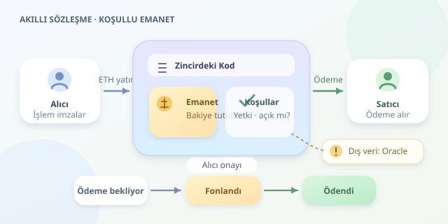

Bir alışverişte paranın yalnızca teslimat onaylandıktan sonra satıcıya gönderildiğini düşünün. Normalde bu süreci bir aracı yönetir. Akıllı sözleşmelerde ise kurallar kodla tanımlanır, para sözleşmenin adresinde tutulur ve uygun işlem geldiğinde ödeme gerçekleştirilir. Ancak bu dijital kasanın neyi gerçekten bildiğini anlamak, en az kilidini tasarlamak kadar önemlidir.

``

## Temel fikir: Paylaşılan bir durum makinesi

Akıllı sözleşme, blok zincire yerleştirilmiş programdır. Ethereum gibi ağlarda kod, Ethereum Sanal Makinesi üzerinde yürütülür. Sözleşmenin bakiyesi, yetkili adresleri ve ödeme durumu kalıcı veriler olarak saklanır.

Bunu bir durum makinesi gibi düşünebiliriz: Sözleşme başlangıçta **ödeme bekliyor**, ardından **fonlandı**, son olarak **ödendi** durumuna geçer. Her geçişin koşulları vardır. Yetkisiz bir kullanıcı düğmeye bassa bile programın kontrollerini geçemez. Güven, tarafların iyi niyetinden çok, kodun doğruluğuna ve ağın güvenlik varsayımlarına dayanır.

## “Otomatik” ödeme hangi adımlarla gerçekleşir?

1. **İşlem oluşturulur:** Kullanıcı, sözleşmenin bir fonksiyonunu çağıran işlemi özel anahtarıyla imzalar.
2. **Kod yürütülür:** İşlemi işleyen düğümler, ilgili blok bağlamında aynı kuralları uygulayarak sonucu hesaplar.
3. **Durum güncellenir:** Koşullar sağlanırsa bakiye ve kayıtlar değişir. Bir kontrol başarısız olursa işlem geri alınır; harcanan işlem ücretleri genellikle yine ödenir.

Buradaki kritik ayrıntı şudur: Sözleşmeler kendiliğinden uyanıp çalışmaz. Bir işlemle tetiklenmeleri gerekir. Zamanlanmış işler için harici otomasyon hizmetleri kullanılabilir; bunlar da sonuçta zincire işlem gönderir.

Ödeme kuralını şöyle özetleyebiliriz:

$$T = B \cdot \mathbf{1}_{A \land \neg K}$$

Burada $B$ emanetteki tutar, $A$ yetkili alıcının onayı, $K$ ise sözleşmenin kapanmış olmasıdır. Gösterge fonksiyonu, koşul doğruysa bir, yanlışsa sıfır üretir. Yani onay yoksa veya ödeme zaten yapıldıysa transfer gerçekleşmez.

| Özellik | Merkezi ödeme sistemi | Akıllı sözleşme |
|---|---|---|
| Kurallar | Sunucu uygulamasında | Zincirdeki kodda |
| İşlemi yürütme | İşletmeci altyapısı | Ağın işlem yürütme mekanizması |
| Değişiklik | İşletmeci güncelleyebilir | Tasarıma bağlı, çoğunlukla sınırlı |
| Dış dünya bilgisi | API ve kurum kayıtları | Oracle veya taraf beyanı |

## Solidity ile küçük bir emanet kasası

Aşağıdaki örnek, alıcının sözleşmeyi oluştururken yatırdığı ETH’yi saklar. Yalnızca aynı alıcı onay verdiğinde satıcıya ödeme yapar.

```solidity
// SPDX-License-Identifier: MIT
pragma solidity ^0.8.24;

contract Emanet {
    address public immutable alici;
    address payable public immutable satici;
    uint256 public immutable tutar;
    bool public kapandi;

    constructor(address payable _satici) payable {
        require(msg.value > 0, "Bos emanet");
        require(_satici != address(0), "Gecersiz satici");
        alici = msg.sender;
        satici = _satici;
        tutar = msg.value;
    }

    function teslimatiOnayla() external {
        require(msg.sender == alici, "Yetkisiz kullanici");
        require(!kapandi, "Zaten odendi");

        kapandi = true;
        (bool basarili, ) = satici.call{value: tutar}("");
        require(basarili, "Transfer basarisiz");
    }
}
```

`payable`, oluşturma sırasında ETH kabul edilmesini sağlar. `msg.sender` çağıranın adresidir; `msg.value` gönderilen tutarı belirtir. `immutable` alanlar oluşturulduktan sonra değiştirilemez. `require` ifadeleri ise geçersiz işlemleri durdurur.

Önemli güvenlik ayrıntısı, `kapandi` değişkeninin dış adrese para gönderilmeden önce güncellenmesidir. Bu, **kontroller–etkiler–etkileşimler** düzenidir: Önce koşulları denetle, sonra iç durumu değiştir, en son dış çağrı yap. Transfer başarısızsa `require` tüm bu durum değişikliklerini geri alır.

## Blok zincir kargonun geldiğini nereden bilir?

Bilmez! Örnekte “teslimat”, alıcının onayı anlamına gelir; fiziksel teslimatın bağımsız kanıtı değildir. Kargo şirketinden bilgi alınacaksa oracle gerekir. Oracle, dış veriyi zincire taşıyan bir mekanizmadır ve sisteme yeni güven varsayımları ekler.

Bu yüzden “kod aracıları tamamen kaldırır” sözü her senaryoda doğru değildir. Özellikle fiyat, hava durumu veya teslimat gibi verilerde kaynağın doğruluğu, güncelliği ve manipülasyona dayanıklılığı ayrıca değerlendirilmelidir.

## Gerçek kullanımda eksik parçalar

Bu örnekte alıcı hiç onay vermezse para kilitli kalır. Üretim tasarımında süreli iade, anlaşmazlık çözümü, olay kayıtları ve kapsamlı testler düşünülmelidir. Yeniden giriş saldırıları, erişim yetkileri ve yükseltme mekanizmaları ayrıca incelenmelidir.

İşlem ücretleri küçük ödemeleri pahalılaştırabilir; blokta görünmek de her ağda aynı kesinlik düzeyini sağlamaz. Akıllı sözleşme sihirli noter değildir: Açıkça tanımlanmış koşulları uygular. Başarılı tasarımın sırrı, yalnızca mutlu ödeme yolunu değil, herkesin fikrini değiştirdiği ve sistemlerin aksadığı günleri de kodlamaktır.



