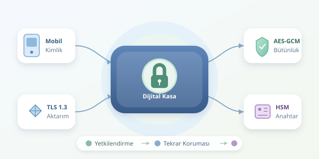

Mobil bankacılıkta “Gönder” düğmesine bastığınızda yalnızca para hareket etmez; kimlik bilgileriniz, işlem talimatınız ve güven ilişkisi de sistemler arasında yolculuğa çıkar. Bu yolculuğu korumak, verinin üzerine tek bir şifreleme kilidi takmaktan çok daha fazlasıdır. Gelin bankanın dijital kasasının katmanlarını birlikte açalım.

``

## Güvenliğin üç temel direği

Finansal güvenlik üç hedef üzerinde yükselir: **gizlilik**, veriyi yetkisiz kişilerin okuyamaması; **bütünlük**, işlem bilgilerinin izinsiz değiştirilememesi; **erişilebilirlik**, hizmetin ihtiyaç anında çalışmasıdır. Şifreleme ilk iki hedefe katkı sağlar; ancak tek başına hizmet kesintilerini veya yanlış yetkilendirmeyi çözmez.

Örneğin, saldırgan şifreli bir havalenin tutarını değiştirememeli, aynı talimatı tekrar göndererek ikinci ödeme oluşturamamalıdır. Bunun için şifrelemeye ek olarak kimlik doğrulama, işlem yetkilendirmesi ve tekrar saldırılarını önleyen kontroller gerekir. Sağlam bir kasa, yanlış kişiye verilen anahtarı telafi edemez!

## “Uçtan uca” gerçekten ne demek?

Bu ifade dikkatli kullanılmalıdır. Mobil uygulama ile banka ağ geçidi arasındaki TLS bağlantısı, **aktarım sırasında koruma** sağlar. TLS ağ geçidinde sonlanıyorsa veri orada çözülebilir; dolayısıyla bütün işlem zinciri otomatik olarak gerçek uçtan uca şifrelenmiş sayılmaz.

Gerçek uçtan uca şifrelemede içerik yalnızca belirlenen uçlarda okunabilir. Bankanın işlemi gerçekleştiren uygulamasının veriyi görmesi gerektiğinden, finansal mimariler çoğunlukla farklı güven sınırlarında birbirini tamamlayan korumalar kullanır.

| Katman | Temel araç | Tek başına çözmediği sorun |
|---|---|---|
| Ağ iletişimi | TLS 1.3 | Ele geçirilmiş uygulama |
| Servisler arası bağlantı | mTLS | Gereğinden geniş yetkiler |
| Veritabanı ve yedekler | Disk veya alan şifreleme | Yetkili hesabın kötüye kullanılması |
| İşlem içeriği | AEAD, gerektiğinde dijital imza | Tekrar gönderilen geçerli talimat |

TLS 1.3 güçlü bir güncel tercihtir; doğru yapılandırılmış TLS 1.2 de bazı uyumluluk senaryolarında kullanılabilir. Sertifika doğrulamasını kapatmak ise güvenlik kapısını dekoratif hale getirir.

## Standartlar: Aynı işi yapmayan kurallar

**PCI DSS**, kapsam dahilindeki ödeme kartı verilerinin korunmasına yöneliktir; bütün bankacılık verileri için evrensel bir şifreleme standardı değildir. **ISO/IEC 27001**, bilgi güvenliği yönetim sistemini ele alır. **KVKK** ve ilgili bankacılık düzenlemeleri ise veri işleme ve güvenlik yükümlülükleri getirir.

Kriptografik modüller için **FIPS 140-3**, anahtarların yaşam döngüsü için **NIST SP 800-57** önemli referanslardır. Bunların zorunluluğu kurumun faaliyet alanına ve mevzuata bağlıdır. Sertifika sahibi olmak, uygulamadaki bütün açıkların kapandığı anlamına gelmez; denetim ve güvenli geliştirme devam etmelidir.

## Şifreleme ile bütünlüğü birlikte korumak

AES-GCM gibi doğrulanmış şifreleme yöntemleri, içeriği gizlerken değiştirilmesini de saptar. Mantığını şöyle özetleyebiliriz:

$$C \parallel T = \mathrm{AESGCM}_K(N, P, A)$$

Burada $P$ açık veri, $K$ anahtar, $N$ nonce, $A$ ek doğrulanan veri, $C$ şifreli içerik ve $T$ doğrulama etiketidir. Ek veri gizlenmez; fakat değiştirilirse doğrulama başarısız olur. **Aynı anahtarla nonce tekrar kullanılmamalıdır.**

Aşağıdaki Python örneği, işlem içeriğini şifreler ve işlem kimliğini içerikle ilişkilendirir:

```python
import json
import os
from cryptography.hazmat.primitives.ciphers.aead import AESGCM

key = AESGCM.generate_key(bit_length=256)
aead = AESGCM(key)
nonce = os.urandom(12)
aad = b"transaction:tx-1042"
payload = json.dumps({
    "amount_kurus": 12500,
    "currency": "TRY"
}).encode("utf-8")

ciphertext = aead.encrypt(nonce, payload, aad)
plaintext = aead.decrypt(nonce, ciphertext, aad)
print(json.loads(plaintext))
```

Parasal tutarı kayan noktalı sayı yerine kuruş cinsinden tam sayı olarak tutuyoruz. `decrypt`, içerik veya ek veri değişmişse doğrulama hatası verir. Bu, öğretici bir örnektir: üretimde anahtar yönetimi HSM veya KMS ile tasarlanmalı; nonce benzersizliği, anahtar yenileme ve kalıcı kayıt stratejileri ayrıca uygulanmalıdır. Anahtarı şifreli verinin yanına açık biçimde koymak korumayı boşa çıkarır.

## Şifrelemenin dışındaki kritik savunmalar

HSM, anahtarların korunmasına ve kriptografik işlemlerin kontrollü yürütülmesine yardımcı olur. Bunun yanında en az ayrıcalık, görev ayrılığı, çok faktörlü doğrulama ve hassas işlem onayı gerekir.

Tekrar saldırıları için benzersiz işlem kimlikleri ve atomik idempotency kontrolleri kullanılmalıdır: aynı talimat ikinci kez ödeme üretmemelidir. Loglar denetlenebilir olmalı, ancak kart bilgilerini veya sırları açıkça taşımamalıdır. Yedeklerin geri yüklenmesi ve anahtar kurtarma süreçleri de düzenli test edilmelidir.

Sonuçta güvenli bankacılık, tek bir algoritmanın zaferi değildir. Doğru kriptografi, sınırlı yetkiler, güvenli uç cihazlar ve sürekli izleme birlikte çalışır. Dijital kasanın gücü, en parlak kilidinden değil, en zayıf bağlantısının sağlamlığından gelir.



