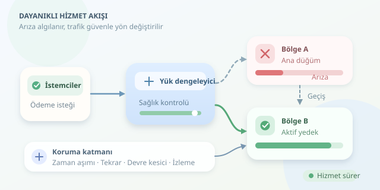

Bir ödeme sistemi düşünün: Kampanya başladı, trafik yükseldi ve veritabanı sunucusu aniden sustu. Kullanıcılar alışverişe devam edebilecek mi? Dayanıklı yazılım mimarisi, bu soruyu arıza yaşanmadan cevaplama sanatıdır. Amaç, hiçbir parçanın bozulmaması değil; parçalar bozulurken sistemin temel görevini güvenilir biçimde sürdürebilmesidir.

``

## Dayanıklılık, Sadece Fazladan Sunucu Değildir

**Yedeklilik**, aynı görevi yapabilecek alternatif kaynakların bulunmasıdır. **Dayanıklılık** ise arızayı algılama, etkisini sınırlama, alternatif kaynağa geçme ve toparlanma yeteneğidir. Garajda yedek lastik bulunması güzeldir; fakat lastiği değiştiremiyorsanız yolculuk yine durur!

Kullanılabilirlik, basitleştirilmiş bir modelde şöyle ifade edilir:

$$A = \frac{MTBF}{MTBF + MTTR}$$

Burada MTBF arızalar arasındaki ortalama çalışma süresi, MTTR ise ortalama hizmeti geri getirme süresidir. Dolayısıyla yalnızca arızaları azaltmak değil, toparlanmayı hızlandırmak da kullanılabilirliği yükseltir.

Bağımsız iki bileşenden herhangi birinin hizmet vermesi yeterliyse, kusursuz geçiş varsayımı altında:

$$A_{toplam} = 1 - (1-A)^2$$

Her bileşen yüzde 99,9 kullanılabilir olduğunda teorik sonuç yüzde 99,9999 olur. Ancak ortak elektrik, ağ veya yazılım hataları bu hesabın bağımsızlık varsayımını bozar.

## Yedekliliğin Farklı Lezzetleri

| Strateji | Çalışma biçimi | Temel bedel |
|---|---|---|
| Aktif-pasif | Yedek, ana bileşenin yerine geçer | Geçiş süresi |
| Aktif-aktif | Birden fazla bileşen trafik işler | Koordinasyon karmaşıklığı |
| N+1 | Gereken kapasiteye bir yedek eklenir | Sınırlı arıza toleransı |
| Çok bölgeli | Kaynaklar ayrı coğrafi bölgelerde çalışır | Gecikme ve maliyet |

İki sunucuyu aynı fiziksel makinede çalıştırmak, iki şemsiyeyi aynı delik çantaya koymaya benzer. Gerçek yedeklilik, **arıza alanlarını** ayırır: farklı makineler, erişilebilirlik alanları veya bölgeler. Yük dengeleyici, DNS, kimlik servisi ve bağlantı altyapısı da tek hata noktası bakımından incelenmelidir.

Aktif-pasif tasarımda yedeğin güncel veriye erişmesi gerekir. Aktif-aktif yaklaşımda ise eşzamanlı güncellemeler, veri çatışmaları ve oturum yönetimi özellikle önem kazanır.

## İki Lider, Bir Büyük Sorun

Ağ bölünmesi sırasında iki düğüm kendisini lider sanabilir. **Split-brain** denen bu durum, aynı siparişin farklı biçimlerde işlenmesine neden olabilir. Çözüm yalnızca daha fazla kopya değildir; lider seçimi ve yazma yetkisinin sınırlandırılması gerekir.

Çoğunluk gerektiren bir karar için:

$$q = \left\lfloor \frac{N}{2} \right\rfloor + 1$$

Üç oy veren düğümde çoğunluk ikidir. Bu yapı, uygun bir konsensüs protokolüyle bir düğüm kaybına dayanabilir. Eski liderin yazmasını engellemek için hedef kaynağın doğruladığı **fencing token** kullanılabilir. Ağ bölünmesinde tutarlılığı korumak bazen bazı isteklere hizmet verememeyi gerektirir.

## Kurtarma Hedeflerini Sayıya Dökün

- **RTO:** Hizmeti geri getirmek için hedeflenen azami süre.
- **RPO:** Kabul edilebilir veri kaybının zaman karşılığı.

Örneğin RTO iki dakika, RPO otuz saniye olabilir. Asenkron replikasyon veri kaybı riski taşırken senkron replikasyon gecikmeyi artırabilir. Yedekleme ise ayrı bir ihtiyaçtır: Replikasyon, yanlışlıkla silinen veriyi de kopyalayabilir. Bu yüzden geri yükleme testleri şarttır.

## Yeniden Deneyin, Ama Sonsuza Kadar Değil

Geçici bağlantı sorunlarında sınırlı tekrar yararlıdır. Aşağıdaki Python 3.11+ örneği, asenkron bir okuma işlemini toplam süre bütçesi içinde yeniden dener:

```python
import asyncio
import random

async def resilient_read(fetch):
    async with asyncio.timeout(2.0):
        for attempt in range(3):
            try:
                return await asyncio.wait_for(
                    fetch(), timeout=0.5
                )
            except (TimeoutError, ConnectionError):
                if attempt == 2:
                    raise
                delay = random.uniform(
                    0, 0.1 * 2 ** attempt
                )
                await asyncio.sleep(delay)
```

`fetch`, gerçek ağ çağrısını yapan asenkron fonksiyondur. Her denemenin zaman aşımı vardır; toplam bütçe iki saniyedir. Rastgele bekleme, yani **jitter**, istemcilerin aynı anda tekrar saldırmasını azaltır. Yazma işlemlerinde tekrar kullanacaksanız idempotency anahtarıyla yinelenen işlemleri önlemelisiniz.

Sürekli başarısız olan bağımlılıklarda **circuit breaker**, yeni çağrıları geçici olarak keser. **Bulkhead** yaklaşımı ise bağlantı ve işçi havuzlarını ayırarak bir servisin kaynakları tüketip diğerlerini sürüklemesini önler.

## Dayanıklılığı Test Etmeden İnanmayın

Gecikme, hata oranı, replikasyon gecikmesi ve geçiş süresi izlenmelidir. Önce izole ortamda düğüm kaybı ve ağ kesintisi deneyleri yapın; üretim deneylerini dar kapsam ve durdurma koşullarıyla yürütün. Kapasiteyi de sınayın: Yedek sistem bütün trafiği taşıyamıyorsa yalnızca dekoratif bir yedektir.

Son olarak, kritik işlevleri önceliklendirin. Öneri servisi kapanabilir; ödeme doğruluğu kapanamaz. Doğru sonuç üretilemiyorsa güvenli biçimde durmak, hatalı işleme devam etmekten iyidir. Dayanıklılık, daha çok sunucu değil, arıza anında daha doğru karar demektir.



