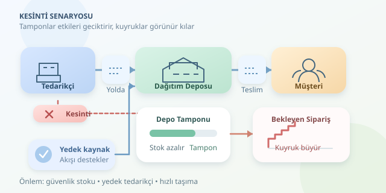

Bir tedarikçinin üretimi durduğunda sorun yalnızca boşalan bir kamyon değildir: üretim planları kayar, depolar erir ve müşterilerin sabrı stoklardan önce tükenebilir. Tedarik zinciri simülasyonu, bu domino etkisini gerçek müşterileri kızdırmadan incelememizi sağlar. Gelin, kesintinin nerede başladığını, nasıl yayıldığını ve hangi önlemlerle yavaşlatılabileceğini küçük bir Python modeli üzerinden keşfedelim.

``

## Önce zincirin mantığını kuralım

Basit ağımız **tedarikçi → dağıtım deposu → müşteri** olsun. Tedarikçi günlük kapasitesi kadar ürün gönderir; ürünler belirli bir teslim süresinden sonra depoya ulaşır. Depo müşteri talebini karşılar, karşılayamadığı miktarı bekleyen sipariş olarak saklar. Böylece kayıp satış değil, gecikmeli teslimat modeli kurmuş oluruz.

Kesinti başladığında müşteri hemen etkilenmeyebilir: depodaki ve yoldaki ürünler tampon görevi görür. Ancak bu tamponlar bittiğinde sipariş kuyruğu büyür. Tedarikçi yeniden çalışmaya başladığında da sistem anında iyileşmez; yeni sevkiyatların ulaşması ve biriken talebin eritilmesi gerekir. Fabrikanın ışıkları yandı diye zincirin tamamı normale dönmüş sayılmaz!

## Stok, akış ve gecikme

Modelin temelinde ürünlerin korunumu vardır. $I_t$ eldeki stok, $A_t$ gelen ürün, $D_t$ yeni talep ve $B_t$ önceki bekleyen sipariş olsun. Gönderilen miktar:

$$S_t = \min(I_t + A_t, D_t + B_t)$$

Sonraki dönem stok ve bekleyen sipariş miktarları ise:

$$I_{t+1} = I_t + A_t - S_t$$

$$B_{t+1} = D_t + B_t - S_t$$

Bu denklemler, ürün yokken teslimat yapmamızı engeller. Ayrıca geciken talebi görünür tutar; aksi hâlde simülasyon, karşılanmayan siparişleri sessizce unutup bize pembe bir tablo sunabilir.

| Kavram | Ne anlatır? | Kesintide davranışı |
|---|---|---|
| Eldeki stok | Hemen kullanılabilen ürün | Önce azalır |
| Yoldaki stok | Henüz ulaşmamış sevkiyat | Etkiyi geciktirir |
| Bekleyen sipariş | Karşılanmamış talep | Tampon tükenince artar |
| Toparlanma süresi | Normal hizmete dönüş süresi | Kapasiteye bağlıdır |




## Günlük adımlarla çalışan model

Aşağıdaki kod, kırk günlük bir dönemi simüle eder. Günlük talep 20, normal tedarik kapasitesi 30 ve teslim süresi üç gündür. Kesinti, sıfırdan başlayan gün indekslerinde 8–14 arasında gerçekleşir. İsteğe bağlı yedek tedarikçi yalnızca bu aralıkta devreye girer; onun teslim süresini de üç gün varsayıyoruz.

```python
from collections import defaultdict


def simule(kesinti=False, yedek=0):
    stok, bekleyen = 120, 0
    yolda = defaultdict(int)
    zamaninda, en_buyuk_kuyruk = 0, 0

    for gun in range(40):
        stok += yolda.pop(gun, 0)
        talep = 20
        ihtiyac = bekleyen + talep
        teslim = min(stok, ihtiyac)

        # Önce eski siparişleri karşıla.
        zamaninda += max(0, teslim - bekleyen)
        stok -= teslim
        bekleyen = ihtiyac - teslim
        en_buyuk_kuyruk = max(en_buyuk_kuyruk, bekleyen)

        # Sipariş politikasına yoldaki ürünleri de kat.
        pozisyon = stok + sum(yolda.values()) - bekleyen
        kapasite = yedek if kesinti and 8 <= gun < 15 else 30
        siparis = min(kapasite, max(0, 120 - pozisyon))
        yolda[gun + 3] += siparis

    return {
        "zamaninda_karsilama": zamaninda / (40 * 20),
        "maksimum_bekleyen": en_buyuk_kuyruk,
    }


print(simule())
print(simule(kesinti=True))
print(simule(kesinti=True, yedek=8))
```

`defaultdict`, varış günlerine göre sevkiyat takvimini tutar. Stok pozisyonu $IP = I + P - B$ ile hesaplanır; burada $P$ yoldaki toplam üründür. Hedef pozisyonun 120 olması, siparişlerin bu seviyeye tamamlanmasını sağlar. Yoldaki ürünleri unutmak, aynı ihtiyacı tekrar tekrar sipariş ederek yapay stok şişmesine yol açardı.

## Sonuçları nasıl okumalıyız?

Üç çalıştırma; normal işletme, tam kesinti ve kısmi yedekleme senaryolarını karşılaştırır. Zamanında karşılama oranı, yeni talebin geldiği gün teslim edilen bölümünü ölçer. Eski siparişlerin sonradan gönderilmesi bu oranı yükseltmez. Böylece “sonunda hepsini gönderdik” savunması, gecikmeleri halının altına süpüremez.

| Önlem | Kazancı | Bedeli |
|---|---|---|
| Daha fazla güvenlik stoku | Daha uzun tampon | Depolama maliyeti |
| Yedek tedarikçi | Kesintide ek akış | Sözleşme ve kapasite maliyeti |
| Hızlı taşıma | Daha kısa bekleme | Yüksek navlun |

## Modeli gerçek hayata yaklaştırmak

Bu örnek deterministiktir; gerçekçi değerlendirmede talebi, kesinti süresini ve teslim gecikmelerini olasılıksal üretip çok sayıda tekrar çalıştırmalısınız. Aynı rastgele örnekleri senaryolar arasında kullanmak karşılaştırmayı daha adil yapar. Ortalama performansın yanında kötü durumları ve toparlanma süresini de raporlayın.

Üretim tesisleri eklerken ürün reçetelerini ve darboğaz kapasitelerini modelleyin: tek bir kritik parçanın eksikliği, diğer parçalar depoda beklerken üretimi durdurabilir. Sipariş tepkileri yukarı doğru büyüyorsa kamçı etkisini de inceleyin; bunu kesintinin otomatik sonucu saymayın. Sonuçta amaç geleceği kusursuz tahmin etmek değil, hangi tamponun hangi riski hangi maliyetle azalttığını görmektir.
